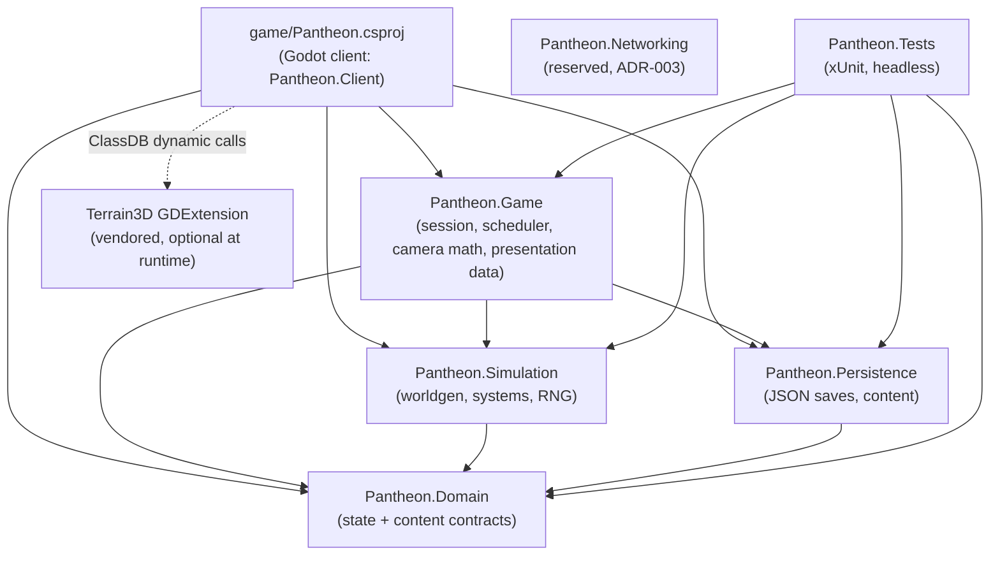
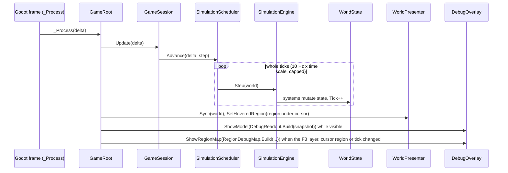
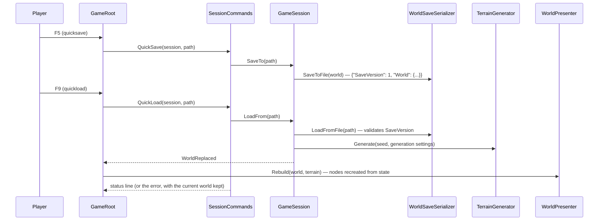
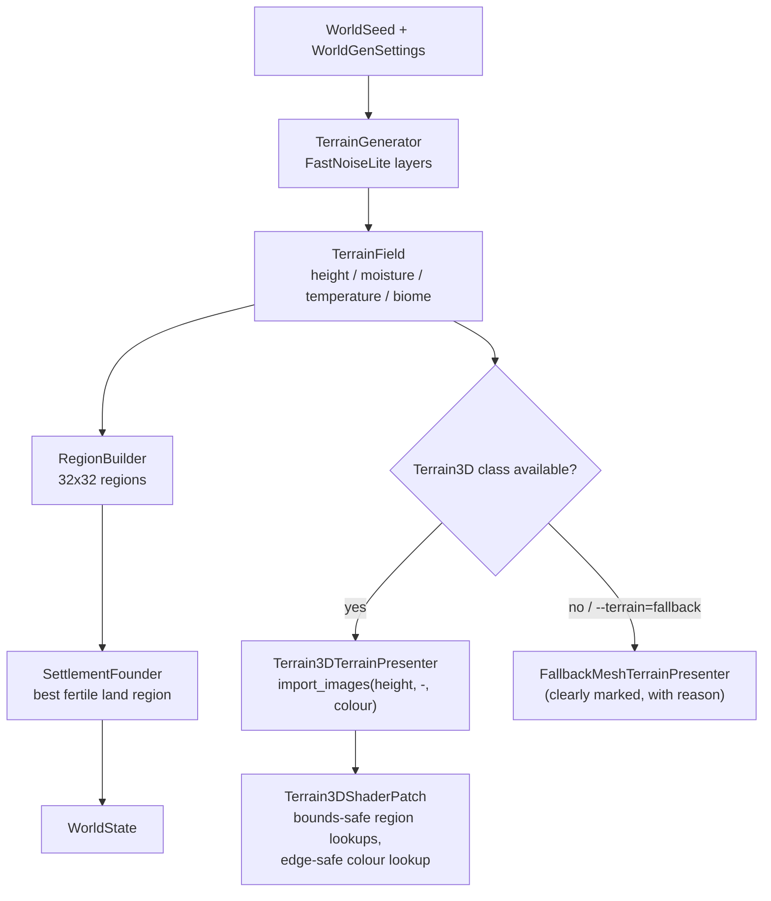

# Milestone 1 — Foundation Implementation

## Overview

Milestone 1 lays PANTHEON's technical foundation. Deliverables:

- A Godot 4.7.2-stable (.NET) project plus a C# solution (`Pantheon.sln`) that builds.
- A deterministic world generated from a `WorldSeed` with FastNoiseLite: elevation, moisture and
  temperature fields classified into three land biomes (Grassland, Forest, Highland) plus open Sea.
- Terrain rendered with Terrain3D, behind an adapter, with a clearly marked fallback mesh renderer
  used when the Terrain3D GDExtension is unavailable (or forced with `--terrain=fallback`).
- A free god camera: WASD/arrow pan, edge scroll, right-drag "grab" pan, wheel zoom, Q/E and
  middle-drag rotate, focus-settlement; three zoom bands (Close, Regional, Strategic).
- A region grid in `WorldState` (`RegionState`: Id, Biome, Elevation, Temperature, Moisture,
  Fertility, Vegetation) and one settlement (`SettlementState`: population, food, housing, ...),
  shown visually.
- Versioned, human-readable JSON saves (`SaveVersion`); save/load round trip rebuilds all visuals.
- A debug overlay: FPS, simulation tick, seed, region under cursor, settlement stats, terrain
  backend, camera zoom band, region-boundary toggle.
- A fixed-step simulation tick loop decoupled from the render frame rate.
- xUnit tests (`Pantheon.Tests`): same seed reproduces the same world, save/load round-trip
  equality, save version present (plus supporting unit tests).

Playable outcome: the player can launch the game and explore the generated island.

**Plan pattern: Non-TDD (architecture first).** The architecture is fixed by ADR-001…ADR-006, so
design drives implementation; tests are specified in the Test Plan and written alongside the core
libraries. The user asked for fully autonomous execution, so the pattern could not be confirmed
interactively. This is recorded as an explicit assumption.

**Status:** implemented and verified; see Test Plan → Verification results. The owner's coding
rules (spec §134, see Architecture → Coding rules) added the tasks under Tasks → In Progress. The
items under Tasks → Future are follow-ups outside this milestone.

## Architecture

### Projects and dependency direction

| Project | Kind | Depends on | Responsibility |
| --- | --- | --- | --- |
| `src/Pantheon.Domain` | .NET 8 class library | — | Pure state and content contracts (`WorldState`, `RegionState`, `SettlementState`, `WorldGenSettings`, `SettlementRules`). No behaviour beyond trivial lookups. |
| `src/Pantheon.Simulation` | .NET 8 class library | Domain | Deterministic behaviour: `SimulationRandom`, FastNoiseLite (vendored), terrain generation, biome classification, region building, settlement founding, tick systems, `SimulationEngine`, heightfield raycast. |
| `src/Pantheon.Persistence` | .NET 8 class library | Domain | System.Text.Json saves (`SaveGame` envelope with `SaveVersion`) and content-file parsing. |
| `src/Pantheon.Game` | .NET 8 class library | Domain, Simulation, Persistence | Engine-agnostic application layer: `GameSession`, `SessionCommands`, fixed-step `SimulationScheduler`, god-camera math (`GodCameraModel`, `EdgeScroll`), debug readouts, launch options, and presentation data shared by both terrain renderers (including `Terrain3DShaderPatch`). |
| `src/Pantheon.Networking` | .NET 8 class library | — | Reserved for ADR-003 (host-authoritative ENet). Empty in M1. |
| `src/Pantheon.Tests` | xUnit test project | Domain, Simulation, Persistence, Game | Headless tests. Loads the shipped `game/Data/*.json` content. |
| `game/Pantheon.csproj` | Godot.NET.Sdk/4.7.2 | Domain, Simulation, Persistence, Game | Godot client (namespace `Pantheon.Client`): bootstrap, input, presentation adapters, UI. |

Godot tooling constraint: the Godot C# project must sit next to `project.godot` and node scripts
must live under `res://`. The Godot-facing code therefore lives in `game/Scripts` (assembly
`Pantheon`), and `src/Pantheon.Game` is the engine-agnostic application layer. `project.godot`
sets `dotnet/project/solution_directory="../"` so the editor uses the root `Pantheon.sln`.

### Core rules

- `WorldState` is the single source of truth. Godot nodes are presentation only and are built
  from state by presentation adapters (`WorldPresenter`, `ITerrainPresenter`, ...).
- The SceneTree is never serialized. Saves contain `WorldState`; loading rebuilds visuals.
- The terrain heightfield (`TerrainField`) is derived data. It is regenerated from
  `WorldState.Seed` + `WorldState.Generation` (generation settings are copied into the state), so
  saves stay small and exact. Future terrain edits will be stored as deltas in `WorldState`.
- Core systems use `SimulationRandom` instances derived from the seed; RNG state is stored in
  `WorldState.Random`, so a loaded save continues the same random sequence. No global randomness
  in core code (`System.Random` is only used by the Godot shell to pick a fresh seed on F2).
- Content is data-driven: `game/Data/worldgen.json` (generation), `game/Data/settlement_rules.json`
  (tick rules), `game/Data/biome_palette.json` (presentation colours).

### Runtime data flow

1. `GameRoot._Ready` parses launch options (`--seed`, `--load`, `--terrain`,
   `--quit-after-frames`, `--screenshot`), loads the content JSON, creates a `GameSession` (new
   world or loaded save; a failed load falls back to a new world with a warning) and asks
   `WorldPresenter` to rebuild. Broken content quits with exit code 1. With
   `--quit-after-frames`, a `SmokeTestDriver` node quits after N frames and optionally saves a
   screenshot first.
2. Each frame `GameRoot._Process(delta)` calls `GameSession.Update(delta)`. The
   `SimulationScheduler` converts real time into whole 10 Hz ticks (with time scale, pause and a
   backlog cap). Each tick runs `SimulationEngine.Step(WorldState)`.
3. After the update, `WorldPresenter.Sync(WorldState)` refreshes dynamic visuals (settlement
   label, hut count) and `SetHoveredRegion` outlines the region under the cursor. Picking uses
   `TerrainRaycaster` on the `TerrainField`, so it does not depend on the terrain backend.
4. While the panel is visible, the debug overlay receives a `DebugPanelModel` built by
   `DebugReadout` (pure formatting).
5. World and simulation hotkeys (quicksave, quickload, new world, pause, speed presets) go
   through `SessionCommands`, which returns the status line shown in the overlay. B, F1 and F
   act on the presenters, the overlay and the camera directly.

### Terrain pipeline

- `TerrainGenerator` (Simulation) produces `TerrainField`: 1024×1024 samples at 2 m spacing
  (2048 m island), with heights in metres (sea level = 0 m), moisture, temperature and per-sample biome.
- `RegionBuilder` aggregates 32×32 samples into each of the 32×32 regions (64 m regions).
- Presentation: `TerrainPresenterFactory` returns `Terrain3DTerrainPresenter` when
  `ClassDB.ClassExists("Terrain3D")`, otherwise `FallbackMeshTerrainPresenter`. The fallback
  carries its reason ("Terrain3D unavailable" or "forced by --terrain=fallback"), which appears in
  the log, in the overlay's terrain line and next to a "FALLBACK TERRAIN RENDERER" badge.
  Terrain3D receives a height image (FORMAT_RF), a biome colour map (FORMAT_RGBA8) and one
  procedural ground texture asset.
- Terrain3D shader patch: `Terrain3DTerrainPresenter` enables the material's shader override,
  which copies the generated code. It then applies `Terrain3DShaderPatch.Apply` and assigns the
  result. Unrecognised code keeps the stock shader and logs a warning. The patch fixes two
  Terrain3D 1.0.2 defects:
  - The shader reads `_region_map[pos.y * _region_map_size + pos.x]` before it discards
    positions outside the region map. Mesa's software Vulkan driver (lavapipe) does not
    bounds-check uniform arrays. A pixel with an extreme UV therefore reads about 4 GB past the
    uniform buffer, and the llvmpipe rasterizer thread segfaults. The patch clamps the index;
    results the shader keeps are unchanged.
  - The colour map lookup (`get_index_uv(UV2)`) is offset by half a texel. The last half texel
    along the east and south edges of the outermost regions therefore finds no region and gets
    `COLOR_MAP_DEF` (white). With `world_background` NONE, and 2 m texels, that is a 1 m pale
    strip along the world's edge, visible through the sea on any GPU. The patch makes the
    lookup try the colour map texel under the pixel (`index[3]`, which searches inwards) before
    the white default.
- Terrain3D 1.0.2-stable (MIT) is vendored as a runtime-only desktop subset in
  `game/addons/terrain_3d` (reproducible with `tools/vendor-terrain3d.sh`).

### Water and overlays

- `WaterPresenter`: a sea-level plane and a sea floor below the lowest terrain. The water shader
  is tinted by a baked `WaterDepthMap` texture, so it never reads the depth buffer. Between 150 m
  and 1200 m from the camera, its waves flatten to 35 % strength and the roughness rises from
  0.08 to 0.25, so distant sun glints do not flicker.
- `SettlementPresenter` / `SettlementView`: shrine, MultiMesh huts placed by `SettlementLayout`,
  and a billboard label (`SettlementLabel`).
- `RegionBoundaryOverlay`: region grid lines and a hover outline built by `RegionBoundaryBuilder`,
  drawn with an unlit line shader. They are hidden until B is pressed.

### Environment and configuration

- Godot 4.7.2-stable .NET build; .NET SDK 8.0+ (`net8.0`, matching GodotSharp 4.7.2).
- First run after cloning: `godot --headless --path game --import` imports assets and writes
  `.godot/extension_list.cfg`, which registers Terrain3D. Without it the game uses the fallback
  renderer.
- No backend, no network at runtime. Saves are written to `user://saves/quicksave.json`.

### Coding rules (owner's spec §134)

The owner's coding-agent rules are binding for every change, and `AGENTS.md` states them for
every contributor. Milestone 1 meets them as follows.

| Rule | How Milestone 1 meets it | Checked by |
| --- | --- | --- |
| Build incrementally; every milestone leaves the game playable | The island can be explored after a fresh clone, using the README steps. | Windowed smoke runs |
| Simulation and presentation separate; core sim testable without rendering | The core assemblies have no Godot reference; Godot code lives only in `game/Scripts`. | `ArchitectureRulesTests`, headless `dotnet test` |
| `WorldState` authoritative; no SceneTree nodes as canonical domain objects | Presenters only read state. Simulation systems and `SessionCommands` are the only writers, and saves never contain nodes (ADR-006). | Save/load and determinism tests |
| Prefer data-driven content | World generation, settlement rules, settlement names and colours live in `game/Data/*.json`, parsed strictly. | `ContentTests` |
| Don't optimize before profiling | No speculative optimisation. ADR-006 defers incremental visual sync until profiling shows a need. | Review |
| No infrastructure without need; no cloud dependency | No services, backend, accounts or CI. The only tool script reproduces the vendored addon. The game runs offline. | Review |
| macOS, Windows and Linux; native dependencies support all three | Godot .NET and .NET 8 are cross-platform. Terrain3D ships Windows x86_64, Linux x86_64 and universal macOS (x86_64 and arm64) builds; the fallback renderer covers anything else. | `ArchitectureRulesTests` (GDExtension platforms) |
| Seeded randomness | Simulation randomness comes from `SimulationRandom` streams derived from the seed, with their state saved. Only F2 picks a fresh seed, which is then shown and saved. | `ArchitectureRulesTests` (no `System.Random`, clock or GUIDs in core), determinism tests |
| Automated tests for important sim rules | Settlement food, storage, births, deaths and starvation; world generation; determinism; saves. | xUnit suite |
| Document architecture changes; never silently replace a decision | `docs/ARCHITECTURE.md` and this plan change in the same PR as the code. ADR changes need a new ADR (ADR-007 amends ADR-005), as `docs/ADR/README.md` requires. | Review |
| Gameplay systems over graphical polish; emergent interactions over scripted content | Simulation rules and debug tools come before visual effects. There are no scripted events: food, population and fertility interact through rules. | Review |
| Debug tools early | F1 overlay, B region grid, F3 region debug map, `.` single-tick step, launch options and scripted smoke runs. | `RegionDebugMapTests`, `SessionCommandsTests` |

### Debug tools

- F1: the debug panel (see Overview).
- B: the region grid and the outline of the region under the cursor.
- F3: the region debug map, a corner map with one pixel per region. F3 cycles through Biome,
  Elevation, Temperature, Moisture, Fertility, Vegetation and off. Numeric layers use a dark-to-bright
  ramp from the lowest to the highest value, and the legend names the range. The region under the
  cursor is white and settlement regions are red. The map is rebuilt only when the layer, the
  cursor region, the tick or the world changes.
- `.`: pauses the simulation and runs exactly one tick, through the same engine call as the
  scheduler, so stepping N times equals running N scheduled ticks.
- Launch options and `SmokeTestDriver` for scripted runs (see Runtime data flow).

## Mermaid Diagrams









## Code Plan

Signatures only; all public members carry XML doc comments.

### Pantheon.Domain

```csharp
readonly record struct WorldSeed(ulong Value) { static WorldSeed Parse(string text); }   // number or FNV-1a hash of text
readonly record struct GroundPosition(float X, float Z);
readonly record struct RandomState(ulong S0, ulong S1, ulong S2, ulong S3);
enum Biome { Sea, Grassland, Forest, Highland }
sealed class RegionState { int Id; Biome Biome; float Elevation, Temperature, Moisture, Fertility, Vegetation; }
sealed class RegionGrid { int Columns, Rows; float RegionSize; List<RegionState> Cells;
    bool TryGetRegionIdAt(float x, float z, out int id); GroundPosition GetRegionCenter(int id); (int Column, int Row) GetCoordinates(int id); }
sealed class SettlementState { int Id; string Name; int RegionId; GroundPosition Position; int Population; float Food; int Housing; }
sealed class WorldState { WorldSeed Seed; WorldGenSettings Generation; long Tick; RandomState Random; RegionGrid Regions; List<SettlementState> Settlements; }
sealed record WorldGenSettings { int HeightmapResolution; float VertexSpacing; int RegionsPerSide; TerrainShapeSettings Shape;
    NoiseLayerSettings ElevationNoise, RidgeNoise, MoistureNoise, TemperatureNoise; ClimateSettings Climate;
    IReadOnlyList<BiomeRule> Biomes; StartingSettlementSettings StartingSettlement; }
sealed record SettlementRules { float WorkforceShare, FoodPerWorkerPerTick, FoodPerPersonPerTick, FoodStoragePerHousing,
    SurplusFoodPerPerson, BirthChancePerPersonPerTick, DeathChancePerPersonPerTick, StarvationDeathChancePerPersonPerTick; }
```

### Pantheon.Simulation

```csharp
sealed class SimulationRandom { SimulationRandom(ulong seed); static FromState(RandomState); RandomState GetState();
    ulong NextUInt64(); int NextInt(int maxExclusive); double NextDouble(); float NextFloat(); int NextPoisson(double mean); }
static class SeedMixer { ulong Derive(WorldSeed seed, string purpose); int DeriveNoiseSeed(WorldSeed seed, string purpose); }
sealed class NoiseLayer { NoiseLayer(NoiseLayerSettings s, int seed, bool ridged); float Sample01(float x, float z); }
sealed class TerrainField { int Resolution; float Spacing; float WorldSize; ReadOnlySpan<float> Heights/Moisture/Temperature;
    ReadOnlySpan<Biome> Biomes; float GetHeight(int x, int z); float SampleHeight(float x, float z); float SampleSlope(int x, int z); }
static class TerrainGenerator { TerrainField Generate(WorldSeed seed, WorldGenSettings settings); }
static class TerrainRaycaster { bool TryRaycast(TerrainField f, Vector3 origin, Vector3 dir, float maxDistance, float floorHeight, out Vector3 hit); }
sealed class BiomeClassifier { BiomeClassifier(IReadOnlyList<BiomeRule> rules); Biome Classify(float elevation, float temperature, float moisture); BiomeRule GetRule(Biome b); }
static class RegionBuilder { RegionGrid Build(TerrainField field, WorldGenSettings settings); }
static class SettlementFounder { SettlementState Found(RegionGrid grid, WorldSeed seed, StartingSettlementSettings s); }
sealed record GeneratedWorld(WorldState State, TerrainField Terrain);
static class WorldGenerator { GeneratedWorld Generate(WorldSeed seed, WorldGenSettings settings); }
interface ISimulationSystem { void Update(TickContext context); }
sealed record TickContext(WorldState World, SimulationRandom Random);
sealed class SettlementSystem : ISimulationSystem { static float ComputeFoodBalance(...); static float ComputeFoodStorage(...); }
sealed class SimulationEngine { SimulationEngine(SettlementRules rules); void Step(WorldState world); }
```

Settlement tick model (statistical tier, per tick at 10 Hz):

```text
production  = population * WorkforceShare * FoodPerWorkerPerTick * region.Fertility
consumption = population * FoodPerPersonPerTick
food        = clamp(food + production - consumption, 0, housing * FoodStoragePerHousing)
births      = Poisson(population * BirthChance)            if food >= population * SurplusFoodPerPerson and population < housing
deaths      = Poisson(population * DeathChance) (+ Poisson(population * StarvationChance) when food == 0)
```

### Pantheon.Persistence

```csharp
sealed class SaveGame { int SaveVersion; WorldState World; }
static class WorldSaveSerializer { const int CurrentSaveVersion = 1; string Serialize(WorldState); WorldState Deserialize(string json);
    void SaveToFile(WorldState world, string path); WorldState LoadFromFile(string path); }   // atomic temp-file write
sealed class SaveFormatException : Exception;            // missing/unsupported SaveVersion, malformed JSON
static class ContentJson { WorldGenSettings ParseWorldGenSettings(string json); SettlementRules ParseSettlementRules(string json); }
sealed class ContentFormatException : Exception;
static class PantheonJson { JsonSerializerOptions Options; }   // indented, enums as strings, strict members
```

### Pantheon.Game

```csharp
sealed record GameContent(WorldGenSettings WorldGen, SettlementRules SettlementRules);
sealed class SimulationScheduler { SimulationScheduler(double ticksPerSecond, int maxTicksPerUpdate);
    bool IsPaused; double TimeScale; int Advance(double realDeltaSeconds, Action step); void Reset(); }
sealed class GameSession { static CreateNew(GameContent, WorldSeed); static Load(GameContent, string path);
    WorldState World; TerrainField Terrain; SimulationScheduler Scheduler; event Action WorldReplaced;
    int Update(double delta); void StepOneTick(); void StartNewWorld(WorldSeed); void SaveTo(string path); void LoadFrom(string path); }
static class SessionCommands { IReadOnlyList<double> SpeedPresets = [1, 4, 16];       // each returns the status line
    string QuickSave(GameSession, string path); string QuickLoad(GameSession, string path); string NewWorld(GameSession, WorldSeed);
    string TogglePause(GameSession); string SetSpeedPreset(GameSession, int preset);
    string StepTick(GameSession); }                                                     // pauses, then runs exactly one tick
enum CameraZoomBand { Close, Regional, Strategic }
sealed record GodCameraSettings { MinDistance, MaxDistance, CloseBandMaxDistance, RegionalBandMaxDistance, pitch range, speeds, smoothing }
sealed class GodCameraModel { Pan(Vector2 axes, float dt); PanWorld(Vector2 offset); Rotate(float radians); Zoom(float steps); ZoomAt(...);
    FocusOn(Vector2 point, float? distance); SetBounds(...); Update(float dt, Func<float,float,float> ground); CameraPose ComputePose(ground); CameraZoomBand Band; }
static class EdgeScroll { Vector2 ComputeAxes(Vector2 mouse, Vector2 viewportSize, float margin); }
static class DebugReadout { const string CameraHints, KeyHints, DebugHints; DebugPanelModel Build(DebugSnapshot snapshot); }
enum RegionDebugLayer { Biome, Elevation, Temperature, Moisture, Fertility, Vegetation }
sealed record RegionDebugMapImage(int Width, int Height, byte[] Rgba, string Legend);              // one RGBA8 pixel per region, row-major
static class RegionDebugMap { RegionDebugLayer? Next(RegionDebugLayer? layer);                   // F3 cycle; null = map off
    float GetValue(RegionState region, RegionDebugLayer layer);                                     // numeric layers only
    RegionDebugMapImage Build(WorldState world, RegionDebugLayer layer, BiomePalette palette, int? cursorRegionId); }
sealed record LaunchOptions { static IReadOnlySet<string> KnownOptions; static WorldSeed DefaultSeed;   // 1234
    WorldSeed? Seed; string? LoadPath; TerrainBackendPreference Terrain; int? QuitAfterFrames; string? ScreenshotPath;
    IReadOnlyList<string> Warnings; static LaunchOptions Parse(IEnumerable<string> args); }          // unknown name → warning first
// Presentation data (engine-agnostic, shared by both terrain renderers)
sealed record BiomePalette { ...colours, BeachMaxHeight, DeepWaterDepth, ColorVariation; static BiomePalette Parse(string json); }
static class TerrainColorizer { byte[] ComputeRgba(TerrainField, BiomePalette); RgbColor ComputeColor(TerrainField, BiomePalette, int x, int z); }
static class TerrainMeshBuilder { int ChunksPerSide(TerrainField, int cells, int stride); TerrainMeshData BuildChunk(...); }
static class WaterDepthMap { byte[] Compute(TerrainField, int resolution, float deepWaterDepth); }
static class RegionBoundaryBuilder { Vector3[] BuildGridLines(RegionGrid, TerrainField, float lift, float spacing); Vector3[] BuildOutline(RegionGrid, int regionId, ...); }
static class SettlementLayout { int ComputeHutCount(SettlementState); IReadOnlyList<HutPlacement> ComputeHuts(SettlementState, TerrainField, int count); }
static class SettlementLabel { string Format(SettlementState); }
static class Terrain3DShaderPatch { const string RegionMapLookup, ClampedRegionMapLookup, ColorMapLookup, EdgeSafeColorMapLookup;
    string? Apply(string code); }   // null unless both lookups are present (unrecognised code)
```

`Terrain3DShaderPatch.Apply` (string replace, all occurrences):

```text
_region_map[ pos.y * _region_map_size + pos.x ]
→ _region_map[ clamp(pos.y * _region_map_size + pos.x, 0, _region_map.length() - 1) ]

vec4 color_map = region_uv.z > -1.0 ? textureLod(_color_maps, region_uv, region_mip) : COLOR_MAP_DEF;
→ vec4 color_map = region_uv.z > -1.0 ? textureLod(_color_maps, region_uv, region_mip)
      : (index[3].z > -1 ? texelFetch(_color_maps, index[3], 0) : COLOR_MAP_DEF);
```

`RegionDebugMap.Build`:

```text
numeric layer: (min, max) = range of GetValue over all regions
               t = max > min ? (value - min) / (max - min) : 0.5
               colour = piecewise-linear ramp #440154 → #3b528b → #21918c → #5ec962 → #fde725
biome layer:   Sea → palette.DeepWater, land biomes → palette.GetBiomeColor(biome)
markers:       settlement regions red, then the cursor region white (the cursor wins)
legend:        "<layer>  <min> – <max>" (elevation in metres) + marker key
```

### Godot client (`game/Scripts`, namespace `Pantheon.Client`)

```csharp
partial class GameRoot : Node3D            // composition root, hotkey table, cursor picking, F3 map layer state
partial class SmokeTestDriver : Node       // static Create(int frames, string? screenshotPath, Func<string> summary)
static class GodotContentLoader           // res://Data/*.json -> GameContent / BiomePalette
static class InputActions                 // StringName constants matching project.godot [input]
static class GodotConversions             // RgbColor/System.Numerics <-> Godot types
partial class GodCameraController : Node3D // input -> GodCameraModel -> Camera3D; SetTerrain, FocusOn, CursorGroundPoint
sealed class WorldPresenter               // owns terrain/water/settlement/region presenters; Rebuild, Sync, SetHoveredRegion
static class NodeExtensions               // FreeChildren, AddLayer
interface ITerrainPresenter { string BackendName; bool IsFallback; void Build(TerrainField, BiomePalette); void Clear(); }
sealed class Terrain3DTerrainPresenter     // ClassDB/Set/Call adapter; UsePatchedShader(material)
sealed class FallbackMeshTerrainPresenter  // (Node3D parent, string reason): 64-cell chunks, stride 2
static class TerrainPresenterFactory       // Create(TerrainBackendPreference, Node3D parent, Camera3D camera)
static class GroundTexture                 // seamless procedural ground texture for Terrain3D
sealed class WaterPresenter                // sea surface + sea floor; depth map shader parameters
sealed class SettlementPresenter / SettlementView / SettlementAssets
sealed class RegionBoundaryOverlay         // grid + hover outline line meshes
partial class DebugOverlay : CanvasLayer   // PanelVisible, ShowModel, SetFallbackBadgeVisible, ShowRegionMap(RegionDebugMapImage?)
```

Input map (project.godot): `camera_pan_*` (WASD + arrows), `camera_rotate_left/right` (Q/E),
`camera_zoom_in/out` (wheel, `=`/`-`, keypad `+`/`-`), `camera_drag_pan` (RMB),
`camera_drag_rotate` (MMB), `camera_focus_settlement` (F, Home), `toggle_region_boundaries` (B),
`toggle_debug_overlay` (F1), `world_new` (F2), `world_quicksave` (F5), `world_quickload` (F9),
`sim_toggle_pause` (Space), `sim_speed_1/2/3` (1/2/3 → ×1/×4/×16), `sim_step_tick` (`.`),
`toggle_region_map` (F3).

Zoom bands: Close ≤ 120 m camera distance, Regional ≤ 700 m, Strategic up to 2600 m.

## Test Plan

Unit and integration tests in `src/Pantheon.Tests` (xUnit, headless, no Godot): 118 test
methods, 147 test cases.

| Area | Tests | Verifies |
| --- | --- | --- |
| World generation | `WorldGenerationTests` (8) | Same seed (numeric or text) gives a deep-equal world: state, JSON text and terrain arrays. Different seeds differ. Full 32×32 region grid, all biomes present, island surrounded by sea, settlement on habitable land. Settings validation. |
| Seeds | `WorldSeedTests` (4) | Decimal seeds verbatim, stable FNV-1a hashing of text, round trip through `ToString`. |
| Biomes | `BiomeClassifierTests` (4) | Data-driven rules in order, catch-all required, no duplicates. |
| Persistence | `SaveLoadTests` (12) | Round trips in memory and through a file. `SaveVersion` present, first and current. Readable JSON. Clear `SaveFormatException` for a missing, future or invalid version, malformed JSON, unknown members, nulls, inconsistent regions and an all-zero RNG state. |
| Determinism | `DeterminismTests` (4) | Ticks → save → load → ticks equals an uninterrupted run. Same seed and ticks give the same state. |
| Simulation | `SettlementSystemTests` (6) | Food balance, storage cap, starvation, births bounded by housing and food. |
| RNG | `SimulationRandomTests` (11) | Matches the xoshiro256\*\* reference. Restored state resumes. Bounds and Poisson mean. Independent derived streams. |
| Scheduler | `SimulationSchedulerTests` (8) | Fixed-step accumulation, frame-rate independence, pause, time scale, backlog cap, invalid input. |
| Session | `GameSessionTests` (5), `SessionCommandsTests` (8) | Fixed tick rate. Save/load restores world and terrain. A failed or unsupported load keeps the current world. Pause and speed presets. New world. The single-tick step pauses, runs exactly one tick, and N steps equal N scheduled ticks. |
| Architecture rules | `ArchitectureRulesTests` (4) | Core assemblies reference only lower layers and never Godot. Core code references no `System.Random`, wall clock, tick count or GUIDs (read from assembly metadata; a sanity case proves the scan finds such references). Every vendored GDExtension lists existing Windows, macOS and Linux libraries for debug and release builds. |
| Debug map | `RegionDebugMapTests` (5) | F3 cycle, one pixel per region, ramp ends at the lowest and highest values, flat layers, biome colours, cursor and settlement markers, legend text. |
| Camera | `GodCameraModelTests` (12), `EdgeScrollTests` (4) | Zoom clamping and bands, yaw-relative and distance-scaled panning, bounds, zoom-at-cursor, smoothing, pitch, ground clearance, edge-scroll ramp. |
| Terrain | `TerrainRaycasterTests` (4) | Downward and oblique rays hit the visible surface; rays away from the world and beyond the maximum distance miss. |
| Presentation | `PresentationTests` (10), `DebugReadoutTests` (3) | Colour map, fallback mesh chunks and winding, region lines and outline, water depth map, settlement label and hut layout, overlay readouts including the fallback marker. |
| Terrain3D patch | `Terrain3DShaderPatchTests` (5) | In Terrain3D 1.0.2's code, every region-map lookup is clamped, the colour lookup tries the texel under the pixel before white, and nothing else changes. Code missing either lookup, unrelated code and already patched code are rejected. |
| Content | `ContentTests` (6) | Shipped `game/Data/*.json` parse strictly. Unknown members, out-of-range values and invalid colours are rejected. |
| Launch | `LaunchOptionsTests` (6) | `--seed`, `--load`, `--terrain`, smoke-test options, `=` and space syntax, warnings (unknown options before missing values). |

Client verification (Godot 4.7.2 .NET on the VM, Forward+ on lavapipe):

- `dotnet build Pantheon.sln` with warnings as errors, and `dotnet test`.
- Headless import, then headless runs for both backends with `--quit-after-frames`, including bad
  input (unknown options, invalid values, a missing save file).
- Windowed smoke runs for both backends with `--screenshot` captures.
- Interactive checks of every control, the boundary toggle, F5/F9 save and load with rebuild, F2
  and the speed presets.
- A stress loop (zoom in and out across all bands, cursor sweeps, boundaries on) that checks for
  driver crashes.
- Edge-scroll captures at the world's east and south edges on both backends, looking for seams.
- Debug tools: F3 cycles every map layer and turns the map off, and `.` advances exactly one tick
  while paused.

### Verification results

- Build: 0 warnings, 0 errors. Tests: 147 of 147 passed.
- Headless and windowed runs: both backends start, render and quit cleanly. The fallback shows
  its badge and reason. Unknown options warn, and a bad `--load` falls back to a new world.
- Interactive checks:
  - Wheel zoom towards the cursor reaches Close at 88 m and Strategic at 2600 m.
  - Q/E, WASD, edge scroll, RMB grab and MMB rotate all work, and F focuses at 220 m.
  - B toggles the grid and the hover outline.
  - F5 reported "Saved tick 790 to quicksave.json". F9 reported "Loaded tick 790 of seed 1234
    from quicksave.json" and rebuilt the visuals.
  - F2 generated seed 965765862, the settlement Larkspur. Space pauses, and 3 runs at ×16.
- lavapipe crash:
  - Before the fix, the game crashed with SIGSEGV once in interactive use. The stress loop then
    crashed in both runs with boundaries on, the second in cycle 5. A 6-cycle run with
    boundaries off happened to survive.
  - Core dumps put the fault in llvmpipe JIT code, executing Terrain3D's
    `get_index_coord` region-map read with a lane index of `0x3ffffe90`.
  - After `Terrain3DShaderPatch`, 24 stress cycles ran with no crash. The live shader code
    (`RenderingServer.shader_get_code`) contains 2 clamped lookups and no unclamped ones.
  - Captures before and after the patch are pixel-identical except for the animated water.
- Water: Strategic captures no longer show scattered sun-glint pixels on the far sea. Close
  water keeps its waves and broad glints.
- World edge line:
  - Before the fix, Terrain3D showed a pale line about 3 px wide in the sea along x = 2048, the
    world's east edge. The fallback renderer showed none in the same place, so it was not the
    water or the sea floor.
  - The line was about 1.2 (linear) brighter than the sea bed showing through 97 %-opaque water,
    which matches the white `COLOR_MAP_DEF` strip. Replacing Terrain3D's NaN vertex discard
    with a deep sink did not remove it, which ruled out lavapipe's NaN handling.
  - After the fix, captures at the same camera position (cursor 1926, 992) and at the
    south-east corner show no line, even with contrast boosted ×4. The fixed-camera smoke
    capture is unchanged apart from one overlay digit.

## Tasks

### Completed

- [x] Confirm pinned versions: Godot 4.7.2-stable .NET, Terrain3D 1.0.2-stable (supports Godot 4.4–4.7), .NET 8 SDK.
- [x] Prototype Terrain3D runtime import (height + colour map + procedural texture) under Forward+ and Compatibility.
- [x] Write this plan.
- [x] ADR-001…ADR-006, `docs/GAME_SPEC.md`, `docs/ARCHITECTURE.md`.
- [x] Solution scaffolding (`Pantheon.sln`, `Directory.Build.props`, project files, ignore/attributes files).
- [x] Pantheon.Domain state and content contracts.
- [x] Pantheon.Simulation: RNG, noise, terrain generation, regions, settlement founding, tick systems.
- [x] Pantheon.Persistence: versioned saves and content parsing.
- [x] Pantheon.Game: session, session commands, scheduler, camera model, edge scroll, readouts, launch options, presentation data.
- [x] Pantheon.Tests: tests from the Test Plan; run them (147 passing).
- [x] Godot project: `project.godot` (input map), scenes, data files, materials, shaders.
- [x] Godot client scripts: bootstrap, camera, presenters (Terrain3D + fallback), overlay, smoke-test driver.
- [x] Vendor the Terrain3D runtime subset and add `tools/vendor-terrain3d.sh`.
- [x] Verify in Godot (headless import/run, windowed captures, interactive checks).
- [x] Discovered: report unknown launch options before missing values (`--wat` was reported as "needs a value").
- [x] Discovered: show why the fallback renderer is active (forced or unavailable) instead of always "Terrain3D unavailable".
- [x] Discovered: find the cause of the lavapipe SIGSEGV and fix it with `Terrain3DShaderPatch` (unit tests, live-shader check, stress loop).
- [x] Discovered: stop distant water sun glints from flickering (`water.gdshader` distance fade).
- [x] Discovered: remove the pale line along the world's east and south edges (Terrain3D's half-texel colour lookup), with `Terrain3DShaderPatch` (unit tests, edge captures on both backends, smoke capture comparison).
- [x] README: requirements, setup, tests, controls, options, saves, known issues, third-party code.
- [x] Open the PR ([#1](https://github.com/roeyazroel/pantheon/pull/1)).

### In Progress

Added by the owner's coding rules (spec §134):

- [ ] Write the rules down for every contributor in `AGENTS.md`, and link it from the README.
- [ ] Stop editing accepted ADRs in place. Restore ADR-005, record the shader patch and fallback
  labelling as ADR-007 (amends ADR-005), and state in `docs/ADR/README.md` how decisions change.
- [ ] Enforce the checkable rules with `ArchitectureRulesTests` (layering, no Godot in core, no
  unseeded randomness or clock in core, GDExtensions for all three desktop platforms).
- [ ] Debug tool: `.` pauses and steps exactly one tick (`GameSession.StepOneTick`, `SessionCommands.StepTick`).
- [ ] Debug tool: F3 region debug map (`RegionDebugMap`, `DebugOverlay.ShowRegionMap`).
- [ ] Update the README, `docs/ARCHITECTURE.md` and this plan; verify both renderers and the new hotkeys.

### Future

- [ ] Report both shader defects to Terrain3D upstream (the `_region_map` read before the bounds
  check, and the white half texel on the outer east and south edges), and remove
  `Terrain3DShaderPatch` once a fixed release is vendored.
- [ ] Export presets for Windows, macOS and Linux, including `Data/*.json` (read at startup).
- [ ] Polish, after gameplay work: make the hover outline easier to see. It is a 1 px line;
  options are a translucent region fill or ribbon geometry.
- [ ] Polish, after gameplay work: tune the beach belt (`BeachMaxHeight` = 2.5 m in
  `biome_palette.json` reads wide at Regional zoom).
- [ ] Only if profiling shows a cost: dispose replaced hover-outline meshes immediately instead of
  leaving them to the GC.

## Relevant Files

- `.docs/milestone-1-foundation.md`: this plan.
- `AGENTS.md`: the owner's coding rules and the repository conventions that meet them.
- `README.md`, `docs/GAME_SPEC.md`, `docs/ARCHITECTURE.md`, `docs/ADR/README.md`, `docs/ADR/ADR-00[1-7]-*.md`
  (ADR-007 amends ADR-005).
- `Pantheon.sln`, `Directory.Build.props`, `.editorconfig`, `.gitignore`, `.gitattributes`.
- `src/Pantheon.Domain/**`: `World/` (`WorldState`, `WorldSeed`, `RegionGrid`, `RegionState`,
  `RandomState`, `GroundPosition`, `StableHash`, `Generation/*`), `Ecology/Biome.cs`,
  `Settlements/` (`SettlementState`, `SettlementRules`).
- `src/Pantheon.Simulation/**`: `Randomness/`, `Noise/` (vendored `FastNoiseLite.cs`, `NoiseLayer`),
  `Terrain/`, `WorldGen/`, `Settlements/`, `Systems/`, `SimMath.cs`.
- `src/Pantheon.Persistence/**`: `WorldSaveSerializer`, `SaveGame`, `SaveIntegrity`, `ContentJson`,
  `PantheonJson`, `WorldSeedJsonConverter`, exceptions.
- `src/Pantheon.Game/**`: `GameSession`, `SessionCommands`, `SimulationScheduler`, `GameContent`,
  `Camera/`, `Diagnostics/` (including `RegionDebugLayer.cs`, `RegionDebugMapImage.cs`,
  `RegionDebugMap.cs`), `Launch/`, `Presentation/` (including `Terrain3DShaderPatch.cs`).
- `src/Pantheon.Networking/**` (reserved), `src/Pantheon.Tests/**` (including
  `Architecture/ArchitectureRulesTests.cs`, `Support/RepositoryRoot.cs`,
  `Game/RegionDebugMapTests.cs` and `Game/Terrain3DShaderPatchTests.cs`).
- `game/project.godot`, `game/Pantheon.csproj`, `game/icon.svg` (+ `.import`).
- `game/Scenes/Main.tscn`, `game/Scenes/Camera/GodCamera.tscn`, `game/Scenes/UI/DebugOverlay.tscn`.
- `game/Scripts/**` (+ Godot-generated `.uid` files): `Bootstrap/` (`GameRoot`, `GodotContentLoader`,
  `SmokeTestDriver`), `Camera/GodCameraController`, `UI/DebugOverlay`, `InputActions`,
  `GodotConversions`, `Presentation/` (`WorldPresenter`, `NodeExtensions`, `Terrain/*`, `Water/*`,
  `Settlements/*`, `Regions/*`).
- `game/Data/worldgen.json`, `game/Data/settlement_rules.json`, `game/Data/biome_palette.json`.
- `game/Materials/*.tres` (including `hut_door.tres`), `game/Shaders/water.gdshader`,
  `game/Shaders/overlay_line.gdshader`.
- `game/addons/terrain_3d/**` (vendored), `tools/vendor-terrain3d.sh`.
