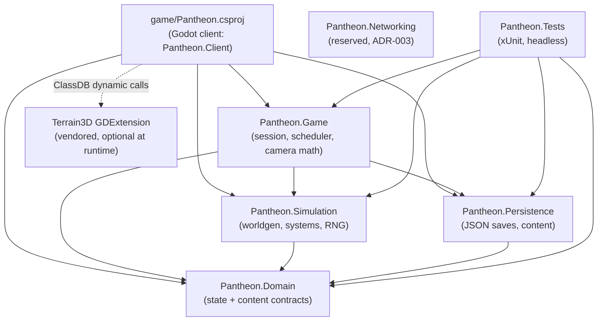
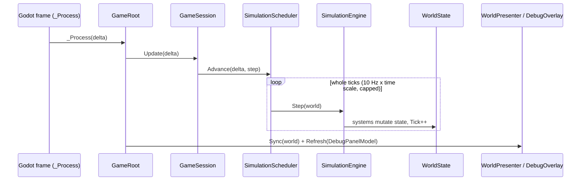
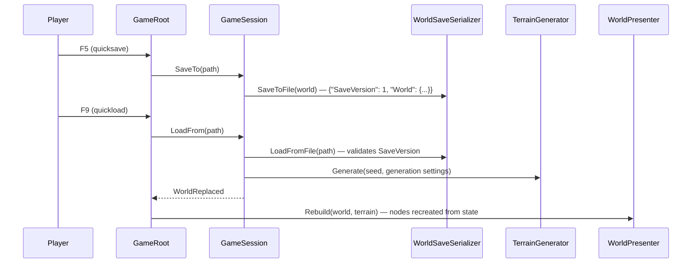

# Milestone 1 — Foundation Implementation

## Overview

Milestone 1 lays PANTHEON's technical foundation. Deliverables:

- A Godot 4.7.2-stable (.NET) project plus a C# solution (`Pantheon.sln`) that builds.
- A deterministic world generated from a `WorldSeed` with FastNoiseLite: elevation, moisture and
  temperature fields classified into three land biomes (Grassland, Forest, Highland) plus open Sea.
- Terrain rendered with Terrain3D, behind an adapter, with a clearly marked fallback mesh renderer
  used when the Terrain3D GDExtension is unavailable (or forced with `--terrain=fallback`).
- A free god camera: WASD/arrow pan, edge scroll, right-drag "grab" pan, wheel zoom, Q/E and
  middle-drag rotate, focus-settlement; three zoom bands (Close, Regional, Strategic).
- A region grid in `WorldState` (`RegionState`: Id, Biome, Elevation, Temperature, Moisture,
  Fertility, Vegetation) and one settlement (`SettlementState`: population, food, housing, ...),
  shown visually.
- Versioned, human-readable JSON saves (`SaveVersion`); save/load round trip rebuilds all visuals.
- A debug overlay: FPS, simulation tick, seed, region under cursor, settlement stats, terrain
  backend, camera zoom band, region-boundary toggle.
- A fixed-step simulation tick loop decoupled from the render frame rate.
- xUnit tests (`Pantheon.Tests`): same seed reproduces the same world, save/load round-trip
  equality, save version present (plus supporting unit tests).

Playable outcome: the player can launch the game and explore the generated island.

**Plan pattern: Non-TDD (architecture first).** The architecture is fixed by ADR-001…ADR-006, so
design drives implementation; tests are specified in the Test Plan and written alongside the core
libraries. The user asked for fully autonomous execution, so the pattern could not be confirmed
interactively. This is recorded as an explicit assumption.

## Architecture

### Projects and dependency direction

| Project | Kind | Depends on | Responsibility |
| --- | --- | --- | --- |
| `src/Pantheon.Domain` | .NET 8 class library | — | Pure state and content contracts (`WorldState`, `RegionState`, `SettlementState`, `WorldGenSettings`, `SettlementRules`). No behaviour beyond trivial lookups. |
| `src/Pantheon.Simulation` | .NET 8 class library | Domain | Deterministic behaviour: `SimulationRandom`, FastNoiseLite (vendored), terrain generation, biome classification, region building, settlement founding, tick systems, `SimulationEngine`, heightfield raycast. |
| `src/Pantheon.Persistence` | .NET 8 class library | Domain | System.Text.Json saves (`SaveGame` envelope with `SaveVersion`) and content-file parsing. |
| `src/Pantheon.Game` | .NET 8 class library | Domain, Simulation, Persistence | Engine-agnostic application layer: `GameSession`, fixed-step `SimulationScheduler`, god-camera math (`GodCameraModel`), debug readouts, launch options. |
| `src/Pantheon.Networking` | .NET 8 class library | — | Reserved for ADR-003 (host-authoritative ENet). Empty in M1. |
| `src/Pantheon.Tests` | xUnit test project | Domain, Simulation, Persistence, Game | Headless tests. Loads the shipped `game/Data/*.json` content. |
| `game/Pantheon.csproj` | Godot.NET.Sdk/4.7.2 | Domain, Simulation, Persistence, Game | Godot client (namespace `Pantheon.Client`): bootstrap, input, presentation adapters, UI. |

Godot tooling constraint: the Godot C# project must sit next to `project.godot` and node scripts
must live under `res://`. The Godot-facing code therefore lives in `game/Scripts` (assembly
`Pantheon`), and `src/Pantheon.Game` is the engine-agnostic application layer. `project.godot`
sets `dotnet/project/solution_directory="../"` so the editor uses the root `Pantheon.sln`.

### Core rules

- `WorldState` is the single source of truth. Godot nodes are presentation only and are built
  from state by presentation adapters (`WorldPresenter`, `ITerrainPresenter`, ...).
- The SceneTree is never serialized. Saves contain `WorldState`; loading rebuilds visuals.
- The terrain heightfield (`TerrainField`) is derived data. It is regenerated from
  `WorldState.Seed` + `WorldState.Generation` (generation settings are copied into the state), so
  saves stay small and exact. Future terrain edits will be stored as deltas in `WorldState`.
- Core systems use `SimulationRandom` instances derived from the seed; RNG state is stored in
  `WorldState.Random`, so a loaded save continues the same random sequence. No global randomness
  in core code (`System.Random` is only used by the Godot shell to pick a fresh seed on F2).
- Content is data-driven: `game/Data/worldgen.json` (generation), `game/Data/settlement_rules.json`
  (tick rules), `game/Data/biome_palette.json` (presentation colours).

### Runtime data flow

1. `GameRoot._Ready` loads content JSON, parses launch options (`--seed`, `--load`, `--terrain`),
   creates a `GameSession` (new world or loaded save) and asks `WorldPresenter` to rebuild.
2. Each frame `GameRoot._Process(delta)` calls `GameSession.Update(delta)`. The
   `SimulationScheduler` converts real time into whole 10 Hz ticks (with time scale, pause and a
   backlog cap). Each tick runs `SimulationEngine.Step(WorldState)`.
3. After the update, `WorldPresenter.Sync(WorldState)` refreshes dynamic visuals (settlement
   label, hut count). Picking uses `TerrainRaycaster` on the `TerrainField` (backend-independent).
4. The debug overlay receives a `DebugPanelModel` built by `DebugReadout` (pure formatting).

### Terrain pipeline

- `TerrainGenerator` (Simulation) produces `TerrainField`: 1024×1024 samples at 2 m spacing
  (2048 m island), with heights in metres (sea level = 0 m), moisture, temperature and per-sample biome.
- `RegionBuilder` aggregates 32×32 samples into each of the 32×32 regions (64 m regions).
- Presentation: `TerrainPresenterFactory` returns `Terrain3DTerrainPresenter` when
  `ClassDB.ClassExists("Terrain3D")`, otherwise `FallbackMeshTerrainPresenter` (clearly labelled
  in the log and in the debug overlay). Terrain3D receives a height image (FORMAT_RF), a biome
  colour map (FORMAT_RGBA8) and one procedural ground texture asset.
- Terrain3D 1.0.2-stable (MIT) is vendored as a runtime-only desktop subset in
  `game/addons/terrain_3d` (reproducible with `tools/vendor-terrain3d.sh`).

### Environment and configuration

- Godot 4.7.2-stable .NET build; .NET SDK 8.0+ (`net8.0`, matching GodotSharp 4.7.2).
- No backend, no network at runtime. Saves are written to `user://saves/quicksave.json`.

## Mermaid Diagrams







```mermaid
flowchart TD
    Seed["WorldSeed + WorldGenSettings"] --> TG["TerrainGenerator<br/>FastNoiseLite layers"]
    TG --> TF["TerrainField<br/>height / moisture / temperature / biome"]
    TF --> RB["RegionBuilder<br/>32x32 regions"]
    RB --> SF["SettlementFounder<br/>best fertile land region"]
    SF --> WS["WorldState"]
    TF --> TPF{"Terrain3D class available?"}
    TPF -- yes --> T3["Terrain3DTerrainPresenter"]
    TPF -- no / --terrain=fallback --> FB["FallbackMeshTerrainPresenter<br/>(clearly marked)"]
```

## Code Plan

Signatures only; all public members carry XML doc comments.

### Pantheon.Domain

```csharp
readonly record struct WorldSeed(ulong Value) { static WorldSeed Parse(string text); }   // number or FNV-1a hash of text
readonly record struct GroundPosition(float X, float Z);
readonly record struct RandomState(ulong S0, ulong S1, ulong S2, ulong S3);
enum Biome { Sea, Grassland, Forest, Highland }
sealed class RegionState { int Id; Biome Biome; float Elevation, Temperature, Moisture, Fertility, Vegetation; }
sealed class RegionGrid { int Columns, Rows; float RegionSize; List<RegionState> Cells;
    bool TryGetRegionIdAt(float x, float z, out int id); GroundPosition GetRegionCenter(int id); (int Column, int Row) GetCoordinates(int id); }
sealed class SettlementState { int Id; string Name; int RegionId; GroundPosition Position; int Population; float Food; int Housing; }
sealed class WorldState { WorldSeed Seed; WorldGenSettings Generation; long Tick; RandomState Random; RegionGrid Regions; List<SettlementState> Settlements; }
sealed record WorldGenSettings { int HeightmapResolution; float VertexSpacing; int RegionsPerSide; TerrainShapeSettings Shape;
    NoiseLayerSettings ElevationNoise, RidgeNoise, MoistureNoise, TemperatureNoise; ClimateSettings Climate;
    IReadOnlyList<BiomeRule> Biomes; StartingSettlementSettings StartingSettlement; }
sealed record SettlementRules { float WorkforceShare, FoodPerWorkerPerTick, FoodPerPersonPerTick, FoodStoragePerHousing,
    SurplusFoodPerPerson, BirthChancePerPersonPerTick, DeathChancePerPersonPerTick, StarvationDeathChancePerPersonPerTick; }
```

### Pantheon.Simulation

```csharp
sealed class SimulationRandom { SimulationRandom(ulong seed); static FromState(RandomState); RandomState GetState();
    ulong NextUInt64(); int NextInt(int maxExclusive); double NextDouble(); float NextFloat(); int NextPoisson(double mean); }
static class SeedMixer { ulong Derive(WorldSeed seed, string purpose); int DeriveNoiseSeed(WorldSeed seed, string purpose); }
sealed class NoiseLayer { NoiseLayer(NoiseLayerSettings s, int seed, bool ridged); float Sample01(float x, float z); }
sealed class TerrainField { int Resolution; float Spacing; float WorldSize; ReadOnlySpan<float> Heights/Moisture/Temperature;
    ReadOnlySpan<Biome> Biomes; float GetHeight(int x, int z); float SampleHeight(float x, float z); float SampleSlope(int x, int z); }
static class TerrainGenerator { TerrainField Generate(WorldSeed seed, WorldGenSettings settings); }
static class TerrainRaycaster { bool TryRaycast(TerrainField f, Vector3 origin, Vector3 dir, float maxDistance, float floorHeight, out Vector3 hit); }
sealed class BiomeClassifier { BiomeClassifier(IReadOnlyList<BiomeRule> rules); Biome Classify(float elevation, float temperature, float moisture); BiomeRule GetRule(Biome b); }
static class RegionBuilder { RegionGrid Build(TerrainField field, WorldGenSettings settings); }
static class SettlementFounder { SettlementState Found(RegionGrid grid, WorldSeed seed, StartingSettlementSettings s); }
sealed record GeneratedWorld(WorldState State, TerrainField Terrain);
static class WorldGenerator { GeneratedWorld Generate(WorldSeed seed, WorldGenSettings settings); }
interface ISimulationSystem { void Update(TickContext context); }
sealed record TickContext(WorldState World, SimulationRandom Random);
sealed class SettlementSystem : ISimulationSystem { static float ComputeFoodBalance(...); static float ComputeFoodStorage(...); }
sealed class SimulationEngine { SimulationEngine(SettlementRules rules); void Step(WorldState world); }
```

Settlement tick model (statistical tier, per tick at 10 Hz):

```text
production  = population * WorkforceShare * FoodPerWorkerPerTick * region.Fertility
consumption = population * FoodPerPersonPerTick
food        = clamp(food + production - consumption, 0, housing * FoodStoragePerHousing)
births      = Poisson(population * BirthChance)            if food >= population * SurplusFoodPerPerson and population < housing
deaths      = Poisson(population * DeathChance) (+ Poisson(population * StarvationChance) when food == 0)
```

### Pantheon.Persistence

```csharp
sealed class SaveGame { int SaveVersion; WorldState World; }
static class WorldSaveSerializer { const int CurrentSaveVersion = 1; string Serialize(WorldState); WorldState Deserialize(string json);
    void SaveToFile(WorldState world, string path); WorldState LoadFromFile(string path); }   // atomic temp-file write
sealed class SaveFormatException : Exception;            // missing/unsupported SaveVersion, malformed JSON
static class ContentJson { WorldGenSettings ParseWorldGenSettings(string json); SettlementRules ParseSettlementRules(string json); }
sealed class ContentFormatException : Exception;
static class PantheonJson { JsonSerializerOptions Options; }   // indented, enums as strings, strict members
```

### Pantheon.Game

```csharp
sealed record GameContent(WorldGenSettings WorldGen, SettlementRules SettlementRules);
sealed class SimulationScheduler { SimulationScheduler(double ticksPerSecond, int maxTicksPerUpdate);
    bool IsPaused; double TimeScale; int Advance(double realDeltaSeconds, Action step); void Reset(); }
sealed class GameSession { static CreateNew(GameContent, WorldSeed); static Load(GameContent, string path);
    WorldState World; TerrainField Terrain; SimulationScheduler Scheduler; event Action WorldReplaced;
    int Update(double delta); void StartNewWorld(WorldSeed); void SaveTo(string path); void LoadFrom(string path); }
enum CameraZoomBand { Close, Regional, Strategic }
sealed record GodCameraSettings { MinDistance, MaxDistance, CloseBandMaxDistance, RegionalBandMaxDistance, pitch range, speeds, smoothing }
sealed class GodCameraModel { Pan(Vector2 axes, float dt); PanWorld(Vector2 offset); Rotate(float radians); Zoom(float steps);
    FocusOn(Vector2 point, float? distance); SetBounds(...); Update(float dt, Func<float,float,float> ground); CameraPose ComputePose(ground); CameraZoomBand Band; }
static class DebugReadout { DebugPanelModel Build(...); }
sealed record LaunchOptions(WorldSeed? Seed, string? LoadPath, TerrainBackendPreference Terrain) { static LaunchOptions Parse(IEnumerable<string> args); }
```

### Godot client (`game/Scripts`, namespace `Pantheon.Client`)

```csharp
partial class GameRoot : Node3D            // composition root, hotkeys, cursor picking
static class GodotContentLoader           // res://Data/*.json -> GameContent / BiomePalette
static class InputActions                 // StringName constants matching project.godot [input]
partial class GodCameraController : Node3D // input -> GodCameraModel -> Camera3D transform
sealed class WorldPresenter               // owns terrain/water/settlement/region presenters; Rebuild/Sync
interface ITerrainPresenter { string BackendName; bool IsFallback; void Build(TerrainField, BiomePalette); void Clear(); }
sealed class Terrain3DTerrainPresenter / FallbackMeshTerrainPresenter / TerrainPresenterFactory
sealed class SettlementPresenter / RegionBoundaryOverlay / WaterPresenter
partial class DebugOverlay : CanvasLayer
```

Input map (project.godot): `camera_pan_*` (WASD + arrows), `camera_rotate_left/right` (Q/E),
`camera_zoom_in/out` (wheel, `=`/`-`), `camera_drag_pan` (RMB), `camera_drag_rotate` (MMB),
`camera_focus_settlement` (F, Home), `toggle_region_boundaries` (B), `toggle_debug_overlay` (F1),
`world_new` (F2), `world_quicksave` (F5), `world_quickload` (F9), `sim_toggle_pause` (Space),
`sim_speed_1/2/3` (1/2/3 → ×1/×4/×16).

Zoom bands: Close ≤ 120 m camera distance, Regional ≤ 700 m, Strategic up to 2600 m.

## Test Plan

Unit/integration tests in `src/Pantheon.Tests` (xUnit, headless, no Godot):

| Area | Test | Verifies |
| --- | --- | --- |
| World generation | `SameSeed_ProducesIdenticalWorld` | Two generations from the same seed are deep-equal (state, JSON text, terrain arrays). |
| World generation | `DifferentSeeds_ProduceDifferentWorlds` | Seed actually drives generation. |
| World generation | `GeneratedWorld_HasFullRegionGridAndOneSettlementOnLand` | 32×32 regions with sequential ids; settlement sits on a habitable region. |
| World generation | `Classifier_*` | Data-driven biome rules map elevation/temperature/moisture to Sea/Highland/Forest/Grassland. |
| Persistence | `RoundTrip_PreservesWorldState` | Serialize → deserialize is deep-equal and re-serializes to identical JSON. |
| Persistence | `RoundTrip_ThroughFile_PreservesWorldState` | File save/load path (atomic write). |
| Persistence | `Save_ContainsCurrentSaveVersion` | `SaveVersion` is present, first, and equals `CurrentSaveVersion`. |
| Persistence | `Load_Without/Future SaveVersion_Throws` | Clear `SaveFormatException` on bad versions. |
| Determinism | `ContinuingAfterLoad_MatchesUninterruptedRun` | Ticks → save → load → ticks equals an uninterrupted run (RNG state persisted). |
| RNG | `SimulationRandom_*` | Same seed same sequence; state restore resumes; bounds. |
| Scheduler | `SimulationScheduler_*` | Fixed-step accumulation, pause, time scale, backlog cap. |
| Terrain | `TerrainRaycaster_*` | Downward ray hits sampled height; rays outside the world miss. |
| Camera | `GodCameraModel_*` | Zoom clamping, band classification, yaw-relative panning, bounds clamping. |
| Content | `ShippedContent_Parses` | `game/Data/*.json` parse with strict settings; last biome rule is a catch-all. |
| Launch | `LaunchOptions_*` | `--seed`, `--load`, `--terrain` parsing. |

Manual/automated client verification: `dotnet build Pantheon.sln`; Godot headless import and run
of the main scene (no script errors); windowed run on the VM (Forward+ via lavapipe) with frame
captures of the Terrain3D and fallback backends; interactive check of camera controls, boundary
toggle, F5/F9 save/load rebuild.

## Tasks

### Completed

- [x] Confirm pinned versions: Godot 4.7.2-stable .NET, Terrain3D 1.0.2-stable (supports Godot 4.4–4.7), .NET 8 SDK.
- [x] Prototype Terrain3D runtime import (height + colour map + procedural texture) under Forward+ and Compatibility.
- [x] Write this plan.

### In Progress

- [ ] ADR-001…ADR-006, `docs/GAME_SPEC.md`, `docs/ARCHITECTURE.md`.

### Future

- [ ] Solution scaffolding (`Pantheon.sln`, `Directory.Build.props`, project files, ignore/attributes files).
- [ ] Pantheon.Domain state and content contracts.
- [ ] Pantheon.Simulation: RNG, noise, terrain generation, regions, settlement founding, tick systems.
- [ ] Pantheon.Persistence: versioned saves and content parsing.
- [ ] Pantheon.Game: session, scheduler, camera model, readouts, launch options.
- [ ] Pantheon.Tests: tests from the Test Plan; run them.
- [ ] Godot project: `project.godot` (input map), scenes, data files, materials, shaders.
- [ ] Godot client scripts: bootstrap, camera, presenters (Terrain3D + fallback), overlay.
- [ ] Vendor the Terrain3D runtime subset and add `tools/vendor-terrain3d.sh`.
- [ ] Verify in Godot (headless import/run, windowed captures, interactive checks).
- [ ] README (open in Godot .NET, run tests, controls).
- [ ] Open the PR.

## Relevant Files

- `.docs/milestone-1-foundation.md` — this plan.
- `docs/ADR/ADR-00[1-6]-*.md`, `docs/GAME_SPEC.md`, `docs/ARCHITECTURE.md`.
- `Pantheon.sln`, `Directory.Build.props`, `src/Directory.Build.props`, `.gitignore`, `.gitattributes`, `.editorconfig`.
- `src/Pantheon.Domain/**`, `src/Pantheon.Simulation/**`, `src/Pantheon.Persistence/**`, `src/Pantheon.Game/**`,
  `src/Pantheon.Networking/**`, `src/Pantheon.Tests/**`.
- `game/project.godot`, `game/Pantheon.csproj`, `game/Scenes/**`, `game/Scripts/**`, `game/Data/**`,
  `game/Materials/**`, `game/Shaders/**`, `game/addons/terrain_3d/**` (vendored).
- `tools/vendor-terrain3d.sh`, `README.md`.
