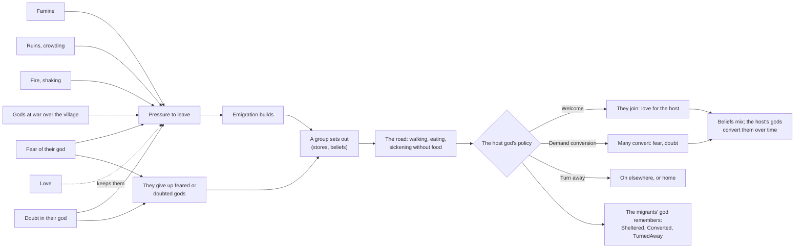

# Milestone 10 — Population Movement

## Overview

Spec §125 asks for migration, refugees and conversion through migration, with the playable outcome
"Populations can abandon gods". The decisions are in
[ADR-016](../docs/ADR/ADR-016-migration-groups-and-refugee-policies.md).

What the player gets:

- **People leave hard lives.** Famine, homelessness after a disaster, fire and shaking, a village
  torn between gods at war, fear of their god and doubt in it all build a village's wish to leave.
  Love keeps people home. Once enough want to go, a group sets out with its share of the stores.
- **They abandon gods.** Those who leave give up their gods in proportion to how much they fear or
  doubt them. People fleeing a feared god do not go where it rules.
- **Groups walk the land.** Each group heads for the best place it can reach (room, food, safety,
  its own gods followed there) and walks there over land, eating as it goes. Without food it
  sickens and dies.
- **Gods decide about refugees.** Where migrants arrive, the god followed most there decides:
  - **Welcome:** they join as they are, and the people love the god for it.
  - **Demand conversion:** many of them must turn to that god, and fear and doubt it.
  - **Turn away:** they go on elsewhere or home, and resent it.

  The migrants' god remembers what was done to its people. Set your own policy in the diplomacy
  panel (P). The Tyrant demands conversion, the Guardian and Trickster welcome, and an Isolationist
  turns migrants away. A welcoming AI god with homeless followers turns them away too.
- **Conversion through migration.** Newcomers mix into their new home's beliefs, and its gods
  convert them over time.
- **Seeing it.**
  - Walkers in the migrants' god's colour, labelled "23 from Elar to Valen (war)".
  - A Migration overlay (O): villages from content to wanting to leave, and every group's way.
  - Label marks "people leaving" and "migrants coming".
  - Alerts about your followers leaving or giving you up, migrants settling among your people,
    and refusals and conversions.
  - F1 lines for groups, policies and a village's pressure.
  - M sends people out of the village under the cursor; `--migrate` and `--refugees` do the same
    from the command line.

## Architecture

| Project | Changes |
| --- | --- |
| `Pantheon.Domain` | `Migration/`: `MigrationState`, `MigrationGroup`, `MigrationRules`, `MigrationCause`, `RefugeePolicy`, `MigrationOutcome`. `SettlementState.Emigration`, `GodState.RefugeePolicy`, `GodProfile.RefugeePolicy`, `WorldState.Migration`. `DiplomaticAct.Sheltered` and `TurnedAway`. The `MigrationStarted`, `MigrationEnded`, `MigrantsTurnedAway` and `RefugeePolicyChanged` events. |
| `Pantheon.Simulation` | `Migration/`: `MigrationModel` (pure rules), `MigrationSystem` (the step, 1 Hz, after diplomacy), `MigrationAuthority` (policies, the fourth authority), `RefugeeAdvisor` (AI policies, run with the god AI), `MigrationRulesValidator`. `BeliefModel.Find` over any belief list. |
| `Pantheon.Persistence` | Save version 10 and the migration from version 9; `MigrationIntegrity`; parsing of `migration.json`. The steps from version 6 on move to `RecentSaveMigrations`, and shared helpers to `SaveJson`, keeping `SaveMigrations` under 500 lines. |
| `Pantheon.Game` | `Migration/MigrationText` and `MigrationCommands`; `Alerts/MigrationAlerts`; `Diagnostics/MigrationReadout`; the Migration overlay; label marks; the panel's policies; `--migrate`, `--refugees`; `GameContent.CreateEngine()`, which tests and the session now use. |
| Godot client | `Presentation/Migration/` (`MigrationPresenter`, `MigrationView`); the panel's refugee row; the M hotkey in `NatureDebug`; the overlay's pressure. |
| Content | `game/Data/migration.json`; a `RefugeePolicy` for every profile in `god_ai.json`. |

### A migration's chain

| Quantity | Rule (shipped values) |
| --- | --- |
| Pressure | `min(1, 1 × hunger + 1 × homeless + 0.8 × danger + 0.5 × war + 0.6 × fear + 0.5 × doubt) × (1 - 0.5 × love)`; fear, doubt and love are the followers' |
| War | `min(1, weaker share / 0.5)` for two gods at war each followed by at least 0.2 |
| Wish to leave | above 0.3: `+ population × 0.005 × (pressure - 0.3) / 0.7` per second, at most a quarter of the people; below: `- 2%` per second |
| Groups | set out at `max(8, 5% of the people)` wanting to go; at most 25%; 15 stay; at most 20 groups on the road |
| Destination | within 900 m, pressure at least 0.15 lower; appeal `room + food security + 0.5 × safety + 0.8 × faith match - 0.6 × distance / 900`; not the god fled |
| Abandonment | each god loses `0.3 × max(fear, doubt)` of its followers among the migrants; noted at a tenth or more |
| Road | 3 m/s; 6 food each (at most their share), 0.05 eaten per second; without food health `- 0.01`/s, deaths `0.004 × (1 - health)`/s |
| Welcome | host love `+ 0.3 × newcomers / population`; `Sheltered` remembered |
| Demand conversion | 60% of other gods' followers and the godless convert; fear 0.3, doubt 0.3 of the host; `Converted` remembered |
| Turn away | love `- 0.3`; `TurnedAway` remembered; on to the next best, or home |
| AI policy | the profile's; a welcoming god turns migrants away while over 20% of its followers are homeless |

## Test Plan

| Area | Tests |
| --- | --- |
| Migration rules | `MigrationModelTests`: each hardship's pressure and cause; fear and doubt; love keeping people; war; abandonment in proportion, and no abandonment for mild doubt; appeal; conversion; merging by population; welcome and resentment; the main god; followers' homelessness. |
| Migration step | `MigrationSystemTests`: the wish building until a group sets out; a comfortable village staying; walking, eating and a welcome with gratitude and memory; conversion; refusal and the way home; dying on the road; avoiding the god fled; the shared stream left alone and a save mid-journey; AI policies and the overwhelmed Guardian; the authority's checks; four gods migrating the same way across a save. |
| Presentation | `MigrationPresentationTests`: alerts; label marks; the overlay; the F1 lines; the commands; the launch options; the panel's policies; the content. `DisasterPresentationTests`: the overlay cycle. |
| Saves | `SaveMigrationV9Tests` against `save-v9.json`, written by the Milestone 9 build at commit 4ba74a2 (seed 77, four gods, Seren and Kaio allied): no groups, no wish to leave, every god welcoming; every other value kept; the same play after a save, the AI choosing its policies; broken groups and emigration refused; a version 9 save with migration refused. Versions 1–8 also migrate to version 10. |

### Verification results

- `dotnet build Pantheon.sln`: no warnings. `dotnet test Pantheon.sln`: 683 tests pass (646 at the
  end of Milestone 9).
- Headless runs of 60 simulated minutes with a passive player and the shipped pantheon:

  | Seed | Groups | People who left | By cause | Arrived | Outcome |
  | --- | --- | --- | --- | --- | --- |
  | 1234 | 22 | 513 | war 358, famine 112, danger 34, doubt 9 | 381 welcomed | no winner in 60 minutes |
  | 42 | 32 | 482 | war 353, fear 61, famine 48, danger 20 | 352 welcomed, 29 converted | Vael and Seren win together at 27.5 min |
  | 7 | 57 | 1,027 | war 770, famine 111, danger 91, doubt 46, homelessness 9 | 785 welcomed, 29 converted | Seren wins at 32.0 min |

  Groups were 8–34 people (median 18). Every policy change was Vael demanding conversion. Most
  groups that abandoned a god abandoned Vael, the feared Tyrant.
- With Kaio made an Isolationist, groups were turned away at Duskwater and Mossgate and went on to
  other villages.
- Tuning:
  - With abandonment only for fear and doubt, and a rate of 0.004 above 0.3, 9–20 groups set out
    in 40 minutes, and few people abandoned gods.
  - Proportional abandonment at 0.5 and a rate of 0.006 above 0.25 moved 400–1,000 people in
    40 minutes, but victories slipped to 44–52 minutes.
  - The shipped 0.3, 0.005 and 0.3 keep migration visible (about one group a minute in busy
    games) and victories near Milestone 9's.
- Godot on macOS (Metal), seed 1234:
  - `--migrate=40` shows 14 walkers in Ilyra's colour, two abreast, labelled "40 from Duskwater to
    Brightwater (doubt in their god)", and the alert "40 people leave Duskwater for Brightwater
    (doubt in their god), and many of them give you up."
  - Seed 7 at 25 minutes: on Terrain3D the Migration overlay shows Larkspur in red with "people
    leaving" and Thornhollow "migrants coming". On the fallback renderer the diplomacy panel's row
    reads "Migrants arriving among your people: Welcome · Demand conversion · Turn away", with the
    current policy in gold, and each rival's card says "Demands that migrants convert." or
    "Welcomes migrants."

## Tasks

### Completed

- [x] ADR-016.
- [x] Pressure, the wish to leave, groups, destinations and abandonment.
- [x] The road: walking, food, sickness and death.
- [x] Arrival: welcome, conversion, refusal, merging, and the gods' memory of it.
- [x] Refugee policies: the authority, the player's panel and the AI's choice.
- [x] Save version 10 and its migration; integrity; the split of the migration steps.
- [x] Walkers, the overlay, label marks, alerts, F1 lines, M, `--migrate`, `--refugees`.
- [x] Tests, headless runs and captures.

### Future

- Negotiating refugees' return and migration agreements as treaties (§31, §38).
- Groups founding new settlements, crossing water, meeting danger on the road, and routes that
  avoid fires.
- Migration of wildlife (§15, §18) and seasonal migration (§17).
- Creatures escorting or attacking groups (Milestone 11).

## Relevant Files

- `src/Pantheon.Domain/Migration/`, `src/Pantheon.Domain/Events/{MigrationStarted,MigrationEnded,MigrantsTurnedAway,RefugeePolicyChanged}.cs`
- `src/Pantheon.Simulation/Migration/`, `src/Pantheon.Simulation/Gods/GodAiSystem.cs`, `src/Pantheon.Simulation/Systems/{SimulationEngine,Authorities}.cs`
- `src/Pantheon.Persistence/{MigrationIntegrity,RecentSaveMigrations,SaveJson,SaveMigrations}.cs`
- `src/Pantheon.Game/Migration/`, `src/Pantheon.Game/Alerts/MigrationAlerts.cs`, `src/Pantheon.Game/Diagnostics/MigrationReadout.cs`
- `game/Scripts/Presentation/Migration/`, `game/Scripts/UI/DiplomacyPanel.cs`, `game/Scripts/Bootstrap/NatureDebug.cs`
- `game/Data/{migration,god_ai}.json`
- `src/Pantheon.Tests/Migration/`, `src/Pantheon.Tests/Game/MigrationPresentationTests.cs`,
  `src/Pantheon.Tests/Persistence/{SaveMigrationV9Tests,Version10Expectations}.cs`,
  `src/Pantheon.Tests/Persistence/Fixtures/save-v9.json`
