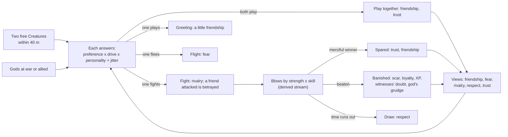

# Milestone 11 — Creature Relationships

## Overview

Spec §126 asks for rival Creatures, friendship, rivalry, combat and memories. The decisions are in
[ADR-017](../docs/ADR/ADR-017-creature-relationships-and-combat.md).

What the player gets:

- **Creatures remember each other.** Each Creature holds its own view of every Creature it has met,
  with friendship, fear, rivalry, respect and trust, and remembers their latest encounters. The two
  sides can differ: the beaten fears the winner.
- **They meet.** Creatures that come close meet, at most every two minutes. Each answers by what it
  has learned, its urges and its personality: fight, play, flee or walk on.
  - Gods at war make their Creatures want to fight.
  - Friendship, trust and alliance make them want to play.
  - Fear and weakness make them want to run.
  - A Creature on its god's errand greets a friend in passing but does not stop to play.
- **Friendship.** Playing together and greeting build friendship and trust. Allies' Creatures
  become friends. Friends whose gods go to war will not fight, and the player hears when the
  player's Creature refuses. A friend that attacks is remembered as a betrayal.
- **Rivalry.** War, fights and attacks on a god's people make rivals. Rivals go looking for each
  other, and an AI god at war sends its Creature against the enemy's Creature near its people.
- **Combat.** Two Creatures fight face to face, trading blows by strength and combat skill, until
  one gives up, time runs out (a draw), or one is called off. A merciful winner lets the loser go.
  Otherwise the loser is banished with a scar, less loyal and set back towards its next level, its
  god's people nearby doubt it, and its god remembers.
- **Learning.** A god can reward or punish a fight or a game like any deed. AI gods teach their
  Creatures to fight enemies and befriend allies. Victories make a Creature bolder and defeats
  warier.
- **Seeing it.**
  - Fighters' labels show their health.
  - Scars show on the flanks.
  - The Creature card lists its bonds, combat skill and scars.
  - The diplomacy panel says how your Creature and each rival's regard each other.
  - Alerts and F1 lines report meetings, fights and views.
  - K brings the nearest Creature to yours, and `--meet=on|<name>` does so at start.

## Architecture

| Project | Changes |
| --- | --- |
| `Pantheon.Domain` | `CreatureRelation`, `CreatureEncounter`, `EncounterKind`; `CreatureState.CombatSkill`, `Scars`, `Relations`; `CreatureActivity.TargetCreatureId`; `CreatureMemory.OtherCreatureId`. Actions `Fight`, `Befriend`, `Flee`; situations `MeetsCreature`, `MeetsEnemyCreature`. `CreatureBondRules` and `CreatureCombatRules` in `CreatureRules`. Events `CreaturesMet`, `CreatureFightEnded`. `DiplomaticAct.CreatureDefeated`. |
| `Pantheon.Simulation` | `CreatureBonds` (pure: views, drives, encounters, fading), `CreatureMeetings` (who meets and what comes of it), `CreatureCombat` (blows, outcomes, defeat), `CreatureBanishment`. The brain lists Creatures to seek or flee and answers meetings. `CreatureSystem` runs meetings on decision ticks, fights every tick and fading every second. `GodAi` teaches dealings with Creatures and confronts enemies' Creatures. |
| `Pantheon.Persistence` | Save version 11 and the migration from version 10; `CreatureIntegrity` checks skill, scars, views and references to Creatures. |
| `Pantheon.Game` | `Creatures/CreatureBondText` and `CreatureCommands`; `Alerts/CreatureAlerts`; the card's bonds and scars; the panel's `Creatures` line; F1 bonds and meeting lines; `--meet`. |
| Godot client | Fight, play and flight poses; scars; health on fighters' labels; the card's bonds line; the panel's line; K. |
| Content | `creatures.json`: `Bonds`, `Combat`, the `Fight`, `Befriend` and `Flee` rules, and starting preferences for meetings. |

### A meeting's chain

| Quantity | Rule (shipped values) |
| --- | --- |
| Meeting | within 40 m, free (not banished, fighting or playing), every 120 s per pair at most |
| Seeking | Creatures within 400 m are options; fleeing within 150 m |
| Fight urge | `(0.05 + 0.5 × rivalry + war - 0.8 × friendship - 0.6 × fear) × confidence`; war 0.4 (hostile 0.2); confidence `clamp(power × health ratio, 0.25, 1)` |
| Play urge | `0.2 + 0.5 × friendship + 0.3 × trust + alliance 0.3 + 0.2 × boredom - 0.6 × rivalry - war - 0.3 × fear` |
| Flee urge | when threatened: `0.8 × fear + 0.5 × (1 / confidence - 1) - 0.2` |
| Views | play: friendship +0.25, trust +0.15; greeting: friendship +0.12; fight: rivalry +0.25, friendship ×0.5; betrayal: trust ×0.4; defeat: fear +0.4, respect +0.25 (winner's rivalry ×0.5); spared: trust +0.3, friendship +0.15; flight: fear +0.1; attack on its god's people: rivalry +0.15 (gains close that share of the gap to 1) |
| Fading | fear −0.0005/s, rivalry −0.001/s, friendship −0.0001/s, trust back to 0.3 at 0.0005/s |
| Blows | each of two equal Creatures loses 0.05 health/s, ×(1 ± 0.5) jitter; power = strength × (1 + skill) |
| End | beaten at 25% health; draw after 40 s; spared when `kindness × (1 - aggression) + friendship - 0.3 at war ≥ 0.5` |
| Defeat | banished 60 s, +1 scar, loyalty −0.03, −15% of progress to the next level, aggression −0.03, liking for a fight ×0.94; the god remembers `CreatureDefeated`; witnesses within 300 m: winner's followers faith +0.06, fear +0.08; loser's doubt +0.08 |
| Victory | experience 4 + 6 × level ratio (0.25–2), aggression +0.01, liking for a fight +3% of the gap; both fighters' skill +10% of the gap |
| AI | rewards fighting enemies' and playing with allies' Creatures, punishes the reverse; confronts an enemy's Creature for `SendCreature × (Protect × threat + 0.5 × Aggression) × confidence` when confidence ≥ 0.8 |

## Test Plan

| Area | Tests |
| --- | --- |
| Bonds | `CreatureBondsTests`: the urges by war, friendship, fear and weakness; confidence and skill; play and greetings; betrayal; defeat and mercy; flight and draws; fading; the cooldown and the encounter memory. |
| Encounters | `CreatureEncounterTests`: meeting once a cooldown; the stronger winning and the loser banished, scarred, less loyal and set back, with witnesses and the god's memory; mercy; a draw; a punishment calling a fight off; flight; play and friendship; friends at war not fighting; betrayal; a Creature on an errand only greeting; rivalry from an attack on a god's people; rivals seeking each other; a fight across a save; blows leaving the shared stream alone. |
| AI | `CreatureRivalryAiTests`: teaching by war and alliance; confronting an enemy's Creature only when a match; never pulling a Creature out of a fight. |
| Presentation | `CreatureRelationsPresentationTests`: alerts; wording; the card and the panel; the F1 lines; K and `--meet`; the content and its validation. |
| Saves | `SaveMigrationV10Tests` against `save-v10.json`, written by the Milestone 10 build at commit 5977e49 (seed 77, four gods, three Creatures, 20 migrants on the road): no skill, scars or views; every other value kept; the same play after a save, Creatures coming to know each other; broken views refused; a version 10 save with views refused. Versions 1–9 also migrate to version 11. |

### Verification results

- `dotnet build Pantheon.sln`: no warnings. `dotnet test Pantheon.sln`: 724 tests pass (683 at the
  end of Milestone 10).
- Headless runs of 60 simulated minutes, passive player, shipped pantheon:

  | Seed | Meetings | Fights | Outcome | Creatures at the end |
  | --- | --- | --- | --- | --- |
  | 1234 | 25: 9 fights at war, 7 greetings, 4 flights, 4 passings, 1 game | 9, all ending in banishment | Seren wins at 58.7 min | Bramble level 7, no scars; Gristle 7 scars; Thistle and Quill 1 each |
  | 42 | 34: 20 greetings, 8 fights at war, 4 flights, 2 games | 8 | Vael and Seren win together at 28.0 min | Bramble and Quill friends (0.60); Gristle and Thistle, whose gods are allied, at 0.48; Gristle 7 scars |
  | 7 | 35: 15 greetings, 8 fights, 10 flights, 2 passings | 8 | Seren wins at 52.8 min | Gristle 6 scars, fearing Bramble; Thistle and Quill friendly (0.19) |

  Vael the Tyrant is at war most of the time, so its Creature, Gristle, fights most and loses most.
  It ends each hour with 6–7 scars, combat skill 0.5–0.6 and loyalty 0.49–0.76.

- Pace of the contest over 40 seeds (30–69), 60 minutes each: Milestone 10 had a winner in 22
  games (median 35.2 min), this build in 24 (median 37.6 min).
- Tuning:
  - The first rules made a fleeing Creature escape only when it was at least as fast as its
    attacker, and counted hostile gods as enemies. Over 60 minutes, 30–40 fights a game followed:
    - the player's Creature, never sent away by a god, reached level 8 with aggression 1;
    - an AI Creature collected 16 scars and lost all its loyalty.
  - These changes took the fights down to 8–9 an hour, nearly all between gods at war:
    - only war makes an enemy;
    - flight always works;
    - fear lasts longer;
    - victories pay less and defeats cost less;
    - being stronger adds no wish to fight;
    - the winner's rivalry halves.
  - A Creature on its god's errand stopping to play sent the AI's courting astray. It now only
    greets, and greetings count for more, so friendships still form.
- Godot on macOS (Metal), seed 1234:
  - Terrain3D, at 20 minutes, with Vael at war with Ilyra and `--meet=Gristle`: Bramble and Gristle
    fight face to face, labelled "Fighting Gristle 88%" and "Fighting Bramble 54%". The alert
    reads "Bramble attacked Gristle (Vael's Creature)." and the card "Reward or punish: fighting
    Gristle".
  - Fallback renderer, twenty seconds later:
    - the alert reads "Bramble beat Gristle (Vael's Creature): it is banished for a while.";
    - the F1 lines show Gristle banished, with combat skill 0.19 and 1 scar, fear 0.40 of Bramble,
      and "[lost to it, greeted]";
    - the card reads "Gristle (Vael): beat it, greeted".
  - The diplomacy panel's card for Vael reads "Bramble: met. Gristle: fears it." and "It remembers
    that you let your Creature beat its Creature." The first part now reads "Bramble: beat it."
  - At 1.5 minutes `--meet=on` brings Thistle: "Bramble played with Thistle (Seren's Creature).",
    both hopping 16 m apart.
  - With three scars set for the capture (a local edit, not committed), two dark slashes show on
    Bramble's flank and the card reads "3 scars".

## Tasks

### Completed

- [x] ADR-017.
- [x] Views, encounters and fading.
- [x] Meetings: answers, play, greetings, flight, betrayal, friends at war.
- [x] Seeking rivals and friends; fleeing threats.
- [x] Combat: blows, mercy, banishment, scars, loyalty, experience, witnesses, the gods' memory,
  draws and broken-off fights.
- [x] Learning from fights; AI teaching and confronting.
- [x] Save version 11 and its migration; integrity.
- [x] Poses, scars, labels, the card, the panel, alerts, F1 lines, K, `--meet`.
- [x] Tests, headless runs and captures.

### Future

- Creatures defending a settlement under attack, group fights, and Creatures escorting or
  attacking migrants (§82).
- A player command to attack a chosen Creature; specializations (§24) that change how a Creature
  fights.
- Permanent death for rare late-game mechanics (§28), and scars that weaken.
- Creatures of the same god (more Creatures, §130).

## Relevant Files

- `src/Pantheon.Domain/Creatures/{CreatureRelation,CreatureBondRules}.cs`, `src/Pantheon.Domain/Events/{CreaturesMet,CreatureFightEnded}.cs`
- `src/Pantheon.Simulation/Creatures/{CreatureBonds,CreatureMeetings,CreatureCombat,CreatureBanishment,CreatureBrain,CreatureSystem}.cs`, `src/Pantheon.Simulation/Gods/GodAi.cs`
- `src/Pantheon.Persistence/{CreatureIntegrity,RecentSaveMigrations}.cs`
- `src/Pantheon.Game/Creatures/{CreatureBondText,CreatureCommands}.cs`, `src/Pantheon.Game/Alerts/CreatureAlerts.cs`, `src/Pantheon.Game/Diagnostics/CreatureReadout.cs`
- `game/Scripts/Presentation/Creatures/{CreatureView,CreatureBody}.cs`, `game/Scripts/UI/{Hud,DiplomacyPanel}.cs`, `game/Scripts/Bootstrap/NatureDebug.cs`
- `game/Data/creatures.json`
- `src/Pantheon.Tests/Creatures/{CreatureBondsTests,CreatureEncounterTests}.cs`, `src/Pantheon.Tests/Gods/CreatureRivalryAiTests.cs`,
  `src/Pantheon.Tests/Game/CreatureRelationsPresentationTests.cs`, `src/Pantheon.Tests/Persistence/{SaveMigrationV10Tests,Version11Expectations}.cs`,
  `src/Pantheon.Tests/Persistence/Fixtures/save-v10.json`
