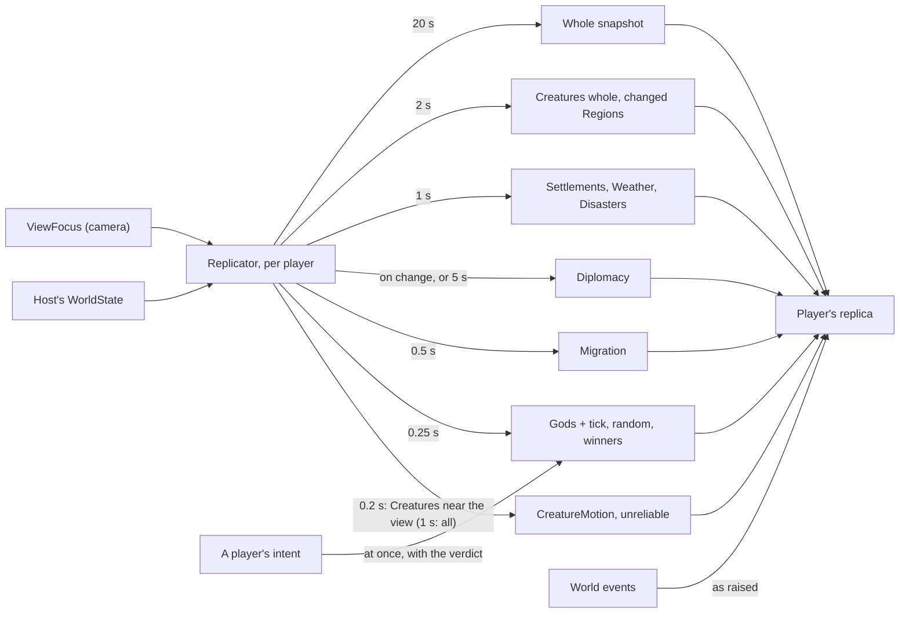

# Milestone 13 — Multiplayer Simulation

## Overview

Spec §128 asks to synchronize miracles, Creatures, settlements, disasters and diplomacy, for four
players. Milestone 12 already sent all of it in a whole snapshot every second. This milestone sends
each part at the rate it needs, with interest management (§95–96). The decisions are in
[ADR-019](../docs/ADR/ADR-019-replication-by-section-and-rate.md), which amends ADR-018's
replication.

What the players get:

- **Creatures move smoothly near them.** Creatures near a player's camera update five times a
  second, those far away once a second.
- **Their own actions show at once.** A miracle's cost, cooldown and effect on settlements arrive
  with the host's verdict, and its effect plays as the host casts it.
- **The world stays the host's.** Gods update four times a second, settlements, weather and
  disasters every second, migrants twice a second, regions' changing values every two seconds.
  Diplomacy updates when something happens. A whole snapshot still corrects everything every 20 s.
- **Four players.** The host and three more, each on a god the AI played. A player who drops and
  comes back under the same name gets its god again; meanwhile newcomers get other gods first.
- **About a third of the traffic.** About 12.5 KB/s per player instead of 36 KB/s.
- **Seeing it.** F1 shows traffic per second and the sections a player received; unattended runs
  print the network lines at the end.

## Architecture

| Project | Changes |
| --- | --- |
| `Pantheon.Networking` | `WorldSection`; `SectionUpdate` and `ViewFocus` messages; compression from 512 bytes. |
| `Pantheon.Persistence` | `PantheonJson.WireOptions` (the save options, compact) and `WorldSaveSerializer.SerializeCompact`. |
| `Pantheon.Game` | `Multiplayer/WorldSections` (writing and applying sections; `CreatureMotion`, `RegionChange`); `Multiplayer/Replicator` (rates, change detection, interest, diplomacy by event, corrections, hurrying after intents); `Multiplayer/TrafficMeter`. `MultiplayerHost` replicates through the replicator and keeps departed players' claims; `MultiplayerClient` applies sections, follows the host's tick and reports its view. `NetworkReadout` shows rates and sections. |
| Godot client | The camera focus goes to the network driver; unattended runs print the network lines. |

### What a player receives

| Quantity | Value |
| --- | --- |
| Section intervals | motion 0.2 s; gods 0.25 s; migration and diplomacy checks 0.5 s; settlements, weather, disasters 1 s; whole Creatures and regions 2 s |
| Interest | Creatures within 600 m of the player's view at 5 Hz, others at 1 Hz; the view sent after 50 m or 2 s |
| Diplomacy | on a change of status, proposal or remembered act; otherwise every 5 s |
| Correction | a whole snapshot every 20 s, on joining and for a new host world |
| Clock | a replica more than 5 ticks from the host's takes its tick |

## Test Plan

| Area | Tests |
| --- | --- |
| Sections | `MultiplayerReplicationTests`: every section carries its part into a replica, making it equal to the host's world; each section arrives at its rate and no whole world before the correction; an unchanged section is not sent again; Creatures near the view move five times a second, others once; a player's intent reaches its world with the verdict; a replica stays with the host as both run; four gods and four players at well under half of whole snapshots; a player who comes back gets its god, which waited for it. |
| Earlier | `MultiplayerSessionTests`, `ProtocolTests` and `MultiplayerPresentationTests` keep passing with sections (snapshots now at the correction interval). |

### Verification results

- `dotnet build Pantheon.sln`: no warnings. `dotnet test Pantheon.sln`: 764 tests pass (756 at the
  end of Milestone 12).
- Headless, shipped world, seed 1234, 5 minutes in, three players for 60 s over the loopback:
  - each received 12.5 KB/s, against 35.7 KB for one whole snapshot;
  - the host spent 1.52 ms per second of play replicating; a player 0.73 ms per second applying;
  - Ana received creature motion 298 times, gods 238, settlements 59, weather 59, whole Creatures 29,
    regions 27, diplomacy 12, migration 3 and disasters 3.
  - Before diplomacy went by event, it was sent 60 times a minute, because the relations' fading
    values change every step.
- Godot on macOS, seed 1234, a Terrain3D host and three headless players over ENet on 127.0.0.1:
  - every player saw the others join and leave, and the host gave each god back to the AI as its
    player left;
  - each player received about 14 KB/s, with 13 ms round trips;
  - over about 12 s each received gods 49 times, Creature motion 60–62 times and settlements 12
    times, as the rates say.
- Four instances that all render on one Mac (two Terrain3D, two fallback) starved each other. The
  background windows ran slowly, round trips reached 175–222 ms, and two players timed out. That
  is not a network limit; across computers each renders alone.
- Bo's Food as Kaio was refused by the host: "Food is ready in 7.1 s", because the AI had cast it
  just before Bo took the god over.

## Tasks

### Completed

- [x] ADR-019; ADR-018's status.
- [x] Sections, their writing and applying; compact JSON on the wire.
- [x] Rates, change detection, interest, diplomacy by event, corrections, hurrying after intents.
- [x] The replica's clock; departed players' gods kept for them.
- [x] Traffic rates and received sections in F1; network lines at the end of unattended runs.
- [x] Tests, headless measurements and a four-player run.

### Future

- Field-level deltas, interest for settlements and migrants, and bandwidth limits per player.
- A lobby or menu, chat, and joining from inside the game.
- Steam lobbies and relays (§69) in Milestone 15.

## Relevant Files

- `src/Pantheon.Networking/Protocol/NetMessage.cs`
- `src/Pantheon.Persistence/{PantheonJson,WorldSaveSerializer}.cs`
- `src/Pantheon.Game/Multiplayer/{WorldSections,Replicator,TrafficMeter,MultiplayerHost,MultiplayerClient}.cs`, `src/Pantheon.Game/Diagnostics/NetworkReadout.cs`
- `game/Scripts/Network/NetworkDriver.cs`, `game/Scripts/Bootstrap/GameRoot.cs`
- `src/Pantheon.Tests/Multiplayer/MultiplayerReplicationTests.cs`
