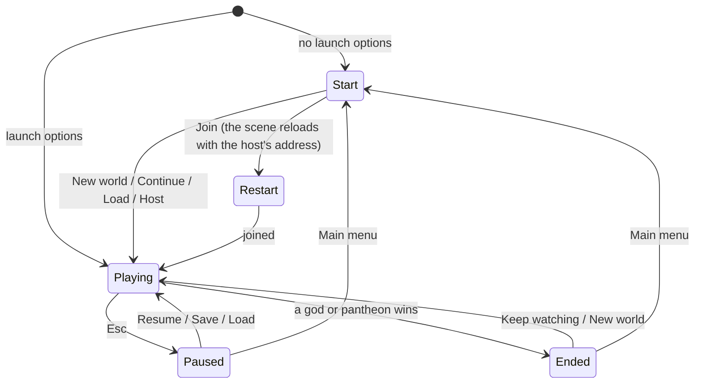

# Milestone 14 — Complete Vertical Slice

## Overview

Spec §129 asks for the complete vertical slice, "the first meaningful validation build". It
includes four gods, eight settlements, Creatures, belief, politics, weather, disaster, local
saves, multiplayer and victory. Every system existed after Milestone 13; this milestone makes them
a game one can play from start to end. The decisions are in
[ADR-020](../docs/ADR/ADR-020-vertical-slice-history-flow-and-eligible-pantheons.md).

What the player gets:

- **A start screen**: new world (with its seed), continue the newest save, load a world, host a
  shared world, join one, quit. It shows when the game starts without options.
- **A guide** for the first minutes. It advances as the player casts a miracle, rewards or punishes
  the Creature and opens diplomacy, ends with how to win, and can be hidden.
- **The world's history** (§50, §92): pacts, wars, betrayals, dominion and victory, ranks,
  conversions, deadly quakes and fires, famines, exoduses, falls of villages, Creatures' battles
  and legends, as "Year 12 — The Shaking of Elar (12 dead)". H shows it; the player's moments are
  in gold.
- **A pause menu** (Esc): resume, save the world, load a world, main menu, quit. Saves are named by
  god, year and seed; an autosave is written every five minutes.
- **An end screen**: Victory or Defeat, who won, how the player's god and Creature ended, and the
  history that led there. Keep watching, start a new world, or go back to the menu.
- **Fair pantheons**: allies win together as a god and its strongest ally, never three or four gods
  at once.
- **Measured performance** at 1080p and in stress scenarios (§104–105).

## Architecture

| Project | Changes |
| --- | --- |
| `Pantheon.Domain` | `History/HistoryRecord`, `HistoryKind`, `HistoryRules`; `WorldState.History`. `DivineRules.PantheonMaxGods`. |
| `Pantheon.Simulation` | `History/HistoryRecorder` (significance, repeats, falls, capacity) and its validator; `SimulationEngine` records history after each tick and, through `Chronicle`, after commands. `VictorySystem.StandingOf` counts a god's strongest direct allies only. |
| `Pantheon.Persistence` | Save version 12 and the migration from version 11; `HistoryIntegrity`; `history.json`; `SaveCatalog` (saves listed from their seed and tick). |
| `Pantheon.Networking` | `WorldSection.History`. |
| `Pantheon.Game` | `History/HistoryText` and `HistoryReadout`; `Flow/EndSummary`, `Flow/Guide`; the session records commands' history; `--menu`, `--guide`, `--history-panel`, `--pause-menu`, `--speed`. |
| Godot client | `Bootstrap/GameFlow` (start screen, pause menu, saves, autosave, hosting and joining from the menu, the end screen, the guide, the history panel), `Bootstrap/PendingLaunch` (options for the next start when the scene reloads) and `UI/Flow/` (`MenuScreen`, `HistoryPanel`, `GuidePanel`, `UiKit`). Esc and H. Frame times at the end of unattended runs. |
| Content | `game/Data/history.json`; `PantheonMaxGods` in `divine_rules.json`. |

### The game's flow

| History rule (shipped) | Value |
| --- | --- |
| A year | 60 simulated seconds |
| Earthquake | 5 dead or 3 houses |
| Fire | 3 houses |
| Exodus | 30 people |
| Conversion | a settlement of 20 people or more turning to a god |
| Repeat | the same kind for the same place or pair counts again after 300 s |
| Legends | levels 5 and 10 |
| Capacity | 300 records |

## Test Plan

| Area | Tests |
| --- | --- |
| History | `HistoryTests`: diplomacy, dominion, victory and ranks recorded and declines not; disasters, famines, exoduses and conversions only when great and not twice in a while; battles, legends, falls and resettlement; capacity; commands' and ticks' history together; the chronicle's words; the end screen; the guide; the save list; the new options; the rules' validation. |
| Saves | `SaveMigrationV11Tests` against `save-v11.json`, written by the Milestone 13 build at commit dbfef2b (seed 77, three Creatures that met): an empty history; every other value kept; the same play after a save, with history begun; a broken history refused; a version 11 save with a history refused. Versions 1–10 also migrate to version 12. |
| Pantheon victory | `PantheonTests.APantheon_IsAGodAndItsStrongestDirectAllies_NoMoreThanTheRulesAllow`. |
| Replication | `MultiplayerReplicationTests.EverySection_CarriesThatPartOfTheWorld_IntoAReplica` now carries the history. |

### Verification results

- `dotnet build Pantheon.sln`: no warnings. `dotnet test Pantheon.sln`: 781 tests pass (764 at the
  end of Milestone 13).
- History over 40 simulated minutes, seed 1234, passive player: 45 records. By kind: conversions
  14, ranks 7, wars 6, battles 5, earthquakes 4, peace 4, exoduses 3, a dominion and a legend.
- A bot playing the player's god, 20 seeds (100–119), 60 minutes each:

  | Played as | Games with a winner | Player among the winners | Before limiting pantheons |
  | --- | --- | --- | --- |
  | Guardian | 9 | 7 (15.7–46.9 min) | 14 games, 12 with the player, many of them three- or four-god victories |
  | Tyrant | 12 | 8 | 12, 9 |
  | Opportunist | 8 | 0 | 8, 0 |
  | Passive | 16 | 0 | 16, 0 |

- Performance on an M3 Pro (Metal), 1920 × 1080, seed 1234, 30 minutes into a game:

  | Case | Frame time |
  | --- | --- |
  | Terrain3D, regional view, x1 | 8.4 ms (vsync at 120 Hz) |
  | Terrain3D, regional view, x16 | 8.4 ms (vsync); 6.7 ms (150 FPS) without vsync, worst 12.5 ms |
  | Terrain3D, close to a grown village, x16 | 8.4 ms; 6.7 ms without vsync, worst 10.0 ms |
  | Fallback renderer, x16 | 8.4 ms |

  Headless simulation:
  - 0.076 ms a tick on the shipped world (8 settlements, 3,480 people): 12 ms a real second at x16;
  - 0.198 ms a tick with 21 settlements and 7,096 people: 32 ms a real second at x16.

  Saving takes 43 ms (408 KB) and loading with the terrain 1.4 s.
- Captures:
  - The start screen over the world, with Continue offering the newest save.
  - Seed 19 at 17.5 minutes: the end screen reads "Defeat — Seren has won the world's belief.",
    with "Year 17 of the world", Ilyra's and Bramble's state, and six moments from Seren's rise
    ("Year 16 — The Ascendancy of Seren").
  - The fallback renderer with the History panel and the guide's first step.
  - The pause menu.
- Joining from the menu, tried with a temporary switch: the game reloaded in place and joined a
  running host ("Restarted joined and plays Vael"). An operating-system restart had left the
  relaunched app stalled on macOS.

## Tasks

### Completed

- [x] ADR-020; ADR-015's status.
- [x] The world's history: recording, rules, save version 12, integrity, replication, words, the
  panel.
- [x] The start screen, pause menu, end screen, guide, save slots and autosave, hosting and joining
  from the menu.
- [x] Eligible pantheons.
- [x] Frame-time statistics, `--speed`, the flow's capture options; balance and performance
  measured.

### Future (Milestone 15)

- Settings (graphics scaling, §105; audio; keys), audio itself (§60), an in-game lobby.
- Domains, doctrines, holy sites, schisms, more miracles and Creatures (§130).

## Relevant Files

- `src/Pantheon.Domain/History/`, `src/Pantheon.Simulation/History/`, `game/Data/history.json`
- `src/Pantheon.Simulation/Belief/VictorySystem.cs`, `src/Pantheon.Simulation/Systems/SimulationEngine.cs`
- `src/Pantheon.Persistence/{HistoryIntegrity,SaveCatalog,RecentSaveMigrations}.cs`
- `src/Pantheon.Game/History/`, `src/Pantheon.Game/Flow/`
- `game/Scripts/Bootstrap/{GameFlow,SmokeTestDriver}.cs`, `game/Scripts/UI/Flow/`
- `src/Pantheon.Tests/History/HistoryTests.cs`, `src/Pantheon.Tests/Persistence/{SaveMigrationV11Tests,Version12Expectations}.cs`,
  `src/Pantheon.Tests/Persistence/Fixtures/save-v11.json`
