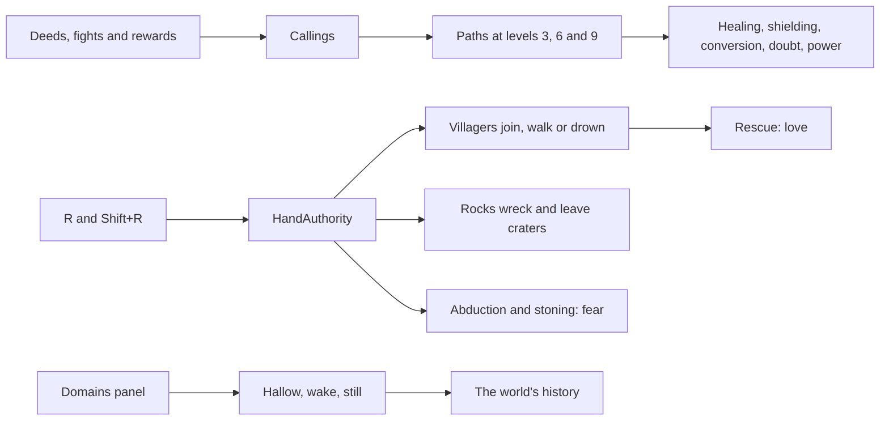

# Milestone 15, part 10 — Creatures' paths, the Divine Hand and the Divine Acts

## Overview

Part 10 gives the Creature its paths, the god a hand that does things, and the dearest miracles
(§14, §23–24, §55). The decisions are in
[ADR-030](../docs/ADR/ADR-030-creature-paths-divine-hand-and-divine-acts.md). The remaining UI panels,
overlays, export presets and Tier 3 follow in part 11.

What the player gets:

- **Paths (§24):** the Creature takes up a path at levels 3, 6 and 9, the one its deeds and the
  player's rewards have called it to most:

  | Path | What it does |
  | --- | --- |
  | Healer | Heals villages |
  | Guardian | Shields villages from disasters |
  | Missionary | Wins the godless |
  | Nature Keeper | Heals the land |
  | Warrior | Fights harder |
  | Destroyer | Kills more |
  | Trickster | Sows doubt in rivals |
  | Commander | Defends villages |

  It walks three paths at most.
- **Attributes (§23):** intelligence, resilience and divine affinity grow with level, beside
  strength and speed.
- **The Divine Hand (§55):**
  - R lifts what lies under the cursor where the god's influence reaches: villagers, a tree, a rock
    or the Creature.
  - R sets it down; Shift+R throws it.
  - Villagers carried out of danger to safety love their god. Taken from a safe home they are
    afraid, set down in the sea they drown, and set down on open land they walk to the nearest
    village.
  - Thrown rocks wreck and kill and leave craters. Trees are planted where they are set down.
- **Divine Acts (§14):** from the Domains panel (G), a Greater God may hallow the land, wake the
  volcano or still every disaster at once. Each enters the history.
- **Where to see it:** the Creature card (paths, the next calling level, attributes), F1's callings,
  alerts, the history, the hand showing what it holds, a held Creature hanging under the hand, the
  Domains panel's acts, and `--hand`.

## Architecture

| Project | Changes |
| --- | --- |
| `Pantheon.Domain` | Paths: • `Creatures/CreatureSpecialisation`, `CreatureCallings`, `CallingRules` (`CreatureRules.Callings`) • `CreatureState.Specialisations` and `Callings`  The hand: • `Hand/HeldObject`, `HandCommand` (`HandAction`, `HandRejection`), `HandRules` (`DivineRules.Hand`) • `GodState.Held`, `MigrationCause.Carried`  Acts: • `MiracleEffectKind` Hallow, Awaken, Still; `RegionState.Hallowed` • `DivineRules.CreatureAffinityPerLevel`  Events and history: • events `VillagersLifted`, `VillagersSetDown`, `HandStruck`, `DivineActDone`, `CreatureSpecialised` • history kinds `Calling`, `Rescue`, `Stoning`, `Hallowing`, `Awakening`, `Stillness` |
| `Pantheon.Simulation` | Paths: • `Creatures/CreatureCalling`, `CallingEffects`, `CreatureAttributes`, `CallingRulesValidator` • callings from deeds, rewards and fights • effects in deeds, combat power and disaster protection • held Creatures skipped by the Creature step and meetings  The hand: • `Hand/HandAuthority`, `HandModel`, `HandCarry`, `HandThrow`, `HandCreatures`, `HandRulesValidator` • `Authorities.Hand`  Acts: • `Miracles/DivineActs`, and the act effects in `MiracleEffects` • hallowed blessing in `BeliefSystem` • the AI's valuation of hallowing and stilling |
| `Pantheon.Persistence` | Save version 22 and `CallingSaveMigration`; `HandIntegrity`; the Creature and region checks. |
| `Pantheon.Networking` | Protocol version 10; `HandIntent`. |
| `Pantheon.Game` | • `Hand/HandCommands`, `HandText` • `Alerts/PowerAlerts` • `Creatures/CreatureGrowthText` • the card's paths and attributes, F1's callings • the Domains panel's acts (`DomainReadout`), acts off the miracle bar • the history's titles • the host answering `HandIntent` • `RegionChange.Hallowed` • `--hand` |
| Godot client | • R and Shift+R (`hand_grab`) • `DivineHand` holding and flinging (`HeldThing`) • the held Creature drawn under the hand • the Domains panel's Divine Acts with Aim • the card's paths and attributes |
| Content | `Callings` in `creatures.json`; `Hand` and `CreatureAffinityPerLevel` in `divine_rules.json`; the three acts in `miracles.json` and their looks in `divine_view.json`. |

## Test plan

- **Paths (`CallingTests`):**
  - Deeds call the Creature down their paths, and rewards call it further.
  - At each calling level it takes up the path it walked most, never twice and never all. With no
    calling it follows its strongest trait. Won fights call towards Warrior, mercy towards Guardian.
  - Each path's effect: Healer, Missionary, Trickster, Nature Keeper, Destroyer, Commander, Warrior
    and Guardian.
  - Intelligence, resilience and affinity grow with level, and affinity widens the god's influence.
  - In the engine a Creature that levels takes up a path and it is told.
- **The hand (`HandTests`):**
  - People lifted out of a fire and set down in a safe village join it and love their god.
  - People taken from a safe home are afraid, and set down in the wilds they walk to the nearest
    village.
  - People set down in the sea drown.
  - A thrown rock wrecks, kills, frightens and leaves a crater, and striking one's own is cruel.
  - A tree is pulled from green land and planted where it is set down.
  - The Creature waits in the hand, is set down where the hand goes, and is hurt when thrown.
  - Every refusal, including a fighting Creature and setting it down in the sea.
- **Divine Acts (`DivineActTests`):**
  - Hallowing blesses the land forever.
  - Waking the volcano needs a sleeping one.
  - Stilling the world ends every disaster at once.
  - Acts need a Greater God and a great deal of power.
- **Presentation (`PowerPresentationTests`):**
  - Alerts for the hand, paths and acts.
  - The history.
  - The card's paths and attributes.
  - The hand's commands and words.
  - The Domains panel's acts and the targeting of a chosen act.
  - `--hand` and the regions section.
  - Strict parsing of the new content.
  - A joined player's hand through the host.
- **Saves (`SaveMigrationV21Tests`):**
  - A save written by part 9's build has no paths, held things or hallowed land.
  - It keeps every other value and keeps playing the same way.
  - A version 21 save with callings is refused.
  - Paths, held things and hallowed land survive a save and load.

### Verification results

- **Build and tests:** `dotnet build` has no warnings. 1204 tests pass (1166 before).
- **Paths and acts in ten one-hour games** (seeds 100–109, a passive player):
  - **Paths:** Creatures took up 69 paths: Guardian 23, Missionary 17, Nature Keeper 13, Commander
    11, Trickster 5.
    - Untaught Creatures mostly build, play and forage, so feeding (Healer) and fighting (Warrior,
      Destroyer) rarely led. A player who rewards those deeds raises those paths.
    - The most grown Creature (level 10) walked three paths. None walked more.
  - **Acts:** the leading AI gods reached Greater God and hallowed land 37 times and stilled the
    world 19 times.
- **Tuning:**
  - **Acts:** the AI first stilled the world 35 times in ten hours and hallowed 70 times, because
    the leading AI gods hold hundreds of thousands of power in a passive game. It now stills only a
    real disaster among its own people (danger 0.5 or more), hallows only land not yet hallowed, and
    the cooldowns are 20 minutes (hallow, wake) and 30 minutes (still).
  - **The hand** first lifted the Creature standing in a village rather than the village's people;
    it now lifts whichever is nearer the cursor.
- **Balance:** 40 one-hour games with a passive player (seeds 30–69).

  | Build | Games with a winner | Median time | Mean time | Winners |
  | --- | --- | --- | --- | --- |
  | Part 9 | 39 / 40 | 24.9 min | 28.3 min | Seren 16, Vael and Seren 12, Kaio 6, Seren and Kaio 5 |
  | Part 10 (this build) | 39 / 40 | 27.6 min | 29.3 min | Vael and Seren 17, Seren 14, Kaio 5, Seren and Kaio 3 |

  The leading AI gods now spend some of their hoard on acts, and their Creatures walk paths.
  Games end a little later, within the spread seen between seeds before.
- **On the Mac:**
  - **The hand holding villagers** (seed 42, `--hand=villagers`): four little figures under the
    hand, "You lift 10 people of Brightwater. R sets them down, Shift+R throws", and Brightwater
    down to 44 people, at 114 FPS. The card reads "No path yet - at level 3 it becomes a Healer"
    over its attributes.
  - **The Creature in the hand** (`--hand=creature --focus=creature`): Bramble hangs in the air under
    the hand, "Held in its god's hand", at 116 FPS.
  - **The Divine Acts** (`--rank=GreaterGod --divine-power=6000 --domains-panel=on`): the panel
    opens on the three acts with their rank, cost and Aim, at 110 FPS.
  - **Hallowing on the fallback renderer** (`--terrain=fallback --cast=hallow`): golden motes rise
    over Brightwater and the alert "You hallow the land around Brightwater: its blessing will never
    fade", at 115 FPS.
- **Found on the Mac:**
  - Scripted runs aimed at the real mouse whenever it lay over the window, so the hand was drawn
    wherever the pointer happened to be. They now always aim at the screen centre.
  - The acts sat below the fold of the panel; they now lead it.
  - A held Creature's label said it was thinking what to do; it now says it is in the hand.

## Tasks

### Completed

- [x] Eight paths from callings, at levels 3, 6 and 9, with their effects; three attributes.
- [x] The Divine Hand: lifting, carrying, rescuing, planting, throwing and holding the Creature.
- [x] Three Divine Acts in the Domains panel, remembered by the history.
- [x] Save version 22 with the migration and the version 21 fixture; protocol 10.
- [x] Alerts, history, card, F1, panel, the hand's visuals, R and `--hand`.
- [x] Tests, probes and captures.

### Future

- Acts that reshape the terrain, should the terrain become changeable.
- Offerings carried by the hand.
- Creatures above level 10.
- The AI using the hand.

## Relevant files

- `src/Pantheon.Domain/Creatures/CreatureSpecialisation.cs`, `CallingRules.cs` and `Hand/`
- `src/Pantheon.Simulation/Creatures/CreatureCalling.cs`, `CallingEffects.cs`, `CreatureAttributes.cs`,
  `Hand/` and `Miracles/DivineActs.cs`
- `src/Pantheon.Game/Hand/`, `Alerts/PowerAlerts.cs`, `Creatures/CreatureGrowthText.cs` and
  `Domains/DomainReadout.cs`
- `src/Pantheon.Persistence/CallingSaveMigration.cs` and `HandIntegrity.cs`
- `game/Scripts/Presentation/Divine/DivineHand.cs`, `HeldThing.cs` and `game/Scripts/UI/DomainPanel.cs`
- `game/Data/creatures.json` (`Callings`), `divine_rules.json` (`Hand`) and `miracles.json`
- Tests: `src/Pantheon.Tests/Powers/` and `Persistence/SaveMigrationV21Tests.cs`
