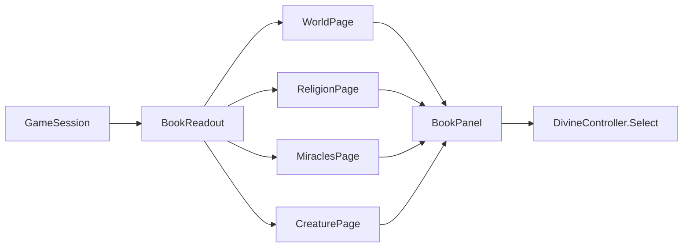

# Milestone 15, part 11 — The Book of the World, the last overlays, the overview and exports

## Overview

Part 11 completes the interface the specification asks for (§56–58) and makes the game exportable
for every platform (§62). The decisions are in
[ADR-031](../docs/ADR/ADR-031-book-of-the-world-overlays-overview-and-exports.md). Tier 3 (§80)
follows in part 12.

What the player gets:

- **The Book of the World (Tab):** four pages, with no new permanent UI.

  | Page | What it holds |
  | --- | --- |
  | World | Every god, the race for victory, the dangers and the holy sites |
  | Religion | The player's followers village by village, every god's faith, the Old Faiths and the godless |
  | Miracles | Every miracle with what it costs and still needs, and Aim |
  | Creature | The Creature in full: growth, paths, learning, memories and bonds |

- **Overlays (O):** population, disaster risk and political control after the others.
- **The strategic overview (backtick):** the whole island from afar, and back.
- **Releases:** export presets for Windows x64, macOS (universal) and Linux x64.

## Architecture

| Project | Changes |
| --- | --- |
| `Pantheon.Game` | • `Book/`: `BookModel` (`BookTab`, `BookLine`, `BookPage`), `BookReadout`, `WorldPage`, `ReligionPage`, `MiraclesPage`, `CreaturePage` • `Presentation/StateOverlays` and `OverlayKind` Population, Risk, Politics • `Camera/GodCameraModel.ToggleOverview` • `--book` and `--overview` |
| Godot client | • `UI/BookPanel`, `Bootstrap/BookController` • Tab (`toggle_book`) and backtick (`camera_overview`) in the camera controller • scripted runs always aim at the screen centre |
| Project | • `game/export_presets.cfg` (Windows, macOS, Linux) with `Data/*.json` • ETC2/ASTC import for Apple Silicon • `build/` ignored |

## Test plan

- **The book (`BookTests`):**
  - The World page names the world, every god (the player's own marked), the race, the dangers and
    the holy sites.
  - The Religion page shows the player's villages (failing ones warned), every god's faith and the
    Old Faiths.
  - The Miracles page lists every miracle by kind, offers those that may be aimed and says what the
    others need.
  - The Creature page shows its growth, paths, learning, memories and bonds.
  - The overview shows the whole island and goes back.
  - `--book` and `--overview`.
- **Overlays (`StateOverlayTests`):**
  - The cycle runs on to population, risk and politics.
  - The population overlay colours the largest village gold.
  - Risk is highest on dry woods and low land by the water, and nothing at sea.
  - Allies share their leader's colour.
- **Exports (`ExportPresetTests`):** presets for Windows, macOS and Linux carry the data and write
  outside the repository; the project imports ETC2/ASTC.

### Verification results

- **Build and tests:** `dotnet build` has no warnings. 1215 tests pass (1204 before). No
  simulation rule changed, so the balance is part 10's.
- **On the Mac (seed 42, ten minutes in):**
  - **World page:** Kaio leads with 52% of the people, at war with Vael; the player shows as
    "Ilyra (you)"; Kaio has held its dominance for 3:42 of 10:00; the four holy sites and keepers;
    at 119 FPS.
  - **Religion page:** the player's two villages, both doubting and marked, every god's faith and
    five Old Faiths, at 116 FPS.
  - **Miracles page:** every miracle with its cost and what it needs, Aim lit for the castable ones,
    at 119 FPS.
  - **Creature page:** Bramble, level 3, a Guardian called next towards Missionary, its learning,
    memories and two Creatures greeted, at 120 FPS.
  - **Overlays from the overview:** risk in yellow to red over the dry and steep land; politics with
    Seren's bloc in blue and Kaio in green; at 120–122 FPS.
- **Exports:**
  - **macOS:** a universal app (arm64 and x86_64), 130 MB, played from the export (Terrain3D,
    114 FPS).
  - **Windows and Linux:** each with the content in the pack, the .NET assemblies and the Terrain3D
    library. Not run, as no such machine is at hand.
- **Found on the way:**
  - **The macOS signature:** Godot's built-in ad-hoc signature adds the hardened runtime, and macOS
    26 killed the app at launch (exit 137, even for `--version`). Signing with Apple's `codesign`
    leaves it out, and the app runs.
  - **ETC2/ASTC:** export for Apple Silicon needs the project to import it.
  - **Words:** the human player's god has no personality name ("Ilyra the  (you)"), and "1
    followers" read wrong; both are fixed.
  - **The risk overlay** first drew too faint to read; it is now drawn from 0.15 risk at greater
    opacity.

## Tasks

### Completed

- [x] The Book of the World's four pages, Tab and `--book`.
- [x] Population, disaster risk and political control overlays.
- [x] The strategic overview (backtick) and `--overview`.
- [x] Export presets for Windows, macOS and Linux; the macOS export played.
- [x] Tests and captures.

### Future

- Run the Windows and Linux builds; sign and notarize the macOS build.
- Tier 3 entities (part 12).

## Relevant files

- `src/Pantheon.Game/Book/`, `Presentation/StateOverlays.cs` and `Camera/GodCameraModel.cs`
- `game/Scripts/UI/BookPanel.cs`, `game/Scripts/Bootstrap/BookController.cs` and
  `game/Scripts/Camera/GodCameraController.cs`
- `game/export_presets.cfg` and `game/project.godot`
- Tests: `src/Pantheon.Tests/Interface/`
