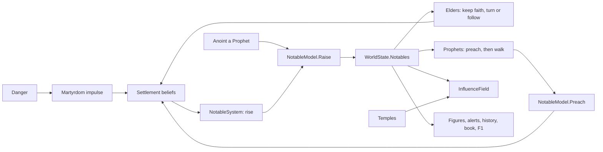

# Milestone 15, part 12 — Prophets, elders and temples' influence

## Overview

Part 12 adds Tier 3 individuals (§80): prophets and elders, who live in the world by name, walk,
preach, keep faith, turn, die and are remembered. It also completes the sources of influence (§10)
with temples and prophets. The decisions are in
[ADR-032](../docs/ADR/ADR-032-prophets-elders-and-temple-influence.md), which amends ADR-004 and
ADR-008 on what Tier 3 is.

What the player gets:

- **Elders:**
  - Every village of 40 or more chooses an elder of the god most of it follows.
  - The elder keeps the village's faith in that god and calms its doubt.
  - The elder turns from a god the village resents, which costs that god its followers' trust.
  - When the village leaves the god, the elder follows it.
- **Prophets:**
  - A village devout to its god may call a prophet, and a Lesser God may anoint one (Shift+1).
  - A prophet preaches in a village, then walks to the next, winning the godless and some of
    every rival's followers.
  - A god may have two at a time.
- **Martyrs:** a prophet who dies in danger is a martyr, and the god's followers nearby hold the
  harder.
- **Influence:** temples and prophets carry their god's influence beyond its followers.
- **Seeing them:**
  - robed figures in their god's colour, a prophet with a staff under a halo;
  - their labels, alerts and history;
  - the book's World and Religion pages, F1 and `--prophet`.

## Architecture

| Project | Changes |
| --- | --- |
| `Pantheon.Domain` | • `Notables/`: `NotableState`, `NotableKind`, `NotableDeed`, `NotableMemory`, `NotableRules` • `Events/NotableEvents`: `NotableRose`, `NotablePreached`, `NotableDied`, `ElderTurned` • `WorldState.Notables` and `NextNotableId` • `DivineRules.Notables`, `TempleInfluenceStrength` and `TempleInfluenceReach` • `MiracleEffectKind.Anoint` • `HistoryKind` Prophet, Martyrdom and ElderTurned, and `HistoryRecord.Name` |
| `Pantheon.Simulation` | • `Notables/`: `NotableModel`, `NotableSystem` (after `BeliefSystem`), `NotableRulesValidator` • `InfluenceField`: temple and prophet sources • `MiracleEffects`: Anoint • `MiracleValuer` values it for the AI • `HistoryRecorder` |
| `Pantheon.Persistence` | • Save version 23 (`NotableSaveMigration`) • `NotableIntegrity` |
| `Pantheon.Networking` | Protocol 11 and `WorldSection.Notables` |
| `Pantheon.Game` | • `Notables/NotableText`, `NotableCommands` • `Alerts/NotableAlerts` • `Book/NotableSection` • `Diagnostics/NotableReadout` • `WorldSections` and `Replicator` (every second) • `--prophet` • the Anoint sound and words |
| Godot client | `Presentation/Notables/NotablePresenter` and `NotableView`, owned by `MigrationPresenter` |
| Content | • `divine_rules.json`: `Notables`, with 40 names, and the temples' influence • `miracles.json`: `anoint` • `divine_view.json`: its look |

## The numbers (`divine_rules.json`, `Notables`)

| Rule | Value |
| --- | --- |
| A village chooses an elder from | 40 people |
| An elder's devotion | 0.0005 faith a second, and as much doubt taken away |
| An elder turns at resentment | 0.5, leaving 0.15 doubt |
| An elder follows the village when another god has | more than twice their god's following |
| An elder lives | 20–40 minutes |
| Devout | at least 0.6 of the village follows the god, in faith of at least 0.6 |
| A devout village calls a prophet | 0.6 an hour |
| Prophets a god may have | 2 |
| Anoint a Prophet | Lesser God, 300 power, ten-minute cooldown, a village 40% the god's within 60 m |
| A sermon | 40 s; wins 2.5% of the godless and 1.25% of each rival's followers, adds 0.05 faith |
| A prophet walks | 4 m/s, to villages within 1500 m |
| A prophet lives | 15–30 minutes |
| A prophet's death in danger | 0.01 × danger a second; martyrdom: faith +0.12, love +0.08, doubt −0.1 within 400 m |
| Influence of a temple / a prophet | 0.4, reaching 250 m |
| Memories | 12 |

## Test plan

- **The simulation (`NotableTests`):**
  - A sizeable village chooses one elder, of the god it follows most.
  - An elder keeps the faith.
  - An elder turns from a resented god, or follows a village that left their god.
  - Devout villages call prophets, up to each god's limit.
  - A prophet preaches, walks to the next village and preaches there.
  - A sermon wins the godless and some of each rival's followers.
  - A martyr's death strengthens the faithful nearby.
  - Danger lived through is remembered once for each place.
  - Notables die of age or with their village.
  - Anointing raises a prophet, within the limit.
  - Temples and prophets carry influence.
  - The same world raises the same notables.
- **Presentation (`NotablePresentationTests`):**
  - the alerts and the history;
  - the `--prophet` option, the book's sections and the F1 lines;
  - the words;
  - a save, and the section sent to joined players;
  - the shipped rules, and broken ones rejected.
- **Saves (`SaveMigrationV22Tests`):** a part 11 save (`save-v22.json`) loads with no notables.

### Verification results

- **Build and tests:** `dotnet build` has no warnings, and 1240 tests pass (1215 before).
- **Balance:** over 40 seeds (30–69), 38 games are won within the hour, at a median of 28.3
  minutes and a mean of 30.9. Part 10 gave 39 of 40, at a median of 27.6
  minutes and a mean of 29.3.
  - A sermon first won 4% of the godless, and the median fell to 21.7 minutes, faster than any
    part before. A sermon now wins 2.5%.
- **Rates:** over ten one-hour games (seeds 100–109), a game sees:

  | Measure | Per game |
  | --- | --- |
  | Elders chosen | 21 |
  | Elders who follow their village | 30 |
  | Sermons | 60, winning about 340 people |
  | Prophets anointed by the AI gods | 9 |
  | Prophets called by villages | 0.7 |
  | Martyrs | 0.4 |

  The AI gods keep their two prophets up, so villages rarely call one for them.
- **Cost:** `NotableSystem` takes 4 ms over 3000 ticks of a Huge world.
- **On the Mac (seed 42):**
  - **A prophet rises:** a prophet stands in Brightwater in Ilyra's colour, with a staff under a
    halo, labelled, with the alert, and Anoint shows on Shift+1. 113 FPS.
  - **Walking:** "Prophet Pell of Ilyra, walking to Saltreach" leaves Brightwater while Elder
    Bram stays by its centre. 127 FPS at ×16.
  - **Religion page:** your prophet with their memory, and the villages your elders keep. 120 FPS.
  - **Fallback terrain:** the prophet preaches by Brightwater's shrine beside the elder. 157 FPS
    at ×16.
- **Found on the way:**
  - **No elders at the start:** the starting villages hold 28–52 people, so the first threshold
    (60) left them without elders. It is now 40.
  - **Elders keeping a god the village had left:** the book showed elders still keeping villages
    for Ilyra after Seren had won them. An elder now follows the village, quietly, while turning
    from a resented god stays an event.
  - **The prophet's label:** it gave way to the elder's beside it. A walking prophet now comes
    first.

## Tasks

### Completed

- [x] Notables in the world state, their rules, events, saves (v23) and protocol section (11).
- [x] `NotableSystem`: elders, prophets, sermons, walking, martyrs and memories.
- [x] Anoint a Prophet, and the AI valuing it.
- [x] Temples and prophets as sources of influence.
- [x] Figures, labels, alerts, history, the book's sections, F1 and `--prophet`.
- [x] Tests, probes and captures.

### Future

- A selected villager followed as an individual (§80), which would need camera-driven promotion.
- Prophets of rival gods confronted by the player's Creature or hand.

## Relevant files

- `src/Pantheon.Domain/Notables/` and `Events/NotableEvents.cs`
- `src/Pantheon.Simulation/Notables/` and `Belief/InfluenceField.cs`
- `src/Pantheon.Persistence/NotableSaveMigration.cs` and `NotableIntegrity.cs`
- `src/Pantheon.Game/Notables/`, `Alerts/NotableAlerts.cs`, `Book/NotableSection.cs` and
  `Diagnostics/NotableReadout.cs`
- `game/Scripts/Presentation/Notables/`
- Tests: `src/Pantheon.Tests/Notables/` and `Persistence/SaveMigrationV22Tests.cs`
