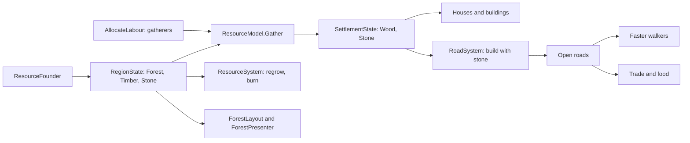

# Milestone 15, part 13 — Wood, stone, forests and roads

## Overview

Part 13 builds what §29 lists among the villages' own decisions but was missing, roads and
gathering, with the resources of §5 and the forests of §93. The decisions are in
[ADR-033](../docs/ADR/ADR-033-resources-gathering-forests-and-roads.md).

What the player gets:

- **Forests and stone:**
  - the land has forests and stone, laid by the seed;
  - trees stand on the island, thick in the forests, sparse on the grassland, white under snow.
- **Gathering:**
  - villages send gatherers out for wood and stone while their stores run short;
  - houses take wood, and buildings wood and stone;
  - cut forests grow back, fire burns them, and cleared land holds fewer animals and slides
    sooner.
- **Roads:**
  - villages build roads to their neighbours with stone;
  - walkers go faster on them, and they carry trade and food to the hungry;
  - floods, fires and landslides cut them until they are mended.
- **Seeing it:**
  - the Settlements panel, the book, alerts and F1;
  - timber and stone on F3;
  - `--roads` and `--stores`.

## Architecture

| Project | Changes |
| --- | --- |
| `Pantheon.Domain` | • `RegionState.Forest`, `Timber`, `Stone` • `SettlementState.Wood`, `Stone` • `Roads/RoadState`, `RoadRules` • `Settlements/ResourceRules` • `SettlementRules.Resources` and `Roads` • `BuildingDefinition.Wood` and `Stone` • `WorldGenSettings.Resources` (`ResourceSettings`), `StartingSettlementSettings.Wood` and `Stone` • `Events/RoadEvents`: `RoadBuilt`, `RoadChanged` • `WorldState.Roads` and `NextRoadId` |
| `Pantheon.Simulation` | • `WorldGen/ResourceFounder` • `Resources/`: `ResourceModel`, `ResourceSystem`, `ResourceRulesValidator` • `Roads/`: `RoadModel`, `RoadSystem` • Gatherers in `AllocateLabour`, house wood in `SettlementSystem`, building materials in `SocietySystem`, settlers' stores in `Expansion` • Cleared forests in `EcologySystem` and `HazardSystem`; timber in the Regrowth miracle and the hand • Roads in `MigrationSystem` and `NotableModel` |
| `Pantheon.Persistence` | • Save version 24 (`ResourceSaveMigration`) • `RoadIntegrity` |
| `Pantheon.Networking` | Protocol 12 and `WorldSection.Roads` |
| `Pantheon.Game` | • `Resources/ResourceText`, `ResourceCommands` • `Alerts/RoadAlerts` • `Diagnostics/ResourceReadout` • `Presentation/ForestLayout`, `RoadLayout` • F3 `Timber` and `Stone` • `--roads`, `--stores` • The Settlements panel's and the book's lines • Region changes and the Roads section |
| Godot client | • `Presentation/Land/`: `ForestPresenter`, `RoadPresenter`, `TreeMeshes` • `Shaders/tree.gdshader` |
| Content | • `settlement_rules.json`: `Resources` and `Roads` • `society.json`: each building's wood and stone • `worldgen.json`: `Resources` and the starting stores |

## The numbers

| Rule | Value |
| --- | --- |
| Forest of grassland, forest and highland, as a factor on vegetation | 0.8, 1.1, 1.6 |
| Their stone | 0.15, 0.2, 0.75 |
| Patches | 500 m, varying the values by up to 60% |
| Starting stores | 30 wood, 15 stone |
| Gatherers, when the stores are empty | 15% of the workforce, from two regions around |
| One gatherer a second, from full land | 0.5 wood or 0.3 stone |
| Stores wanted | 0.4 wood and 0.2 stone a place of housing, at least 30 and 20 |
| A house | 6 wood |
| A building | 5–25 wood and 0–20 stone (a temple 25 and 15) |
| Timber cut per unit of wood | 0.02, shared among the land cut |
| Timber regrowth | 0.3% of the gap a second |
| Fire burning timber | 0.1 a second at full fire |
| A cleared forest's wildlife | half |
| A cleared wet slope's landslides | twice as often |
| Roads | from villages of 50 to neighbours within 700 m; 5% of the workforce laying 0.5 m each a second; 0.02 stone a metre |
| On a road | walkers 1.6 times as fast within 20 m; 0.01 wealth a second to each village; up to 1 food a second to a village with fewer than 10 steps of food |
| Wear | 0.015 a second at full flood, fire or rubble; cut at 0.6; mended 0.005 a second; decays 0.002 a second to a lost village |

## Test plan

- **The land and gathering (`ResourceTests`):**
  - generation lays forests and stone by biome, the same for the same seed;
  - gatherers go out when the stores run short and take wood and stone from the land;
  - bare land yields little, and stony land yields stone;
  - a house takes wood and waits for it;
  - a building waits for its wood and stone and takes them;
  - timber grows back, but not under snow, and fire burns it;
  - a cleared forest holds less wildlife;
  - settlers carry their share of the stores.
- **Roads (`RoadTests`):**
  - a village plans a road to its nearest neighbour in range, one at a time;
  - builders lay it with stone, and a whole road is told;
  - an open road speeds walkers and leads either way;
  - a prophet takes the road;
  - an open road carries trade and food;
  - a flood cuts it, and it is mended;
  - a road to a lost village decays.
- **Presentation (`ResourcePresentationTests`):**
  - the road alerts;
  - the panel, the book, F1, `--roads` and `--stores`;
  - trees by timber, never in the sea, a village or on a road, cutting taking the last first;
  - the road's ribbon along what is built;
  - the F3 layers, region changes and the Roads section.
- **Content (`ContentTests`):** gathering, roads, generation and buildings, each with one value
  broken.
- **Saves (`SaveMigrationV23Tests`):** a part 12 save (`save-v23.json`) loads with forests by biome,
  stores and no roads, and plays on the same way across a save and load, building roads.

### Verification results

- **Build and tests:** `dotnet build` has no warnings, and 1271 tests pass (1240 before).
- **Balance:** over 40 seeds (30–69), 38 games are won within the hour, at a median of 25.7
  minutes and a mean of 27.3 (part 12: 38, at 28.3 and 30.9).
- **Rates:** over ten one-hour games (seeds 100–109):

  | Measure | Per game |
  | --- | --- |
  | Roads built | 28 (12–69, by the villages' number) |
  | Roads cut | 9.5, nearly all reopened |
  | Forest standing at the end | 65–91% |
  | Village-seconds stalled for want of a house's wood | 0–358 |
  | Temples | 8.8 |
- **Cost:** on a Huge world, `ResourceSystem` takes 46 ms and `RoadSystem` 4 ms over 3000
  ticks. The Huge world's visuals build in 1.25 s (about 1.1 s before), and it runs at 118 FPS.
- **On the Mac (seed 42):**
  - **A new world:** conifers on the wooded slopes and broadleaves on the grassland around
    Brightwater, and its first road going out. 245 FPS.
  - **Fifteen minutes in:** roads join the villages over the hills and round the lake, and the
    forests thin near them. 118 FPS on both renderers.
  - **The Settlements panel:** "Wood 71 of 74   stone 33 of 37   1 gathering" and five roads, three
    of them still being built. 120 FPS.
- **Found on the way:**
  - **Pale colours:** the trees and roads first drew nearly white. The colours were sRGB values
    used as linear; they are now converted.
  - **A road the flood never cut:** wear was looked at only at a road's points, and a straight
    road has only its two ends. It is now looked at every half region along the way.
  - **Roads cut too often:** at first 29 cuts a game; slower wear and a higher limit leave 9.5.
  - **Forests cut too fast:** at first only half the forest stood after an hour; lighter cutting
    and faster regrowth leave two thirds to nine tenths.
  - **A road across a lake:** the pathfinder treats a lake as land, so the first roads ran straight
    over the water. Roads now go round a lake's regions.

## Tasks

### Completed

- [x] Forests and stone in the land, from the seed.
- [x] Gathering, stores, and houses and buildings that take wood and stone.
- [x] Timber growing back and burning, and cleared land's wildlife and landslides.
- [x] Roads planned, built, used, worn, mended and decayed, with trade and food relief.
- [x] Trees and roads drawn; the panel, book, alerts, F1, F3 and options.
- [x] Saves (v24), sections (protocol 12), tests, probes and captures.

### Future

- Gatherers and road builders as visible figures.
- Roads inside villages, and trade in goods other than food.
- Ores and other resources.

## Relevant files

- `src/Pantheon.Domain/Roads/`, `Settlements/ResourceRules.cs` and
  `World/Generation/ResourceSettings.cs`
- `src/Pantheon.Simulation/Resources/`, `Roads/` and `WorldGen/ResourceFounder.cs`
- `src/Pantheon.Persistence/ResourceSaveMigration.cs` and `RoadIntegrity.cs`
- `src/Pantheon.Game/Resources/`, `Alerts/RoadAlerts.cs`, `Diagnostics/ResourceReadout.cs`,
  `Presentation/ForestLayout.cs` and `RoadLayout.cs`
- `game/Scripts/Presentation/Land/` and `game/Shaders/tree.gdshader`
- Tests: `src/Pantheon.Tests/Resources/` and `Persistence/SaveMigrationV23Tests.cs`
