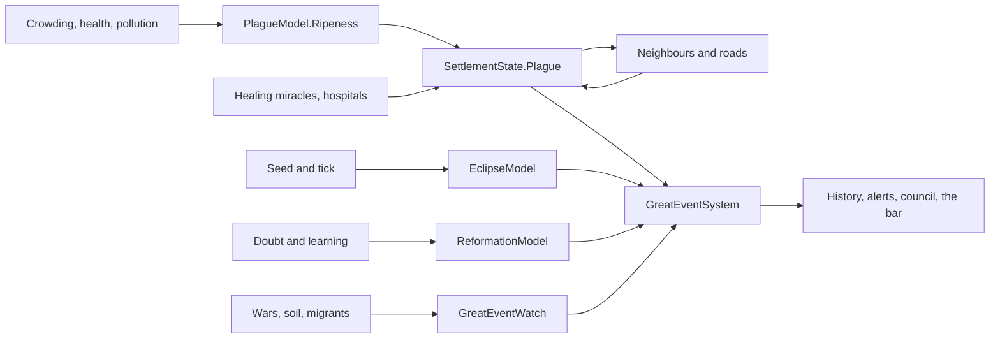

# Milestone 15, part 14 — Great events: plague, eclipses, reformations and world wars

## Overview

Part 14 builds §52's world events from the world's own state and the seed. The decisions are in
[ADR-034](../docs/ADR/ADR-034-great-events-plague-eclipses-reformations-and-world-wars.md).

What the player gets:

- **The plague:**
  - it breaks out in crowded, sick, polluted villages and spreads to neighbours and along roads;
  - hospitals, medicine and healing miracles fight it;
  - three villages sick at once make a great plague, and the council meets to coordinate the
    response.
- **Eclipses:** the sun goes dark at seeded times, frightening everyone, and a miracle worked in
  the dark awes twice as much.
- **Reformations:** a doubting faith whose villages have learned reforms itself, at a cost.
- **World war, great drought and great migration:** named times the whole world lives through.
- **Seeing them:**
  - alerts, the top bar, the book, the history, the "plague" label and the danger overlay;
  - F1, `;` and `--great-event`.

## Architecture

| Project | Changes |
| --- | --- |
| `Pantheon.Domain` | • `GreatEvents/`: `GreatEventState`, `GreatEventsState`, `GreatEventKind`, `GreatEventRules` (`PlagueRules`, `EclipseRules`, `ReformationRules`, `GreatEventNames`) • `SettlementState.Plague`, `Immunity` • `WorldState.GreatEvents` • `DisasterRules.GreatEvents` • `Events/GreatEventEvents`: `GreatEventBegan`, `GreatEventEnded`, `PlagueStruck` • `HistoryKind` Plague, Eclipse, Reformation, WorldWar, GreatDrought, GreatMigration |
| `Pantheon.Simulation` | • `GreatEvents/`: `PlagueModel`, `EclipseModel`, `ReformationModel`, `GreatEventWatch`, `GreatEventModel`, `GreatEventSystem` (after `HazardSystem`), `GreatEventRulesValidator` • The heal's cure in `MiracleEffects` and the eclipse's awe in `MiracleCaster` • The council's summons and `Struck` • `HistoryRecorder` |
| `Pantheon.Persistence` | • Save version 25 (`GreatEventSaveMigration`) • `GreatEventIntegrity` |
| `Pantheon.Networking` | Protocol 13 and `WorldSection.GreatEvents` |
| `Pantheon.Game` | • `GreatEvents/GreatEventText`, `GreatEventCommands` • `Alerts/GreatEventAlerts` • `Diagnostics/GreatEventReadout` • The top bar, the book's section, the label mark and the danger overlay • `--great-event` • `WeatherViewSettings.EclipseDarkness` |
| Godot client | • `WeatherPresenter` darkens the sun, sky and ambient light in an eclipse • `;` (`debug_great_event`) |
| Content | • `disasters.json`: `GreatEvents` • `weather_view.json`: `EclipseDarkness` |

## The numbers (`disasters.json`, `GreatEvents`)

| Rule | Value |
| --- | --- |
| Outbreaks at the worst | 3 an hour, from crowding above 0.9 of the housing |
| Infection | 5% of the healthy who are not immune a second, at full sickness |
| Recovery | 2% of the sick a second, immune |
| Immunity's fade | 0.02% a second, about an hour to halve |
| Health lost at full sickness | 0.008 a second |
| Catching | from a neighbour within 500 m at 1% a second at full sickness, or along a road at 2% |
| Shields | a hospital 40%, each level of medicine 8% |
| A heal's cure | twice its healing |
| A great plague | 3 villages sick at once |
| Eclipses | first at 20–35 minutes, then every 30–45 minutes, for 45 seconds; fear +0.12, doubt +0.06; awe ×2 |
| Reformation | doubt 0.45, learning 0.25, 3 villages; keeps 40% of the doubt, +0.15 faith, 30% of the doubting leave; once in 30 minutes |
| World war | 80% of the gods, at least 3; lasts while all but one fight; +0.0005 fear a second |
| Great drought | the land's soil at 0.25 or below for 2 minutes |
| Great migration | a fifth of the people on the road, until fewer than half as many are |

## Test plan

- **The simulation (`GreatEventTests`):**
  - a village's ripeness for plague;
  - the plague's course to its end, with immunity;
  - shields, catching by contact and by road, and the cure;
  - the great plague, which the council answers;
  - eclipses from the seed, their dread and awe;
  - a reformation and its cooldown;
  - world war and its fear;
  - great drought and great migration;
  - the same world across a save.
- **Presentation (`GreatEventPresentationTests`):**
  - the alerts and the history;
  - the commands, the bar, the darkness, the book, the label and F1;
  - the option, the section and the rules.
- **Content (`ContentTests`):** the plague, the eclipse's waits and the names, broken.
- **Saves (`SaveMigrationV24Tests`):** a part 13 save (`save-v24.json`) loads with nobody sick and
  no great event, and sets its first eclipse.

### Verification results

- **Build and tests:** `dotnet build` has no warnings, and 1293 tests pass (1271 before).
- **Balance:** over 40 seeds (30–69), 37 games are won within the hour, at a median of 25.0
  minutes and a mean of 27.4 (part 13: 38, at 25.7 and 27.3).
- **Rates:** over ten one-hour games (seeds 100–109):

  | Event | Per game |
  | --- | --- |
  | Eclipses | 1.1 |
  | World wars | 0.7 |
  | Reformations | 0.5 |
  | Plague outbreaks | 0.8, spreading 0.8 times |
  | Great plagues | 0.2 |

- **On the Mac (seed 42, five minutes in):**
  - **Eclipse:** "The Dark Noon: the sun is dark (0:41 left)" in the top bar, the land in dusk,
    and the alert. 120 FPS on both renderers.
  - **Plague:** Brightwater's label says "plague", its lands are sickly green on the danger
    overlay, and the alert tells you to heal it. 118 FPS.
- **Found on the way:**
  - **A plague that never ended:** with immunity fading in a few minutes, the sickness settled in
    for good. Immunity now lasts about an hour, and a plague burns out in about nine minutes.
  - **World wars that flickered:** with four gods, three at war began a world war, which started
    and stopped as wars did, in eight of ten games. It now takes four fifths of the gods, and lasts
    while all but one fight.
  - **The eclipse barely darkened the land:** the sky's ambient light lit it. The sky and ambient
    light now dim with the sun.
  - **Great migrations every winter:** the seasons send many people on the road each year. A great
    migration now takes a fifth of the people.

## Tasks

### Completed

- [x] The plague: outbreaks, course, spread, shields, cures, the great plague and the council.
- [x] Eclipses, reformations, world wars, great droughts and great migrations.
- [x] Alerts, history, the top bar, the book, labels, the overlay, F1, `;` and `--great-event`.
- [x] The eclipse's darkness on both renderers.
- [x] Saves (v25), sections (protocol 13), tests, probes and captures.

### Future

- The ancient monster and the magical anomaly of §52 (part 15).
- Peace motions in the council during a world war.

## Relevant files

- `src/Pantheon.Domain/GreatEvents/` and `Events/GreatEventEvents.cs`
- `src/Pantheon.Simulation/GreatEvents/`
- `src/Pantheon.Persistence/GreatEventSaveMigration.cs` and `GreatEventIntegrity.cs`
- `src/Pantheon.Game/GreatEvents/`, `Alerts/GreatEventAlerts.cs` and
  `Diagnostics/GreatEventReadout.cs`
- `game/Scripts/Presentation/Weather/WeatherPresenter.cs`
- Tests: `src/Pantheon.Tests/GreatEvents/` and `Persistence/SaveMigrationV24Tests.cs`
