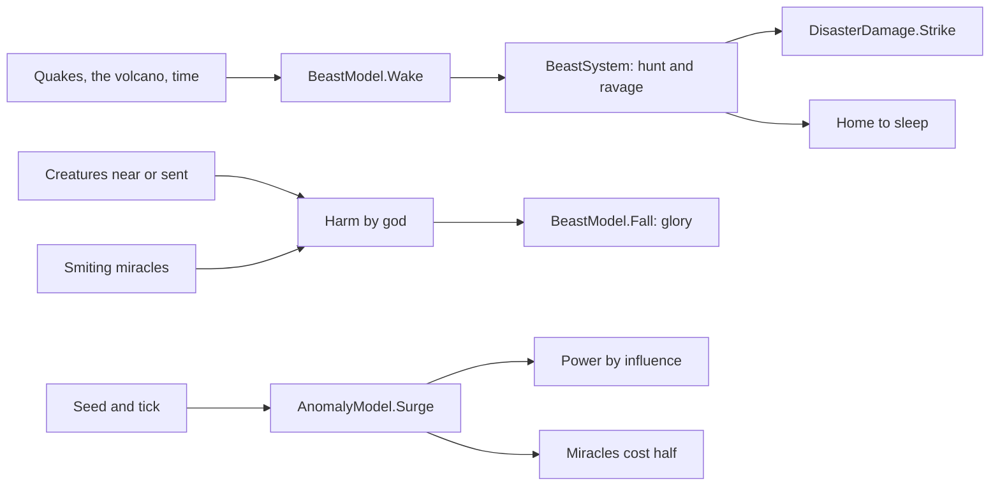

# Milestone 15, part 15 — The ancient beast and the magical anomaly

## Overview

Part 15 completes §52's world events with its last two examples. The decisions are in
[ADR-035](../docs/ADR/ADR-035-the-ancient-beast-and-the-magical-anomaly.md).

What the player gets:

- **The ancient beast:**
  - it sleeps on the island's heights, and once the world has grown, a great quake, the volcano or
    time wakes it;
  - it ravages village after village until slain or tired;
  - Creatures and smiting miracles fight it, and AI gods send theirs;
  - when it falls, every god that harmed it shares the glory.
- **The magical anomaly:** a column of violet light where, for three minutes, miracles cost half and
  the gods draw power by their influence.

## Architecture

| Project | Changes |
| --- | --- |
| `Pantheon.Domain` | • `GreatEvents/BeastState` (`BeastPhase`), `BeastRules`, `AnomalyRules` • `GreatEventsState.Beast` and `NextAnomalyTick` • `GreatEventState.Position` • `GreatEventKind` Beast, Anomaly • `DisasterKind.Beast`, `Preparedness.BeastWalls` • `Events.BeastSlain` • `HistoryKind` Beast, BeastSlain, Anomaly |
| `Pantheon.Simulation` | • `GreatEvents/BeastModel`, `BeastSystem` (after `GreatEventSystem`), `AnomalyModel` • Smiting in `MiracleEffects` • The anomaly's cost in `MiracleCaster` • Walls in `DisasterDamage` |
| `Pantheon.Persistence` | Save version 26 (`BeastSaveMigration`); the beast in `GreatEventIntegrity` |
| `Pantheon.Networking` | Protocol 14 |
| `Pantheon.Game` | • `GreatEventText.Beast` and the anomaly's line • The alerts, the history, F1's beast line • The `;` cycle and `--great-event=beast\|anomaly` |
| Godot client | • `Presentation/GreatEvents/GreatEventPresenter` • The start option looks at the beast or the anomaly |
| Content | • `disasters.json`: `GreatEvents.Beast`, `GreatEvents.Anomaly`, the anomaly's names, `Preparedness.BeastWalls` • `divine_view.json`: the "Beast" look and `AnomalyColor` |

## The numbers

| Rule | Value |
| --- | --- |
| The beast's first sleep | 25 minutes; then it wakes half a time an hour, or at a quake of 6 or the volcano within 900 m |
| Its health | 100, healing 0.15 a second when unharmed |
| Awake | up to 10 minutes; 3 m/s; a minute at each village, a blow every 10 seconds (6% of the houses, 3% of the people) |
| Walls | spare half its harm |
| A Creature fighting it | within 25 m, harms 0.6 a second per unit of power, loses 0.025 health a second, flies at 0.2 |
| Miracles | smiting harms twice its amount; fire 0.5 a second |
| Calling | AI gods' Creatures within 700 m of a ravaged village of theirs |
| Glory | faith +0.12, love +0.15, doubt −0.08, by each god's share of the harm |
| The anomaly | first at 15–25 minutes, then every 25–40 minutes, for 3 minutes; 250 m; miracles at half; 4 power a second at full influence |

## Test plan

- **The simulation (`BeastTests`):**
  - the lair and the name;
  - waking from a great quake, only after the first sleep;
  - walking to and ravaging the nearest village, then the next;
  - Creatures fighting it, and fleeing beaten;
  - a smiting miracle's harm, the fall and the glory shared;
  - going home tired, to sleep whole;
  - the anomaly's timing, power and cheaper miracles.
- **Presentation (`BeastPresentationTests`):**
  - the alerts and the history;
  - the commands, the bar and the section;
  - an AI god's Creature sent to fight;
  - broken rules rejected.
- **Saves (`SaveMigrationV25Tests`):** a part 14 save (`save-v25.json`) loads without a beast or
  anomaly yet, and plays on the same way, finding its lair.

### Verification results

- **Build and tests:** `dotnet build` has no warnings, and 1310 tests pass (1293 before).
- **Balance:** over 40 seeds (30–69), 38 games are won within the hour, at a median of 25.7
  minutes and a mean of 27.8 (part 14: 37, at 25.0 and 27.4).
- **Rates:** over ten one-hour games (seeds 100–109):

  | Event | Per game |
  | --- | --- |
  | The beast waking, from 25 minutes in | 2.0 |
  | Its blows | 34 |
  | The beast slain | 0.4 |
  | The anomaly | 1.8 |

- **On the Mac (seed 42):**
  - **The beast:** Vhorun the Deep on its mountain, "coming for Duskwater (100%)", with the alert,
    at 113 FPS.
  - **The anomaly:** the Shimmering's violet column over Brightwater, at 114 FPS.
  - **Fallback terrain:** the beast wakes on its mountain, at 115 FPS.
- **Found on the way:**
  - **A slain beast got up:** it healed before the check for its fall. A fallen beast no longer
    heals.
  - **The beast woke in the first minutes:** a quake or the volcano near its lair woke it early,
    in half the games by seven minutes. Nothing wakes it now in its first 25 minutes.

## Tasks

### Completed

- [x] The ancient beast: lair, waking, rampage, fights, calls, fall and glory, going home.
- [x] The magical anomaly: surge, power and cheaper miracles.
- [x] Their visuals, alerts, history, F1, commands and options.
- [x] Saves (v26), the protocol (14), tests, probes and captures.

### Future

- Creatures that choose for themselves to fight the beast.
- The beast's harm to the land.

## Relevant files

- `src/Pantheon.Domain/GreatEvents/BeastState.cs` and `BeastRules.cs`
- `src/Pantheon.Simulation/GreatEvents/BeastModel.cs`, `BeastSystem.cs` and `AnomalyModel.cs`
- `src/Pantheon.Persistence/BeastSaveMigration.cs`
- `game/Scripts/Presentation/GreatEvents/GreatEventPresenter.cs`
- Tests: `src/Pantheon.Tests/GreatEvents/BeastTests.cs`, `BeastPresentationTests.cs` and
  `Persistence/SaveMigrationV25Tests.cs`
