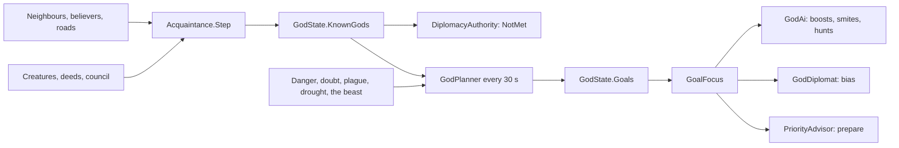

# Milestone 15, part 16 — Known gods and the gods' long-term plans

## Overview

Part 16 gives the gods §11's known gods and the AI §47's long-term goals with §87's major
planning. The decisions are in
[ADR-036](../docs/ADR/ADR-036-known-gods-and-the-gods-long-term-plans.md).

What the player gets:

- **Meeting the gods:**
  - a god knows only the gods it has met: as neighbours, through shared believers, a road, their
    Creatures, their deeds or the Divine Council;
  - until then the two cannot ally, war, sign or ask;
  - the P panel and the top bar say "not yet met", and an alert tells the player whom they met and
    how.
- **The gods' plans:**
  - every 30 seconds an AI god sets itself up to three goals: protect its home, convert a village,
    befriend or weaken a god, prepare for the plague or drought, slay the beast, or win back its
    doubters;
  - its miracles, Creature, diplomacy and villages' priorities lean towards them;
  - a well-informed player sees a rival's goals.

## Architecture

| Project | Changes |
| --- | --- |
| `Pantheon.Domain` | • `Gods/GodGoal` (`GodGoalKind`), `PlanningRules` • `GodState` `KnownGods`, `Goals`, `NextPlanTick` • `GodAiRules.Planning` • `Diplomacy/AcquaintanceRules`, `DiplomacyRules.Acquaintance` • `Events/GodsMet` (`MeetingWay`), `GodGoalTaken` • `HistoryKind.GodsMet` |
| `Pantheon.Simulation` | • `Diplomacy/Acquaintance` (in `DiplomacySystem`), `DiplomacyRejection.NotMet` • `Gods/GodPlanner` (`GoalOption`), `GoalFocus` • `GodAi` plans, boosts, smites and hunts; `GodDiplomat` deals only with known gods, with the goals' bias • `PriorityAdvisor` prepares • `HistoryRecorder` |
| `Pantheon.Persistence` | Save version 27 (`PlanSaveMigration`), `PlanIntegrity` |
| `Pantheon.Networking` | Protocol 15 |
| `Pantheon.Game` | • `Gods/GoalText`, `Alerts/GodAlerts` • `DiplomacyEntry.Met` and goals in the intelligence line • The top bar's "not yet met" • F1's plans, `SessionPreviews.PreviewGodGoals` • `PoliticsCommands.MeetAll`, `--gods-met` |
| Godot client | • `DiplomacyPanel` shows unmet gods • `GameRoot` passes the goal options to F1 • `PoliticsController` applies `--gods-met` |
| Content | • `god_ai.json`: `Planning` • `diplomacy.json`: `Acquaintance` |

## The numbers

| Rule | Value |
| --- | --- |
| Meeting | Villages within 500 m; 5% of a village each; a whole road; Creatures that met; deeds; any stance, treaty or proposal; the council |
| Planning | Every 30 s; up to 3 goals, one of each kind, of weight 0.35 or more; each held 90 s unless moot |
| Protect | Danger 0.3 or more: the beast hunting the home (1), an enemy's Creature within 300 m (0.8), the plague (twice its share) |
| Convert | Within 700 m of a village it leads |
| Prepare | The plague, or the land's dryness past 0.65 |
| Win back | Its followers' mean doubt 0.3 or more |
| Effects | Serving actions up to ×2 by weight; 0.1 of diplomatic bias at full weight |

## Test plan

- **The simulation:**
  - `AcquaintanceTests`:
    - meeting as neighbours, through a shared village, a road, Creatures, deeds and the council;
    - the authority's `NotMet`, and the pinned rules where everyone knows everyone;
    - the diplomat dealing only with known gods;
    - the history of meetings.
  - `PlannerTests`:
    - the beast at the door, and the most goals;
    - converting within reach but not an ally's village;
    - befriending and weakening only known gods, with rest as neither friendship nor hate;
    - preparing for the plague and drought, and winning back doubters;
    - holding young goals, dropping moot ones and rethinking old ones;
    - the boosts and biases by weight;
    - an AI god smiting the beast it means to slay.
- **Presentation (`PlanPresentationTests`):**
  - the meeting alert and the P panel's unmet gods and goals;
  - F1's plans, the words and the chronicle;
  - `--gods-met`.
- **Diplomacy tests:** the existing ones that deal at the start now introduce the gods first, and
  the top bar test checks "not yet met".
- **Content (`ContentTests`):** a broken boost, doubt, shared share and neighbour distance are
  rejected.
- **Saves (`SaveMigrationV26Tests`):** a part 15 save (`save-v26.json`) loads with every god knowing
  every other and no goals, keeps every other value, plays on the same way, and rejects broken goals
  and known gods.

### Verification results

- **Build and tests:** `dotnet build` has no warnings, and 1338 tests pass (1310 before).
- **Balance:** over 40 seeds (30–69), 34 games are won within the hour, at a median of 24.5
  minutes and a mean of 28.5 (part 15: 38, at 25.7 and 27.8).
  - Over 160 seeds (30–189), 150 are won (part 15: 155).
  - Requiring gods to meet first changes nothing (79 of 80 won, mean 30.2, against 78 and 30.2).
  - The plans draw out a few games: weaker gods plan to weaken the leader.
- **Meetings and goals:** over ten one-hour games (seeds 100–109):
  - gods first meet a median 2.3 minutes in, and all have met by a median of 6.1;
  - meetings come as neighbours 28 times, in the council 13, through Creatures 9, by deeds 9 and in
    a shared village once;
  - per game the gods set out about 18 times to convert, 8 to weaken, 6 to befriend, 6 to win back
    doubters, 5 to protect a home and 3 to slay the beast.
- **On the Mac (seed 42):**
  - **Two minutes in:** the P panel shows Vael the Tyrant "Not yet met", with how gods meet, while
    Seren and Kaio, met through the Creatures, can be dealt with. The top bar reads "not yet met".
    120 FPS.
  - **Five minutes in:** F1 shows each AI god's plans, for example Vael "weaken Kaio 0.50 for 88s;
    next plan in 2s; knows Ilyra, Seren, Kaio", and Kaio's casts "goal: convert Brightwater". 120 FPS.
  - **`--gods-met=on`:** four alerts, "You have met Kaio the Trickster, in the Divine Council…",
    and every god open to dealings. 119 FPS.
  - **Fallback terrain:** the same panel at 120 FPS.
- **Found on the way:**
  - **Goals that drew the games out:** with every goal, however slight, worth half as much again,
    the AI won 65 of 80 games against 77. The boost now scales with the goal's weight, and only goals
    of weight 0.35 count.
  - **Friendship never came:** gods at rest are cool (starting rivalry and suspicion), so no god
    ever set out to befriend another, and a fresh relation counted as hate. Feelings are now
    measured from rest.
  - **A bolt on the beast struck the god's own people:** the beast stands in the village it
    ravages. The smite is worth less, by half, the more of the god's people live there.

## Tasks

### Completed

- [x] Known gods: meeting, the authority's check, the AI's knowledge, alerts, history, the panel
  and the top bar.
- [x] Major planning: seven kinds of goal, weights, hysteresis and announcements.
- [x] Goals' effects on casts, the Creature, the beast, diplomacy and priorities.
- [x] F1, the intelligence line, `--gods-met`.
- [x] Saves (v27), the protocol (15), tests, probes and captures.

### Future

- Gods forgetting each other, and unknown gods' names hidden.
- Goals for treaties: asking a favour of a god it means to befriend.

## Relevant files

- `src/Pantheon.Domain/Gods/GodGoal.cs`, `PlanningRules.cs` and `Diplomacy/AcquaintanceRules.cs`
- `src/Pantheon.Simulation/Diplomacy/Acquaintance.cs`
- `src/Pantheon.Simulation/Gods/GodPlanner.cs` and `GoalFocus.cs`
- `src/Pantheon.Persistence/PlanSaveMigration.cs` and `PlanIntegrity.cs`
- `src/Pantheon.Game/Gods/GoalText.cs` and `Alerts/GodAlerts.cs`
- Tests: `src/Pantheon.Tests/Gods/AcquaintanceTests.cs`, `PlannerTests.cs`,
  `PlanPresentationTests.cs` and `Persistence/SaveMigrationV26Tests.cs`
