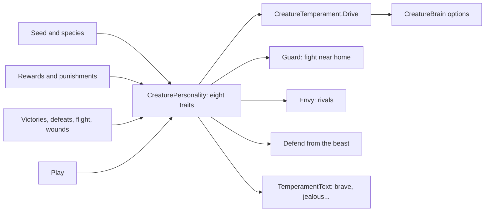

# Milestone 15, part 17 — Creature temperament

## Overview

Part 17 completes §26's Creature personality. The decisions are in
[ADR-037](../docs/ADR/ADR-037-creature-temperament.md).

What the player gets:

- **A character for every Creature:** brave or cowardly, kind or sadistic, protective, jealous,
  playful, curious, lazy, aggressive, and loyal or independent, shown on its card, in the book and
  in F1.
- **Character in what it does:**
  - a brave Creature fights where a coward runs;
  - a protective one stands its ground near its god's people, and defends them from the beast by
    itself;
  - a jealous one makes rivals of stronger Creatures;
  - a playful one plays.
- **Character that changes:** rewards and punishments shape it, victories embolden, defeats and
  wounds cow and embitter, play makes it playful.

## Architecture

| Project | Changes |
| --- | --- |
| `Pantheon.Domain` | • `CreaturePersonality` `Courage`, `Protectiveness`, `Jealousy`, `Playfulness` • `CreatureSpecies` modifiers for them • `TemperamentRules`, `CreatureRules.Temperament` • `Events/CreatureDefending` |
| `Pantheon.Simulation` | • `Creatures/CreatureTemperament` (`CreatureTrait`, `TraitDrive`): traits behind actions, drives, judgement, guard, envy, defending, wounds; replaces `CreatureModel.TraitOf/Get/Nudge` • Hooks in `CreatureBrain` (drives, `Defend`), `CreatureAuthority`, `CreatureCombat`, `CreatureMeetings`, `CreatureDeeds`, `CreatureBonds.Drives`, `CreatureCalling`, `CreatureFounder`, `BeastSystem` and `MiracleEffects` |
| `Pantheon.Persistence` | Save version 28 (`TemperamentSaveMigration`); the traits in `CreatureIntegrity` |
| `Pantheon.Networking` | Protocol 16 |
| `Pantheon.Game` | • `Creatures/TemperamentText` • `CreatureCard.Character`, F1 and the book's character • The defending alert • `CreatureCommands.SetTemperament`, `--temperament` • "going to defend" for a self-chosen errand |
| Godot client | • The Creature card's character line (`Hud`) • `NatureDebug` applies `--temperament` |
| Content | `creatures.json`: species modifiers and `Temperament` |

## The numbers (`creatures.json`, `Temperament`)

| Rule | Value |
| --- | --- |
| Guarding | Within 250 m of a village its god leads, +0.2 × protectiveness to fight, − as much to flee |
| Defending | Protectiveness × courage ≥ 0.3 |
| Envy | +0.03 × jealousy of rivalry on meeting a stronger Creature |
| Courage | +0.04 per victory, −0.08 per defeat, −0.02 per flight, −0.1 × health lost to a wound |
| Jealousy | +0.05 per defeat, −0.01 per reward, +0.01 per punishment |
| Playfulness | +0.02 per game with another Creature |
| Species | Stonehide courage +0.15, playfulness −0.1; Lumen playfulness +0.15, courage −0.1; Swiftclaw jealousy +0.15; Mossback protectiveness +0.1, jealousy −0.1 |
| Names | A trait at 0.65 or more (its opposite at 0.35 or less); loyal at 0.8, independent at 0.4 |

## Test plan

- **The simulation (`TemperamentTests`):**
  - the traits behind each action and their drives;
  - birth from the seed and species;
  - victory emboldening, defeat cowing and embittering;
  - a coward running and cowed further;
  - guarding near home but not against a friend;
  - envy of a stronger, non-allied Creature;
  - defending from the beast: a brave, protective Creature goes, a coward does not, nor one sent
    elsewhere;
  - wounds and judgement.
- **Presentation (`TemperamentPresentationTests`):**
  - §26's words for every character;
  - the card, the book and F1;
  - `--temperament` with a warning for unknown words;
  - the defending alert only for the player's Creature.
- **Updated:** `CreatureModelTests` (judgement through `CreatureTemperament`) and `CallingTests`
  (all eight traits set).
- **Content (`ContentTests`):** a broken guard, courage loss and species courage are rejected.
- **Saves (`SaveMigrationV27Tests`):** a part 16 save (`save-v27.json`) gives every Creature 0.5 of
  each new trait, keeps every other value and plays on the same way.

### Verification results

- **Build and tests:** `dotnet build` has no warnings, and 1359 tests pass (1338 before).
- **Balance:** over 40 seeds (30–69), 33 games are won within the hour, at a median of 22.3 minutes
  and a mean of 27.2 (part 16: 34, at 24.5 and 28.5). Over 160 seeds (30–189), 141 are won (part
  16: 150).

  | Variant (160 seeds) | Wins |
  | --- | --- |
  | Temperament rules off, new drives kept | 149 |
  | No guarding or envy | 146 |
  | No jealousy's growth or envy | 144 |
  | No courage's growth | 139 |
  | Guarding 0.4 and envy 0.06 (first values) | 139 |
  | Guarding 0.2 and envy 0.03 (shipped) | 141 |

- **Creatures:** over ten one-hour games (seeds 100–109), compared with part 16:

  | Encounter | Part 16 | Part 17 |
  | --- | --- | --- |
  | Fights | 11 | 14 |
  | Games of play | 8 | 13 |
  | Flights | 17 | 13 |

  Their 40 Creatures end:
  - 13 playful, 11 kind, 11 brave, 9 cowardly, 9 aggressive, 9 lazy, 9 curious;
  - 8 protective, 8 jealous, 5 sadistic, 3 loyal;
  - 2 even-tempered.
- **On the Mac (seed 42):**
  - **`--temperament=brave,protective,playful --book=creature`:** the card reads "brave, kind,
    protective and playful", and the book "It is brave, kind, protective and playful: kind 0.72 …
    brave 0.90 protective 0.90 jealous 0.37 playful 0.90". 116 FPS.
  - **Fallback terrain, `--temperament=cowardly,jealous,independent`:** the card reads "cowardly,
    kind, playful, jealous and independent", with loyalty 30%. 112 FPS.
- **Found on the way:**
  - **Guarding against a friend:** a protective Creature at home wanted to fight even a friend.
    Guarding now leaves friends and allies' Creatures alone.
  - **No Creature defended itself:** at 0.36 hardly any Creature was brave and protective enough
    in ten games. The threshold is now 0.3.
  - **Leak warning at exit:** Godot sometimes warns that 2–6 objects were leaked at exit, in about
    one run in four, also without any of this part's options. Part 15's build does the same (one
    of eight plain runs, against one of eight for this build), so it predates parts 16 and 17. Runs
    with `--verbose` never showed it. It is not yet traced.

## Tasks

### Completed

- [x] Four new traits, born from the seed and species, named in §26's words.
- [x] Traits behind every action; guarding, envy, defending and mercy.
- [x] Evolution by reinforcement, divine treatment, experience, trauma and relationships.
- [x] The card, the book, F1, the alert and `--temperament`.
- [x] Saves (v28), the protocol (16), tests, probes and captures.

### Future

- Trace the intermittent leak warning at exit.
- Named-trait milestones in the history ("Bramble grew brave").

## Relevant files

- `src/Pantheon.Domain/Creatures/CreaturePersonality.cs`, `TemperamentRules.cs` and
  `CreatureSpecies.cs`
- `src/Pantheon.Simulation/Creatures/CreatureTemperament.cs`
- `src/Pantheon.Persistence/TemperamentSaveMigration.cs`
- `src/Pantheon.Game/Creatures/TemperamentText.cs`
- Tests: `src/Pantheon.Tests/Creatures/TemperamentTests.cs`,
  `TemperamentPresentationTests.cs` and `Persistence/SaveMigrationV27Tests.cs`
