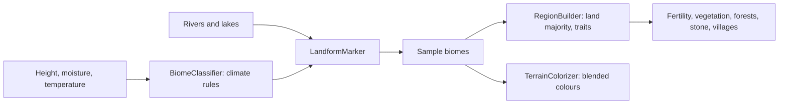

# Milestone 15, part 18 — The biomes of the world

## Overview

Part 18 gives the island every biome §5 lists. The decisions are in
[ADR-038](../docs/ADR/ADR-038-the-biomes-of-the-world.md).

What the player gets:

- **Biomes by climate:** tundra below the heights, desert where it is hot and dry, swamp where it
  is wet and low, beside grassland, forest and highland.
- **Biomes by place:** islands off the main one, coasts, river valleys and the volcanic land
  around the volcano.
- **Their effects and looks:**
  - each has its own fertility, growth, wood and stone, so villages crowd into the fertile valleys
    and the deserts stay empty;
  - each has its own colour, blending softly into its neighbours on both renderers;
  - the book counts the land by biome.

## Architecture

| Project | Changes |
| --- | --- |
| `Pantheon.Domain` | • `Ecology/Biome` Desert, Tundra, Swamp, Coast, RiverValley, Island, Volcanic (appended) • `World/Generation/LandformSettings`, `LandformTraits` • `WorldGenSettings.Landforms` |
| `Pantheon.Simulation` | • `WorldGen/LandformMarker`, run by `TerrainGenerator` • `RegionBuilder`'s land majority with landforms, and `Traits` • `WorldGenSettingsValidator` checks the landforms |
| `Pantheon.Persistence` | Save version 29 (`LandformSaveMigration`) |
| `Pantheon.Networking` | Protocol 17 |
| `Pantheon.Game` | • `BiomePalette`: seven colours and `BiomeBlendMetres` • `TerrainColorizer`'s blend • `Presentation/BiomeText` (names and the census) • The book's land line • Tundra conifers in `ForestLayout` • The volcano threshold check in `GameContent` |
| Content | • `worldgen.json`: Tundra, Desert and Swamp rules, `Landforms`, resources for every biome • `biome_palette.json`: the colours and the blend |

## The numbers

| Biome | Where | Fertility | Vegetation |
| --- | --- | --- | --- |
| Tundra | Colder than 0.40 | 0.30 | 0.35 |
| Desert | At least 0.56 warm, below 0.40 moisture | 0.25 | 0.10 |
| Swamp | At least 0.80 moisture, below 8 m | 0.50 | 0.85 |
| Island | Land masses under 0.12 km² but the largest | 0.70 | 0.60 |
| Volcanic | Within 140 m (in lobes) of the highest land region's centre, when it rises 60 m | 0.80 | 0.25 |
| River valley | Grassland, forest, desert or tundra within 30 m of fresh water, up to 40 m | 1.00 | 0.65 |
| Coast | Grassland or forest within 32 m of the sea, up to 10 m | 0.65 | 0.35 |

## Test plan

- **The simulation:**
  - `LandformTests`:
    - a synthetic field's islet, volcano, valley and coast;
    - the volcano needing a high enough peak;
    - shipped-style worlds with every biome, the volcano on volcanic land, and land not lost to the
      sea;
    - test worlds keeping four biomes;
    - landform traits.
  - `BiomeClassifierTests`: the shipped rules' tundra, desert and swamp.
- **Presentation (`BiomePresentationTests`):**
  - a colour and a name for every biome;
  - volcanic ash coloured dark;
  - the book's census.
- **Content (`ContentTests`):** the shipped biome list and landforms; a broken coast distance, a
  volcano threshold out of step with `disasters.json`, and repeated traits are rejected.
- **Saves (`SaveMigrationV28Tests`):** a part 17 save (`save-v28.json`) loads with no landforms and
  grows its old terrain, keeps every other value and plays on the same way; a world with every
  biome round-trips.
- **Updated:** `HolySiteTests` (the sacred peak may stand on volcanic land).

### Verification results

- **Build and tests:** `dotnet build` has no warnings, and 1379 tests pass (1359 before).
- **The land:** over ten shipped worlds:
  - grassland 23%, forest 20%, coast 17%, river valley 9%;
  - swamp 8%, highland 7%, volcanic land 6%;
  - desert 5%, tundra 3%, island 2%.

  Villages are founded on grassland 30 times, in river valleys 21 and in forest 10. The volcano
  always stands on volcanic land.
- **Balance:** over 160 seeds (30–189), 138 games are won within the hour (part 17: 141). Over
  seeds 30–69, 35 are won at a median of 27.5 minutes and a mean of 32.6.
- **On the Mac:**
  - **Seed 42, the Sacred Peak (the volcano):** a dark, lobed apron of ash around the peak, river
    valleys greener along the rivers. 108 FPS.
  - **Seed 1234, fallback terrain:** sand, ash and valleys from afar. 107 FPS.
  - **Terrain build:** 431 ms for seed 42 (389 before).
- **Found on the way:**
  - **The sea took the coast:** with land split among more biomes, the sea became the most common
    biome of mixed coastal regions. With landforms, a region is land when most of its samples are.
  - **Desert and tundra were too rare to see:** at first they covered 0.7% and 1% of the land, and
    the coast turned desert shores into coast. Desert now needs 0.56 warmth and below 0.40
    moisture, tundra lies below 0.40 warmth, and the coast takes only grassland and forest.
  - **A circle of ash:** the volcanic land was a perfect disc with a hard edge. It now spreads in
    lobes, and every biome's colour blends over 8 m. A sliding filter kept the cost to about 40 ms.

## Tasks

### Completed

- [x] Tundra, desert and swamp by climate; islands, volcanic land, river valleys and coasts by
  place.
- [x] Their fertility, vegetation, wood and stone; regions that keep their land.
- [x] Colours, blending, names, the book's census and tundra conifers.
- [x] Saves (v29), the protocol (17), tests, probes and captures.

### Future

- Walking costs by biome, fishing on the coast, and sickness in the swamp.
- Palms and cacti.
