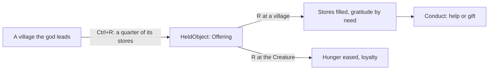

# Milestone 15, part 19 — Offerings

## Overview

Part 19 completes §55's list of what the Divine Hand does, with offerings. The decisions are in
[ADR-039](../docs/ADR/ADR-039-offerings.md).

What the player gets:

- **Taking:** Ctrl+R takes an offering from the stores of a village that follows you: a quarter of
  its food, wood and stone. Its people are glad you accept it.
- **Giving:** R gives the offering to the village or the Creature you point at.
  - A village's stores fill, and it is grateful by its need.
  - Your Creature eats the food and grows more loyal.
- **Being seen:** generous gods are seen as generous.

## Architecture

| Project | Changes |
| --- | --- |
| `Pantheon.Domain` | • `HandAction.TakeOffering` • `HeldKind.Offering`, `HeldObject.Food`, `Wood`, `Stone` • `HandRejection.NoOffering`, `NoPlaceForOffering` • `HandRules`' offering rules • `Events/OfferingGiven` |
| `Pantheon.Simulation` | `Hand/HandOfferings`, used by `HandAuthority` |
| `Pantheon.Persistence` | Save version 30 (`OfferingSaveMigration`); stores checked in `HandIntegrity` |
| `Pantheon.Networking` | Protocol 18 |
| `Pantheon.Game` | • `HandCommands.ActionFor`'s Ctrl • `HandText.Given`, `Goods` • `HandAtStart.Offering` (`--hand=offering`) |
| Godot client | • Ctrl+R in `GameRoot` and `DivineController` • The basket in `HeldThing` and `DivineHand` |

## The numbers (`HandRules`)

| Rule | Value |
| --- | --- |
| An offering | A quarter of the stores, at most 80 food, 20 wood and 12 stone |
| Accepted | Faith +0.03, love +0.02, doubt −0.01 |
| A gift | Love +0.12, faith +0.04, doubt −0.04 at full food need; half as much with none |
| The Creature | Hunger −0.01 per food, loyalty +0.02 |

## Test plan

- **The simulation (`OfferingTests`):**
  - taking from a village the god leads, not from another god's or an empty store;
  - giving to a hungry village earns more love than to a full one;
  - giving back home earns nothing;
  - empty land keeps the offering in the hand;
  - the Creature eating;
  - Ctrl+R and the status lines.
- **Saves (`SaveMigrationV29Tests`):** a part 18 save (`save-v29.json`) loads; a held rock in a
  version 29 document carries no stores; every other value is kept; it plays on the same way; an
  offering round-trips and stores in a rock are rejected.

### Verification results

- **Build and tests:** `dotnet build` has no warnings, and 1391 tests pass (1379 before).
- **Balance:** unchanged, as AI gods do not use the hand.
- **On the Mac (seed 42):** `--hand=offering` reads "You take an offering of 30 food, 8 wood and
  4 stone from Brightwater. R gives it to the village or your Creature you point at", on both
  renderers (106 and 103 FPS).
- **Found on the way:**
  - **The basket was never drawn:** the hand builds its held things once, for rock, tree and
    villagers. It now builds the basket too, and a thrown offering does not fly.
  - **Captures:** scripted runs aim the cursor at the screen's centre only while the real mouse is
    outside the window, so a capture cannot frame the hand reliably. The basket was checked in the
    code rather than in a capture.

## Tasks

### Completed

- [x] Taking an offering and giving it to a village or the Creature.
- [x] Gratitude by need, conduct, and status lines.
- [x] The basket, Ctrl+R and `--hand=offering`.
- [x] Saves (v30), the protocol (18) and tests.

### Future

- Offerings to rival gods and at holy sites.
- Physics-driven objects.
