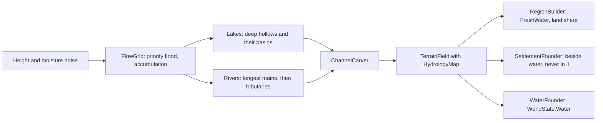
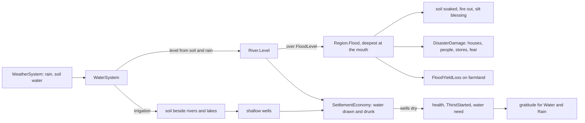

# Milestone 15, part 2 — Water and Law

## Overview

Milestone 15 (spec §130) left work undone. Part 2 builds the first piece of it: the world's fresh
water, and the two domains still missing from §12, Ocean and Justice. The decisions are in
[ADR-022](../docs/ADR/ADR-022-rivers-lakes-floods-water-ocean-and-justice.md).

What the player gets:

- **Rivers and lakes (§5, §93):**
  - Every new world has rivers that run from the highlands to the sea, and lakes in its hollows,
    cut into the land on both terrain renderers.
  - Villages are founded beside water where they can be, and never in it. Their houses and fields
    keep clear of the banks.
- **Floods (§15, §19):**
  - Rain and wet soil swell the rivers, and a river over its banks floods the low land
    downstream.
  - A flood drowns houses, people and stores and frightens the survivors, but its silt enriches
    the fields.
  - Shields and the Protection domain lessen floods, as they do other disasters.
- **Drinking water (§30):**
  - Villages draw water from rivers and lakes, from deep wells, and from shallow wells that dry up
    in a drought.
  - In a long drought away from water the wells run dry: people go thirsty and lose health, and
    the alert, the history and the HUD say so.
- **The Water miracle (§110):** the last of the MVP's nine miracles, on key 0. It fills a
  village's wells and soaks its fields.
- **Ocean (§12):**
  - Its boon: the god's villages fish the sea, the rivers and the lakes around them.
  - Its signature miracle, Tidal Wave, sends the sea over a low coast.
- **Justice (§12):**
  - Its boon: the god's villages keep its law, so fewer leave and doubt about the god fades.
  - Its signature miracle, Judgement, strikes only the followers of gods who wronged the caster.
- **Debug tools:**
  - L floods the nearest river (or sends a wave), and `--disaster=flood` does it at start.
  - The F1 panel lists the rivers' levels and the lakes, and shows a settlement's water.
  - The F3 map has Fresh water and Flood layers.
  - The overlays show rivers (Weather) and floods (Danger).

## Architecture

| Project | Changes |
| --- | --- |
| `Pantheon.Domain` | Generation and settings: • `World/Generation/HydrologySettings` and `WorldGenSettings.Hydrology` (optional) • `StartingSettlementSettings.Water` and `WaterPreference`  Water state and rules: • `Water/` (`WaterState`, `River`, `Lake`, `WaterRules`) • `WorldState.Water` • `RegionState.FreshWater` and `Flood` • `SettlementState.Water` • settlement water rules and `FloodYieldLoss` in `SettlementRules`  Miracles, events and domains: • `MiracleEffectKind` `Water`, `Soak`, `Flood` and `Judge` • `DisasterKind.Flood` • events `FloodStarted` and `ThirstStarted` • history kinds `Flood` and `Thirst` • Ocean and Justice numbers in `DomainBoons` |
| `Pantheon.Simulation` | Generation: • `WorldGen/` (`FlowGrid`, `HydrologyGenerator`, `ChannelCarver`, `WaterFounder`) • `Terrain/HydrologyMap`; `TerrainField` keeps the hydrology and answers `IsUnderFreshWater` and `IsNearFreshWater` • rivers in `TerrainGenerator`, `RegionBuilder` and `SettlementFounder`  Water simulation: • `Water/` (`WaterModel`, `WaterSystem`, validator), between the weather and the disasters in the engine • `Disasters/DisasterDamage`, shared by quakes, fires and floods • drinking and thirst in `SettlementEconomy` and `SettlementSystem` • thirst in `Hazards` and the belief model's water need  Miracles, domains and AI: • the new effects in `MiracleEffects` and `MiracleCaster` • Ocean and Justice in `DomainSystem` • the AI's valuation in `MiracleValuer`  History: • floods and thirst in `HistoryRecorder` |
| `Pantheon.Persistence` | Save version 14 and the migration from 13; `WaterIntegrity` and the region and settlement checks; `water.json`. |
| `Pantheon.Networking` | `WorldSection.Water`. |
| `Pantheon.Game` | Rendering data: • `Presentation/WaterSurfaceMesh` (rivers and lakes) and `FloodSurface` (floodwater) • river beds in `TerrainColorizer` • houses and fields off the water in `SettlementLayout` • flood and fresh water in `OverlayMap`  Readouts and text: • `Diagnostics/WaterReadout`, water in `SettlementReadout`, the F3 layers • `Alerts/WaterAlerts` and the thirst alert • floods and dry wells in the HUD's weather line and the settlement marks  Debug and launch: • `DisasterCommands.StartFlood` and `--disaster=flood` • the tenth miracle key  Other: • flood and wave sounds • the `Water` section and a region's flood in replication • `water.json` in `GameContent` |
| Godot client | `Presentation/Water/FreshWaterPresenter` with `Shaders/fresh_water.gdshader`; the 0 and L actions. |
| Content | New and changed files: • `water.json` • `Hydrology` and the water preference in `worldgen.json` • water rules in `settlement_rules.json` • Ocean and Justice in `domains.json`  Miracles and AI: • Water, Tidal Wave and Judgement in `miracles.json`, with their looks in `divine_view.json` • the Zealot's and Isolationist's domains in `god_ai.json` |

### Generation

1. **Flow:** `FlowGrid` averages the heightfield and moisture into cells of `CellSize` metres.
   - A priority flood from the sea and the edge raises every hollow to its spill level.
   - Each cell drains into the cell it was reached from.
   - Wet land accumulates down that tree.
2. **Lakes:** `HydrologyGenerator` finds the hollows deeper than `MinLakeDepth`, and takes each
   one's whole basin (the cells that fill to its surface) as a lake.
3. **Rivers:**
   - Mouths are cells that carry `RiverCatchment` and drain into the sea or off the edge.
   - Each mouth's main stem is traced upstream along the wettest inflow, up to `HeadwaterCatchment`.
   - The `MaxMainRivers` longest are kept. Tributaries join them up to `MaxRivers`.
4. **Courses:** paths are smoothed. Width and depth grow with the water a point carries. The surface
   is the valley floor (the lowest ground within half a width and a bank of the point) less
   `Freeboard`; it never rises downstream and never goes below the sea.
5. **Carving:** `ChannelCarver` cuts a rounded channel below the water and sloping banks. Ground
   is only ever lowered, from the uncut heights, so the order of the cuts does not matter. Water
   stands over the channel, and over each lake's basin where the ground lies below its surface,
   but not over a river that has left the lake.

### Simulation

## Test plan

- **Hydrology (`HydrologyTests`):**
  - Rivers and lakes are recorded in the state, and generation is deterministic.
  - A river never rises downstream and runs below the land. Main rivers reach the sea, and
    tributaries join rivers.
  - Lakes stand over ground below their surface.
  - Settlements are never founded in water and prefer its banks.
  - A world without hydrology is dry, and validation catches bad settings.
  - A river world saves, loads and keeps playing the same way.
- **The water step (`WaterSystemTests`):**
  - Rivers rise with wet soil and fall back.
  - A flood is deepest at the mouth, and the alarm is raised once each time a river overflows.
  - A flood drowns, spoils and frightens, but much less under a Shield.
  - A flood soaks the land, puts out fire, leaves silt and drains away.
  - Irrigation reaches only watered land, and a wave floods the lowest land deepest.
- **Drinking water (`SettlementWaterTests`):**
  - A river gives full access, and shallow wells dry with the soil.
  - Wells fill to their storage.
  - Thirst lowers health and is reported, and it counts as a water need.
  - Flooded farmland yields less.
- **Miracles and domains (`WaterMiracleTests`):**
  - Water fills wells and soaks fields.
  - Tidal Wave floods a low coast and finds nothing on high ground.
  - Judgement strikes only the guilty.
  - Ocean feeds villages, and Justice calms them.
  - An AI gives Water only where it is needed.
- **Presentation (`WaterPresentationTests`):**
  - The water meshes and floodwater, and river beds.
  - The F1 panel's rivers and settlement water.
  - Flood and thirst alerts, but none for the player's own wave.
  - Flood and thirst history, and the debug flood.
- **Saves (`SaveMigrationV13Tests`):** a save written by Milestone 15's build loads.
  - It has no rivers and keeps its land, with full wells.
  - Every other value is unchanged.
  - It keeps playing the same way.
  - Broken water is refused.
- **Existing tests:**
  - Content: `water.json` is parsed strictly, along with broken water and hydrology numbers, all
    thirteen domains and the signature miracles.
  - The debug map's layers, `--disaster=flood`, the tenth key and the HUD's slots.

### Verification results

- **Build and tests:** `dotnet build` has no warnings. 897 tests pass (853 before).
- **Rivers:** measured on seeds 1234, 42, 7, 77, 100 and 101 (the shipped 2 km island).
  - Each has 4 main rivers of 200–800 m, plus tributaries up to 7 rivers, and 3–4 lakes.
  - 4–5 of the 8 villages stand beside water.
  - Hydrology adds about 0.1 s to the 1.3 s of world generation.
- **Floods:** over ten one-hour games (seeds 100–109), rivers flooded 1–10 times a game, killing
  0–22 people and destroying up to 19 houses in all.
  - The first tuning flooded once in ten hours, so the river gains were raised (soil 1.2 → 1.5,
    rain 0.9 → 1.8, response 0.02 → 0.03).
- **Thirst:** rare. The wells never fell below about 30% in those games: droughts at the
  villages are short, and the AI waters its villages in drought.
  - Storage was halved (6 → 3 per unit of housing) and the wells weakened (deep 0.35 → 0.25,
    shallow 0.6 → 0.5). Thirst still comes only in a long drought away from water.
- **The AI and Water:** at first the AI cast Water 260–775 times a game, courting with it like
  Food. Valuing it by need alone left 150–400 casts, all in drought.
- **Balance:** 40 one-hour games with a passive player (seeds 30–69), each build run the same day.

  | Build | Games with a winner | Median time | Mean time | Winners |
  | --- | --- | --- | --- | --- |
  | Milestone 15 (df01142) | 37 / 40 | 23.6 min | 29.3 min | Seren 22, Vael and Seren 14, Kaio 1 |
  | This build | 36 / 40 | 27.8 min | 29.7 min | Seren 25, Vael and Seren 5, Kaio 6 |

  The pace is unchanged. Kaio, the Trickster, wins more often.
- **On the Mac (Apple M3 Pro, 1080p, Metal):** seed 42 from far and near, on Terrain3D and the
  fallback renderer, at about 120 FPS (8.4 ms).
  - Shown: a river through Brightwater's valley to the sea, the lake above it, Water on key 0, a
    river flood (`--disaster=flood`) along the valley into the lake, and a Tidal Wave over the low
    coast, with the domains line and Shift+1 and Shift+2.
  - First looks showed stepped edges, a lake sheet over its outlet and flat flood rectangles over
    the sea. These were fixed: dry corners meet the ground, lakes fill only their basin, and
    floodwater rises from the nearest water and never covers the sea.

## Tasks

### Completed

- [x] Hydrology settings, flow grid, lakes, rivers and carving; regions' fresh water; founding
  beside water.
- [x] Water state, save version 14 and its migration, integrity checks and the version 13 fixture.
- [x] The water step: levels, floods, silt, irrigation and damage through `DisasterDamage`.
- [x] Drinking water and thirst in the settlement model and the belief model.
- [x] The Water, Tidal Wave and Judgement miracles; the Ocean and Justice domains; the AI's
  valuation and preferences.
- [x] Readouts, F3 layers, overlays, alerts, history, HUD marks, sounds, replication, the 0 and L
  keys and `--disaster=flood`.
- [x] The water and flood meshes, the shader and river beds on both renderers.
- [x] Tests, balance probes and captures on the Mac.

### Future

- River valleys, swamps and the other biomes of §5 (Milestone 15's later parts).
- Migration routes that avoid water, and boats.
- Dams, reservoirs and the other preparations of §21.
- A Divine Act that redirects a river (§14).

## Relevant files

- Generation and the world:
  - `src/Pantheon.Simulation/WorldGen/FlowGrid.cs`, `HydrologyGenerator.cs`, `ChannelCarver.cs`
    and `WaterFounder.cs`
  - `src/Pantheon.Simulation/Terrain/HydrologyMap.cs`
- The water simulation:
  - `src/Pantheon.Simulation/Water/`
  - `src/Pantheon.Simulation/Disasters/DisasterDamage.cs`
- State and content:
  - `src/Pantheon.Domain/Water/`
  - `game/Data/water.json`
- Rendering:
  - `src/Pantheon.Game/Presentation/WaterSurfaceMesh.cs` and `FloodSurface.cs`
  - `game/Scripts/Presentation/Water/FreshWaterPresenter.cs`
  - `game/Shaders/fresh_water.gdshader`
- Tests: `src/Pantheon.Tests/Water/`
