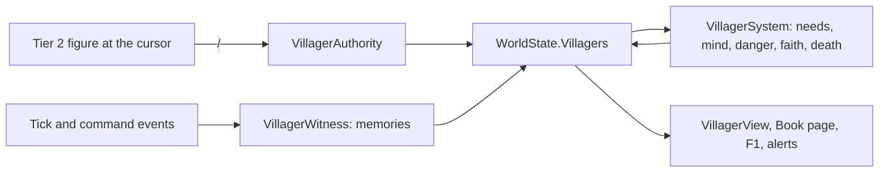

# Milestone 15, part 22 — The selected villager

## Overview

Part 22 builds the last of §80's Tier 3 examples: the selected villager. The decisions are in
[ADR-043](../docs/ADR/ADR-043-the-selected-villager.md).

What the player does and sees:

- **Following:** the player points at someone in a village and presses /. That figure becomes an
  individual of the world, with a name, an age, work, a god and a life:
  - they eat, work, rest and pray as their needs and faith move them;
  - they flee danger and come home after it, and seek a new home if theirs is lost;
  - they turn to another god when their faith fails, and die of age, hunger, illness or danger.
- **What they remember:** miracles near them and what befalls their village. Hardship drives them to
  pray, and danger makes them flee sooner.
- **Seeing them:**
  - / with nobody at the cursor keeps the camera on them;
  - the Book's Villager page tells their life;
  - Shift+/ lets them go.

## Architecture

| Project | Changes |
| --- | --- |
| `Pantheon.Domain` | • `Villagers/` (`VillagerState`, `VillagerMemory`, `VillagerRules`, `FollowVillager`, `VillagerRejection`) • the `VillagerFollowed`, `VillagerFled`, `VillagerTurned` and `VillagerDied` events • `WorldState.Villagers` and `NextVillagerId` • `SettlementRules.Villagers` |
| `Pantheon.Simulation` | • `Villagers/`: `VillagerAuthority`, `VillagerSystem`, `VillagerMind`, `VillagerModel`, `VillagerWitness`, `VillagerRulesValidator` • the engine registers the system and lets villagers witness each tick's and each command's events • `Authorities.Villagers` |
| `Pantheon.Persistence` | • save version 31 (`VillagerSaveMigration`) • `VillagerIntegrity` |
| `Pantheon.Networking` | • protocol 19 • `VillagerIntent`; villagers travel in the `Notables` section |
| `Pantheon.Game` | • `Villagers/VillagerCommands` (pick, follow, release) and `VillagerText` • `Book/VillagerPage` • `Diagnostics/VillagerReadout` • `Alerts/VillagerAlerts` • `--villager` |
| Godot client | • `Presentation/Villagers/VillagerView` • `Bootstrap/VillagerController` (/ and the tracking camera) • `CitizenView` hides the followed figure's crowd double |
| Content | `settlement_rules.json`: `Villagers` |

## Test plan

- **`VillagerTests`:**
  - following makes a named, aged, believing villager, the same person each time;
  - the refusals, and letting one go;
  - working, eating, resting and praying, walking between their places;
  - hunger without food until death;
  - fleeing a fire to a safe village, sheltering fed, coming home, and wary ever after;
  - remembered danger making them flee sooner;
  - death of old age;
  - turning when faith fails, and strong faith holding out until it wanes;
  - seeking a new home in a village of their god;
  - witnessing miracles, disasters, preaching and buildings;
  - hardship driving prayer.
- **`VillagerPresentationTests`:**
  - /, Shift+/ and nobody there;
  - the Book's page and F1;
  - words for every memory, activity and fate with no assumed pronouns;
  - alerts for the player's villager only;
  - the launch options;
  - a joined player following on the host, with the villagers replicated;
  - the same world living the same life.
- **`SaveMigrationV30Tests`:** a version 30 save from part 21's build loads with no villagers and
  plays on the same way; a followed villager saves and lives on the same way; two for one god are
  rejected.
- **`ContentTests`:** a flee danger above 1, a blank name and a life shorter than its start are
  rejected.

### Verification results

- **Build and tests:** `dotnet build` has no warnings, and 1428 tests pass (1401 before).
- **On the Mac (seed 42, `--villager=on`):** Brin, a farmer of Brightwater, is followed.
  - At ×16 the camera keeps Brin in view as they walk to the shrine, and the Book tells their life
    (118 FPS at ×1, 98 at ×16).
  - The fallback renderer shows the marker and label at 117 FPS.
- **Balance:** unchanged, as a villager changes nothing the world reads.
- **Found on the way:**
  - **Starving in shelter:** a villager sheltering in another village starved before the fire at
    home was out. Now they eat from the refuge's stores once hungry.
  - **Resting while starving:** a starving villager now breaks off any activity to eat when there is
    food.
  - **Lost from view:** the camera lost the villager as they walked, so / now keeps it on them until
    the player moves it.
  - **Too many Creature memories:** a Creature's every deed in the village filled their memory. Now
    they remember only its feeding, building, raids and attacks, once in five minutes.

## Tasks

### Completed

- [x] Followed villagers in the world state, chosen from the crowd, saved and shared.
- [x] Needs, choices, danger, homes, faith, memory and death.
- [x] The figure, the camera, the Book page, F1, alerts and the launch option.

### Future

- Families and friends, local navigation round houses (§85) and physics (§94).
