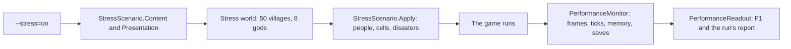

# Milestone 15, part 23 — The stress scenario and the last debug overlays

## Overview

Part 23 builds §104's performance testing and the debug overlays §106 still lacked. The decisions
are in [ADR-044](../docs/ADR/ADR-044-stress-scenario-and-debug-overlays.md).

- **The stress scenario (`--stress=on`):**
  - the vast island with 50 villages of 2,000 people (100,000 in all), 8 gods and 8 Creatures;
  - 20 weather cells, and an earthquake, a fire and a flood at once;
  - the crowd drawn in thousands near the camera.
- **Measurements:**
  - F1 shows frame time, the simulation's share of a frame and a tick's time, ticks per second,
    memory, the engine's objects, nodes and draw calls, the citizens drawn and a save's times;
  - a census of the world's load;
  - unattended runs print the same lines.
- **Overlays:**
  - Navigation: walkable land, roads, rubble and every walker's way;
  - Authority: who commands each village's god;
  - F1's network lines say who decides and, for a joined player, how fresh each section is.

## Architecture

| Project | Changes |
| --- | --- |
| `Pantheon.Game` | • `Performance/StressScenario` • `Diagnostics/PerformanceReadout` (`PerformanceSample`, `SaveTiming`), `DebugSnapshot.Performance` • `Presentation/NavigationOverlay` and `AuthorityOverlay` (`OverlayKind.Navigation`, `Authority`) • `NetworkReadout`'s authority and section-age lines, `MultiplayerClient.SectionTicks` • `--stress` |
| Godot client | • `Bootstrap/PerformanceMonitor` (the clock) • `Bootstrap/DebugView` (F1 and F3, moved out of `GameRoot`, F1 rebuilt four times a second) • `GameRoot` makes the stress world |
| Content | `world_sizes.json`: two more settlement names |

## Test plan

- **`PerformanceToolTests`:**
  - the stress size, crowd and option;
  - the full-size stress world's counts, run for 100 ticks;
  - F1's performance, save and load lines;
  - the Navigation overlay's land, rubble and ways;
  - the Authority overlay's colours, the overlay order and the option;
  - a joined player's authority and section-age lines.
- **Updated:** `StateOverlayTests` (Politics is followed by Navigation) and
  `MultiplayerPresentationTests` (the authority lines).

### Verification results

- **Build and tests:** `dotnet build` has no warnings, and 1434 tests pass (1428 before).
- **On the Mac (`--stress=on --seed=42`):**
  - 100 FPS with 7,000 citizens drawn, on both renderers;
  - a tick costs 1.5 ms;
  - about 500 MB managed and 260 MB in the engine, 1.3 GB resident at most;
  - a 10.2 MB save is written in 129 ms and read back in 151 ms.
- **Headless:**
  - the stress world is made in 6.8 s and a tick costs 1.44 ms;
  - one player needs 0.61 MB to join, then 144 KB/s, mostly regions (1.3 MB raw every 2 s on the
    128 × 128 island).
- **Overlays:** the Navigation overlay (seed 42, roads and a prophet) and the Authority overlay (the
  large island) run at 115 FPS.
- **Balance:** unchanged, as nothing here changes the simulation.
- **Found on the way:**
  - **F1 rebuilt every frame:** with F1 open on the stress world the frame rate fell to 43 FPS, as
    the panel weighs every AI god's options each frame. It now rebuilds four times a second (92 FPS).
  - **GameRoot near the limit:** the debug panel and region map moved to `DebugView` (496 lines to
    413).
  - **Regions dominate the bandwidth:** on the largest island they are nearly all the traffic (see
    ADR-044).

## Tasks

### Completed

- [x] The stress scenario, the client's measurements and the report.
- [x] The Navigation and Authority overlays and the network authority lines.

### Future

- Sending regions within a tolerance (an amendment of ADR-019) when a shared game on the largest
  island needs it.
- A CPU budget per frame for the simulation (§105), and measurements on Windows and Linux.
