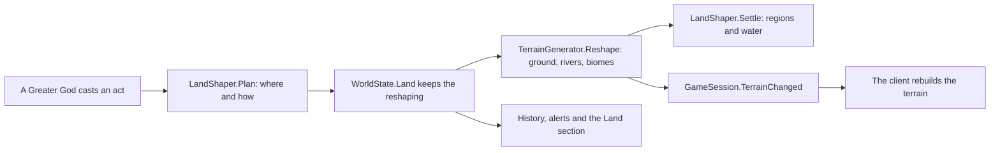

# Milestone 15, part 24 — Divine Acts that reshape the land

## Overview

Part 24 builds the Divine Acts §14 names that change the land's shape. The decisions are in
[ADR-045](../docs/ADR/ADR-045-divine-acts-that-reshape-the-land.md).

- **Raise an Island:** new land rises from the open sea.
- **Split the Mountain:** a gorge opens through a mountain, down to the low ground on either side.
- **Turn the River:** the nearest river runs down to where the god points, and a dam stops its old
  course.

The land stays reshaped: saved, shared and in the history. The rivers, biomes and regions follow
the new land.

## Architecture

| Project | Changes |
| --- | --- |
| `Pantheon.Domain` | • `Land/` (`LandState`, `TerrainReshape`, `ReshapeKind`, `LandRules` in `DivineRules.Land`) • `WorldState.Land` • `MiracleEffectKind.Raise`, `Split`, `Divert` • `DivineActKind` and `HistoryKind` Raising, Splitting, Diverting; `DivineActDone.Name` • `RegionState.FreshWater` settable |
| `Pantheon.Simulation` | • `Terrain/TerrainReshaper` • `TerrainGenerator.Generate` with reshapings and `Reshape` • `TerrainField.Ground` • `Land/LandShaper` (plan, apply, settle), `LandActs` and `LandStage` (`MiracleCaster.Land`), `LandRulesValidator` • `Miracles/Judgement` (moved out of `MiracleEffects`) |
| `Pantheon.Persistence` | • save version 32 (`LandSaveMigration`) • `LandIntegrity` |
| `Pantheon.Networking` | • protocol 20 • `WorldSection.Land` |
| `Pantheon.Game` | • `GameSession.TerrainChanged` and `SyncLand` • `SessionStore` (the load path, moved out) • `Land/LandCommands` (`--reshape`), `Diagnostics/LandReadout` • the acts' words in alerts, the history, the target hints and sounds |
| Godot client | • `GameRoot` rebuilds the terrain and what stands on it on `TerrainChanged` • `NatureDebug` applies `--reshape` |
| Content | `miracles.json`: `raise_island`, `split_mountain`, `turn_river`; `divine_rules.json`: `Land` |

## Test plan

- **`LandTests`:**
  - the reshaper's island, gorge, channel and dam on a test grid;
  - the reshaped terrain matching a terrain made again from the seed;
  - an island's new land and rivers keeping their levels;
  - the refusals;
  - a turned river reaching where the god pointed;
  - casting through the session (`TerrainChanged`, the history and the alert, refused on land);
  - a joined player's terrain made again;
  - F1, the history's words and the option.
- **`SaveMigrationV31Tests`:** a version 31 save from part 23's build loads with the land as the
  seed made it and plays on the same way; a reshaped world saves, loads and makes the same terrain;
  an unknown god is rejected.
- **Updated:** the act lists in `ContentTests` and `PowerPresentationTests`.

### Verification results

- **Build and tests:** `dotnet build` has no warnings, and 1448 tests pass (1434 before).
- **Headless:**
  - an act takes 200–280 ms on the default island, against 1.4 s to make the terrain again;
  - the result matches a terrain made from scratch on seeds 42, 1234 and 7.
- **On the Mac (seed 42, `--reshape`):**
  - an island rises in the bay by Brightwater's river mouth as a wooded headland;
  - a gorge opens through the mountain north of Brightwater, and the big river now runs through it;
  - Brenna is turned east towards Kestrel Rise, on both renderers;
  - all at 112–114 FPS.
- **Balance:** unchanged, as AI gods never reshape the land.
- **Found on the way:**
  - **Uncarved ground:** generation cut the rivers into the heights it kept, so the field now keeps
    the uncarved ground for reshaping.
  - **A channel to the sea:** the first channel ran from a river's mouth into the sea. A river is
    now turned only from inland, to a point on land.
  - **Islands in lakes:** an island could rise in a lake. It now needs open sea.
  - **Class sizes:** `MiracleEffects` was over 500 lines, so the Justice judgement moved to
    `Judgement`. `GameSession`'s load path moved to `SessionStore`.

## Tasks

### Completed

- [x] The three acts, their content and their checks.
- [x] Reshaped terrain made without the noise, regions and water settled.
- [x] Saves, sharing, the client's rebuild, F1, the option, alerts and history.

### Future

- Islands far out at sea, sinking land, and acts the AI chooses.
