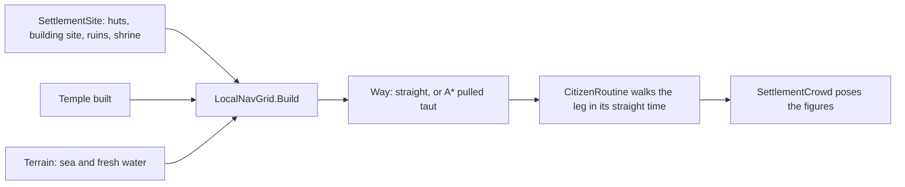

# Milestone 15, part 25 — Local navigation

## Overview

Part 25 builds §85's local navigation for the visible crowd. The decisions are in
[ADR-046](../docs/ADR/ADR-046-local-navigation.md).

- **The grid:** each village shown up close gets a grid baked from its layout. Huts, ruins, the
  building site, the shrine, the temple and water are blocked.
- **The ways:** its figures walk round them on A* ways pulled taut, instead of through them.
- **Work:** nobody works inside a house any more.

## Architecture

| Project | Changes |
| --- | --- |
| `Pantheon.Game` | • `Population/LocalNavGrid` • `ICitizenWays` and `CitizenLeg` • `CitizenRoutine.Evaluate` follows ways • `SettlementCrowd` bakes the grid and supplies the ways (`Navigation`) • `RepresentativeRoster` keeps work spots out of huts • `CrowdStatus.Navigation` and F1's local nav line • `CitizenSettings.NavCellSize` and `NavClearance` |
| Content | `settlement_view.json`: `NavCellSize`, `NavClearance` |

## Test plan

- **`LocalNavTests`:**
  - a way round a hut keeps off its walls and is searched once;
  - a clear line is straight, and a way from beside a wall still leaves it;
  - a built temple stands in the way;
  - a whole village's round has no walking figure inside a hut, where straight lines put some, and
    keeps the same activities.
- **`SettlementCrowdTests`:** the routines are checked with the crowd's ways, and the status
  carries the grid.

### Verification results

- **Build and tests:** `dotnet build` has no warnings, and 1452 tests pass (1448 before).
- **On the Mac:**
  - Brightwater up close runs at 113 FPS, as before;
  - the stress world runs at 87 FPS (100 before) in its first seconds, while about 21,000 ways are
    first searched;
  - Brightwater's grid has 62,001 cells, and its 300 figures needed 152 searched ways.
- **Balance:** unchanged, as this is presentation only.
- **Found on the way:**
  - **Working inside houses:** three of Brightwater's farmers had their work spot inside a hut. Work
    spots now move outside the walls.
  - **A shared cache:** caching ways by cell let a figure take another's way and end at the wrong
    spot. Ways are now cached by their exact ends.

## Tasks

### Completed

- [x] The grid, the ways, the routine and the crowd.
- [x] Work spots outside huts, F1 and content.

### Future

- Local ways for the followed villager, prophets and the Creature in villages; figures steering
  round each other.
