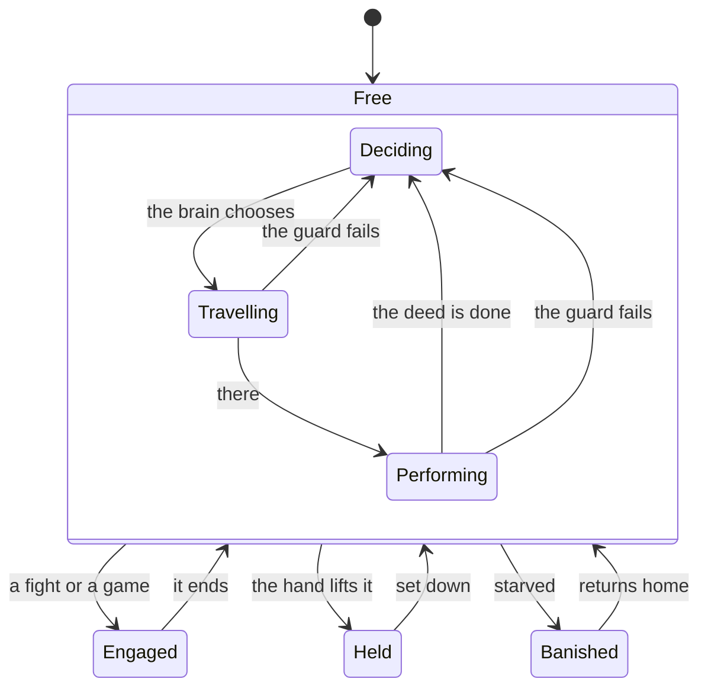

# Milestone 15, part 26 — The Creature's state machine and behaviour trees

## Overview

Part 26 completes §86's Creature AI architecture. The decisions are in
[ADR-047](../docs/ADR/ADR-047-creature-state-machine-and-behaviour-trees.md).

- **The state machine:** an explicit hierarchical state machine (Free › Deciding, Travelling,
  Performing; Engaged › Fighting, Playing; Held; Banished) runs each Creature.
- **The trees:** behaviour trees carry out what the utility brain chooses: an interrupt, a guard and
  travel, perform and deed.
- **Giving up:** a Creature now gives up an errand whose reason is gone (the village fed, the house
  built, the stores empty, the village now an ally's), tells its god, and decides again.

## Architecture

| Project | Changes |
| --- | --- |
| `Pantheon.Domain` | `Events/CreatureGaveUp`, `GiveUpReason` |
| `Pantheon.Simulation` | • `Creatures/CreatureModes` (the state machine) • `CreatureTree` (the trees, `TreeStatus`) • `CreatureSystem` steps by mode and runs the tree |
| `Pantheon.Game` | • F1's mind line • `CreatureText.GaveUp` • `CreatureAlerts` tells of giving up • `SettlementCrowd` rebakes its grid only when the obstacles change (found on the way) |

## Test plan

- **`CreatureTreeTests`:**
  - giving up a building errand when there is nothing to build;
  - feeding only a village still in need (one whose farmers refill it is given up);
  - turning back from an ally's village and from empty stores;
  - a pressing need ending a commanded walk but completing a commanded wait;
  - the state machine's modes and paths, and the tree's description;
  - the god told of its own Creature giving up and not of another's.
- **`CreatureBehaviourTests`:** the forced actions get their reasons (a building wanted, a hungry
  village).
- **`LocalNavTests`:** the grid is baked again only when what stands in the way changes.

### Verification results

- **Build and tests:** `dotnet build` has no warnings, and 1459 tests pass (1452 before).
- **Balance:** 148 of 160 seeds won within the hour (38, 36, 36, 38 by forties); part 20 had 141.
- **Errands given up:** over 20 minutes on seeds 19, 42 and 1234, 4–9 building errands finished
  before the Creature arrived, and a few commanded walks ended because of hunger.
- **On the Mac (seed 42):**
  - grown 6,000 ticks at ×16: 91 FPS (part 25 33, this part before the fix 15), with or without F1;
  - the fallback renderer at ×16: 76 FPS;
  - the stress world: 86 FPS.
- **Found on the way:**
  - **The livelock:** interrupting any action for a desperate need made Creatures that chose to
    rest while starving give up thousands of times. Only commands are interrupted now.
  - **Rebaking the grid (part 25):** a village's grid was baked again whenever its layout was laid
    out again, which happens on every settlement step while it builds. At ×16 that cost most of
    the frame (33 FPS). It is now baked again only when the huts, the building site's place, the
    ruins or the temple change (91 FPS).

## Tasks

### Completed

- [x] The state machine and the behaviour trees, giving up, F1 and alerts.
- [x] The grid rebaking fix, with a test.

### Future

- Trees that differ by action beyond their guards, and trees the Creature learns.
