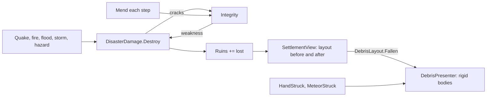

# Milestone 15, part 27 — Structural integrity, flood resistance and debris

## Overview

Part 27 completes §94 (physics and disasters) and makes the hand's throws tactile (§55). The
decisions are in [ADR-048](../docs/ADR/ADR-048-structural-integrity-and-debris.md).

- **Structural integrity:** every blow cracks a village's standing houses, cracked houses fall
  more easily, and villages mend them.
- **Flood resistance:** houses resist floods, as they already resisted quakes and fires.
- **Debris:** fallen houses, strikes and thrown things throw Jolt rigid bodies that tumble onto
  the terrain and fade. They are only shown.

## Architecture

| Project | Changes |
| --- | --- |
| `Pantheon.Domain` | • `SettlementState.Integrity` • `DisasterRules.HouseFloodResistance` and `Structure` (`StructureRules`) |
| `Pantheon.Simulation` | • `DisasterDamage.Destroy` weakens and cracks • `Mend` and `FloodStanding` • `HazardModel.FallingStar` shared by the hazard step and the debug tools • the validator checks the new rules |
| `Pantheon.Persistence` | `StructureSaveMigration` (32 → 33) and the integrity range check |
| `Pantheon.Networking` | protocol 21 |
| `Pantheon.Game` | • `DebrisSettings` and `DebrisLayout` (`Burst`, `Thrown`, `Fallen`, `KeyOf`) • F1's integrity and physics lines • `HandCommands.ThrowAt` and `--hand=throw` • `LocalNavGrid` areas and array-based A* (found on the way) |
| client | • `DebrisPresenter` (rigid bodies on height-map ground patches) • `SettlementView` hands its fallen houses up through `SettlementPresenter` to `WorldPresenter` • `WorldPresenter.React` hears the hand's and the stars' strikes |

## Test plan

- **`StructureTests`:**
  - a quake cracks the houses it leaves standing, unless houses never crack;
  - cracked houses fall more easily in the next quake (over 20 trials);
  - villages mend over time;
  - flood-resistant houses stand up to a flood.
- **`DebrisTests`:**
  - a house throws planks, stones and thatch, a strike only stones, the same each time;
  - a bigger house throws bigger pieces, and no settings mean no pieces;
  - a thrown rock or tree lands on the line of the throw and rolls on, and thrown people are not
    left lying;
  - the houses that fell are those that stood and now lie in ruins, not ones rebuilt;
  - the debug falling star strikes like a natural one;
  - throwing at the start lifts something beside the village and strikes it;
  - out-of-range debris settings are rejected.
- **`SaveMigrationV32Tests`:** a version-32 save gains sound houses; `Version33Expectations` is
  chained into every older migration test.
- **`ContentTests`:** out-of-range flood resistance and weakness are rejected.
- **`LocalNavTests`:** a goal sealed off by water has no way, while ways outside still go round a
  hut.
- **`PerformanceToolTests`:** the physics line.

### Verification results

- **Build and tests:** `dotnet build` has no warnings, and 1479 tests pass (1459 before).
- **Balance:** 141 of 160 seeds won within the hour (37, 33, 37, 34 by forties); part 26 had 148
  and part 20 141.
- **On the Mac (seed 1234):**
  - a falling star on Duskwater (`--disaster=meteor`): 20 houses fall, 240 pieces (the cap) at
    101 FPS on Terrain3D and 119 on the fallback renderer; four seconds later 61–72 are still
    moving;
  - `--hand=throw` on a new world: a rock wrecks 2 houses, and 34 pieces fly: 26 from the houses,
    7 stones and the rock;
  - Jolt reports 0 in Godot's active-bodies monitor, so the debris counts its moving pieces
    itself.
- **Found on the way:** local navigation's searches.
  - **The measurement:** a grown game (seed 42, 6,000 ticks, ×16, 110 m) ran at 71–72 FPS, against
    85–92 for part 26. With the new rules switched off in data it ran at 92 FPS in part 26's
    world, so the client's new code cost nothing; the world differed.
  - **The cause:** timing the client's calls showed the Tier 2 crowds taking 5–10 ms a frame and
    rising. A scratch benchmark on the two biggest villages found A* taking 313 and 781 ms for 534
    and 519 ways. Pulling the ways taut took about 11 ms. 89 searches that had no way explored
    1.5 million cells.
  - **The fix:**
    - the grid numbers its connected areas when baked, so such searches end at once;
    - A* runs on reused arrays with a closed set: 101 ms for the same ways;
    - the ways reach the same places, and those that differ, where the grid had ties, are within
      4% in length.
  - **The result:** 113–114 FPS at ×16 (worst frame 47–50 ms, from 145), 112 on the fallback
    renderer, and 93 FPS in the stress world (86 before).

## Tasks

### Completed

- [x] Integrity, cracking, weakness and mending; flood resistance; the save and the protocol.
- [x] Debris: the layout, the presenter, the fallen-house diff and the strikes.
- [x] The thrown thing lands as a body; `--hand=throw`; the debug falling star strikes.
- [x] F1's integrity and physics lines.
- [x] Local navigation's areas and array-based A*.

### Future

- Integrity per house or per building kind.
- Debris that blocks the way, and debris from the Creature's blows.
