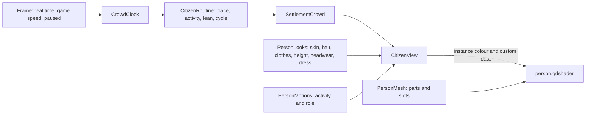

# Milestone 15, part 28 — People that look and move like people

## Overview

The owner found the villagers poor: coloured dots that ran about like ants. Part 28 makes them
people (spec §61, §80, §81). The decisions are in
[ADR-049](../docs/ADR/ADR-049-people-that-look-and-move-like-people.md), which amends ADR-008.

- **People:** a procedural figure with legs, arms, a head, hair and clothes, a look of its own,
  and tools and headwear by work.
- **Motion:** walking, sitting, hoeing, hammering, chores and prayer, animated on the GPU.
- **Pace:** the crowds live on their own clock, at a human pace however fast the game runs.

## Architecture

| Project | Changes |
| --- | --- |
| `Pantheon.Game` | • `Population/CrowdClock` held by `GameSession.Crowds` • `PersonLooks`, `PersonLook` and `PersonHeadwear` • `PersonMotions` and `PersonMotion` • `PeopleSettings` (`People` in `settlement_view.json`) and `CitizenSettings.PaceCap` • `RoutinePose.Cycle` and `CitizenPose.Cycle`, with a gentle step and longer rounds • `Presentation/PersonMesh` (parts, slots and two levels of detail) • `VillagerCommands.Pick` by the crowds' clock • F1's people line |
| client | • `Shaders/person.gdshader` • `People/PersonAssets` and `PersonFigure` • `CitizenView` draws people • `VillagerView`, `NotableView` and `MigrationView` use the person figure • `GameRoot` advances the crowds' clock |

## Test plan

- **`PeopleTests`:**
  - the crowds' clock keeps a human pace at any speed, runs slower below real time and stops when
    paused;
  - F1 shows the people's clock;
  - each person looks their own, the same each time, and a village's people vary (skin, hair,
    clothes, heights, hats by work);
  - what a figure does picks its motion;
  - both figures stand on their feet with every part in place, tools in the right hand, and faces
    wound for Godot;
  - the routine counts strides, strokes and breaths;
  - `/` picks a figure where the crowds' clock shows it.
- **`CitizenRoutineTests`:** the step rises gently, not in hops.
- **`ContentTests`:** the new catch-up speed in the out-of-range case.

### Verification results

- **Build and tests:** `dotnet build` has no warnings, and 1488 tests pass (1479 before).
- **On the Mac:**
  - seed 1234 grown 3,000 ticks, at 22, 70 and 140 m: 118–121 FPS. People sit by their doors,
    hoe the fields in straw hats, hammer at the building site and raise their arms at the shrine;
    the elder is a robed figure with a staff;
  - the migrants of `--migrate=40` walk the road two abreast as people;
  - the fallback renderer, seed 42 at ×16 and 35 m: 273 FPS;
  - the stress world: 108 FPS with 7,000 people (93 FPS with cones), drawing 6.5 million
    triangles.

## Tasks

### Completed

- [x] The crowds' clock, the pace cap and longer rounds; picking by the clock.
- [x] The person mesh, the looks, the motions and the person shader.
- [x] The crowds, the followed villager, prophets, elders and migrants as people.
- [x] F1's people line.

### Future

- Faces, knees and elbows; carried goods.
- Looks that follow a village's culture and biome (the art pass).
