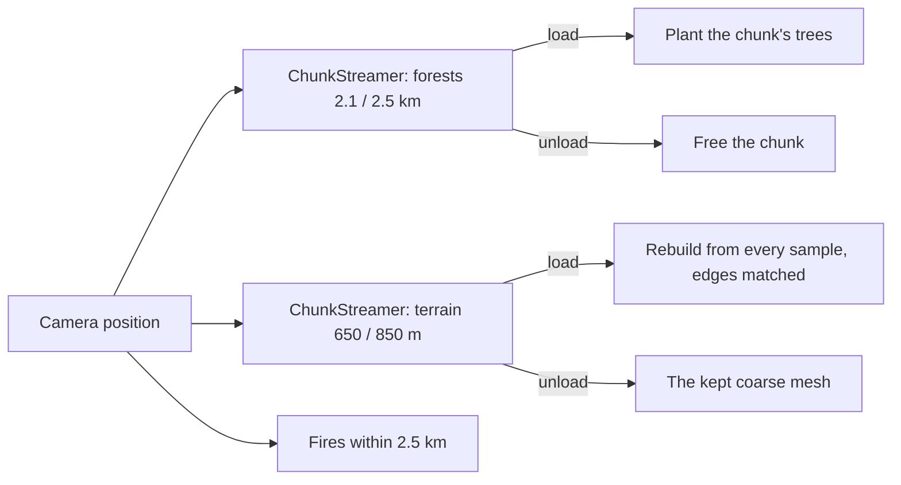

# Milestone 15, part 29 — World streaming

## Overview

Part 29 completes §84: the land near the camera carries its detail, and the rest stays simulation
data. The decisions are in [ADR-050](../docs/ADR/ADR-050-world-streaming.md).

- **Forests:** planted only near the camera.
- **Fallback terrain:** 2 m detail near the camera, 4 m beyond, with matched borders.
- **Fires:** drawn only near the camera.
- **Tools:** an F1 and smoke-run line that says what is loaded.

## Architecture

| Project | Changes |
| --- | --- |
| `Pantheon.Game` | • `Presentation/ChunkStreamer` (and `StreamingStep`) • `StreamingSettings` (`Streaming` in `settlement_view.json`) • `TerrainMeshBuilder.BuildChunk`'s `edgeStride` • `Diagnostics/StreamingReadout` and `StreamingStatus`, in `DebugSnapshot.Streaming` |
| client | • `ForestPresenter` streams its chunks • `ITerrainPresenter.Stream` and `Detail` (Terrain3D: its own clipmap; the fallback: detailed chunks near the camera) • `DisasterPresenter` draws fires within `EffectRadius` • `DebugView` and the smoke-run report show the streaming line |

## Test plan

- **`StreamingTests`:**
  - chunks near the camera load nearest first, a few an update, and a first update may take
    them all;
  - loaded chunks stay until the camera is well away, then go, and a high camera loads nothing
    beneath it;
  - a detailed terrain chunk meets its coarse neighbour without a crack, while the raw detailed
    edge would not;
  - F1's line, and bad settings rejected.

### Verification results

- **Build and tests:** `dotnet build` has no warnings, and 1492 tests pass (1488 before).
- **The vast island (seed 42, 300 m from the camera):**

  | Measure | Before | After |
  | --- | --- | --- |
  | Visuals built | 1,578 ms | 1,384 ms |
  | Engine memory, Terrain3D | 241 MB | 194 MB |
  | Engine memory, fallback | 182 MB | 136 MB |
  | Objects | 12,876 | 6,280 |
  | Nodes | 5,461 | 2,163 |
  | Frame rate, Terrain3D | 229 FPS | 220 FPS |
  | Frame rate, fallback | 269 FPS | 252 FPS |

  200 of 1,849 forest chunks are planted, and 6 of 256 fallback chunks are detailed. On the
  fallback no crack shows between detailed and coarse ground.
- **Measured first:** with the whole vast island in view, 208–215 FPS.
- **A grown game (seed 42, ×16, 110 m):** 198 FPS (113 at part 27); the human-paced crowds of part
  28 search far fewer new ways.
- **The stress world:** 111 FPS (108 before), with managed memory 273 MB (386 before) and engine
  memory 210 MB (257 before).

## Tasks

### Completed

- [x] The chunk streamer and its settings.
- [x] Streaming forests, fallback terrain detail and fires.
- [x] The streaming line in F1 and unattended runs.

### Future

- Streaming houses and fields for very large worlds, if a measurement asks for it.
