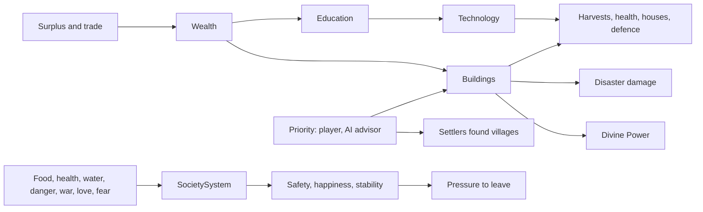

# Milestone 15, part 3 — Society

## Overview

Part 3 gives every settlement a society, so that its people live more than a life of food and
houses (spec §21, §29, §30, §36, with §9's temples and §6's growing worlds). The decisions are in
[ADR-023](../docs/ADR/ADR-023-settlement-society-priorities-buildings-and-technology.md).

What the player gets:

- **A settlement's life (§30):**
  - Safety, happiness, order (political stability), wealth and learning change with how the
    people fare.
  - Unhappy or unsettled people are readier to leave.
- **Priorities (§29):**
  - A god followed by at least 40% of a village can ask it to increase food, improve health,
    grow, focus on worship, prepare for war or for disaster, expand, or build a temple.
  - A course holds at least a minute. AI gods set the course of the villages they lead.
- **Buildings (§21, §9):** temples, granaries, hospitals, walls, levees, firebreaks, shelters and
  cisterns rise under the priorities, once the wealth is put by.
  - A temple raises half again as much power for its god.
  - Preparations spare a village part of a disaster.
  - Temples and walls show in the village.
- **Technology (§36):** eight fields grow with learning, fastest where the village's focus lies,
  and spread between neighbours.
  - Each field has an effect: richer harvests, faster healing, lighter building, arms, faster
    roads, works against floods and fires, learning, and stronger rites.
  - Fields stop at level 5: the world never becomes modern.
- **Expansion (§29, §6):** crowded villages under an Expansion priority send settlers to found
  new villages. In an hour a world can grow from 8 villages to 16.
- **The Settlements panel (§57, N):** a village's faiths, stores, society, technology, buildings
  and work, with a button for each priority.

## Architecture

| Project | Changes |
| --- | --- |
| `Pantheon.Domain` | Society state and rules: • `Society/` (`SocietyState`, `TechnologyLevels`, `Building`, `BuildingKind`, `TechnologyField`, `SettlementPriority`, `PriorityCommand`, `SocietyRules`) • `SettlementState.Society`  Effects in other rules: • `SettlementRules.Civics` (`CivicEffects`) • `DisasterRules.Preparedness` • `DivineRules.TempleInfrastructure` and `ReligionPerLevel` • the migration rules' weights and navigation  Events and history: • `MigrationCause.Unhappiness` and `Unrest` • events `PriorityChanged`, `BuildingCompleted`, `TechnologyAdvanced` and `SettlementFounded` • history kinds `Founding` and `Temple` |
| `Pantheon.Simulation` | Society: • `Society/` (`SocietyModel`, `SocietySystem`, `Expansion`, `SocietyAuthority`, `PriorityAdvisor`, validator) • the engine runs it after the belief step; the AI system runs the advisor  Effects: • `Settlements/CivicModel` in `SettlementEconomy` and `CreatureDeeds` • preparedness in `DisasterDamage` • infrastructure in `BeliefModel.ComputePower` • unhappiness, unrest and navigation in migration |
| `Pantheon.Persistence` | Save version 15, `SocietySaveMigration` and `SocietyIntegrity`; `society.json`. |
| `Pantheon.Networking` | `PriorityIntent`; protocol version 4. |
| `Pantheon.Game` | Panel, commands and text: • `Society/` (`SocietyText`, `SocietyCommands`, `SettlementPanelReadout`) • `GameSession.Command` (a command through the authorities)  Readouts and alerts: • `Diagnostics/SocietyReadout` • `Alerts/SocietyAlerts`  Other: • `Presentation/CivicLayout` • `--priority` and `--settlement-panel` • the history's titles |
| Godot client | `UI/SettlementPanel`, `Bootstrap/SocietyController`, `Presentation/Settlements/CivicView`; the N action. |
| Content | `society.json`; `Civics` in `settlement_rules.json`, `Preparedness` in `disasters.json`, temples and religion in `divine_rules.json`, unhappiness, unrest and navigation in `migration.json`. |

## Test plan

- **The society model (`SocietyModelTests`):**
  - Safety falls with danger and war, and walls restore some.
  - A fed, healthy, loved village is happy, and a fearful, homeless one is not.
  - A united, peaceful village is settled, and a divided one at war is not.
  - Wealth comes from surplus with full stores and from trade, less what is used up.
  - Learning grows with wealth to spare and with order.
  - A priority calls for its buildings: its god's temple, and levees only beside water.
- **The society step (`SocietySystemTests`):**
  - Technology grows fastest in the field of focus and is reported at each level.
  - Knowledge spreads from neighbours.
  - A temple is paid for, built and raised to its god.
  - Expansion founds a village on free land, with its founders' beliefs.
- **Priorities (`PriorityTests`):**
  - The authority checks the share of followers, the waiting time, the issuer and an unchanged
    priority.
  - An AI answers hunger first, then wants a temple, and leaves villages it does not lead.
- **Civic effects (`CivicTests`):**
  - Agriculture and a Food priority raise the harvest.
  - A granary and a cistern store more.
  - Medicine and a hospital heal and save lives.
  - Growth and Worship priorities bring births and worshippers.
  - Architecture lightens houses, and walls and warfare turn attacks away.
  - A temple raises only its own god's power.
  - Firebreaks spare a village a fire.
- **Presentation (`SocietyPresentationTests`):**
  - The Settlements panel, and setting a priority with its waiting time.
  - Alerts, and the history of foundings and temples.
  - The temple and walls' layout.
  - The launch options.
- **Multiplayer (`SocietyMultiplayerTests`):** a joined player's priority reaches the host and
  its replica, and a village it does not lead refuses.
- **Saves (`SaveMigrationV14Tests`):**
  - A save written by part 2's build gains founded societies.
  - It keeps every other value and keeps playing the same way.
  - Broken societies are refused.

### Verification results

- **Build and tests:** `dotnet build` has no warnings. 927 tests pass (897 before).
- **Ten one-hour games** (seeds 100–109, a passive player):
  - **Priorities:** AI gods mostly ask for temples, defence and preparation.
  - **Buildings and new villages:** every game builds temples, firebreaks, shelters, levees,
    cisterns and walls. 0–8 villages are founded per game (up to 16 in all, and 10,000 people).
  - **Society:** happiness ends near 0.85–0.93, safety 0.83–1.0 and stability 0.70–0.94.
  - **Technology:** it ends the hour at mean levels 0.8–2.1. The first tuning reached 4–5, so the
    rate was cut from 0.004 to 0.0012 a second.
- **Balance:** 40 one-hour games with a passive player (seeds 30–69).

  | Build | Games with a winner | Median time | Mean time | Winners |
  | --- | --- | --- | --- | --- |
  | Milestone 15 | 37 / 40 | 23.6 min | 29.3 min | Seren 22, Vael and Seren 14, Kaio 1 |
  | Part 2 | 36 / 40 | 27.8 min | 29.7 min | Seren 25, Vael and Seren 5, Kaio 6 |
  | Part 3 (this build) | 32 / 40 | 23.9 min | 26.4 min | Seren 14, Vael and Seren 13, Kaio 5 |

  A few more games end without a winner, as worlds grow larger and the 60% share is harder to
  hold, and those that are won are won a little sooner.
- **On the Mac:** seed 42, 15 minutes in, at about 120 FPS.
  - The Settlements panel on Saltreach: its faiths, stores, society, technology, a temple to Seren
    with levees, firebreaks and shelters, a cistern 31% built and Seren's priority, its buttons
    disabled because the player has 8% there.
  - The temple: a stone hall roofed in Seren's blue beside the shrine. The first placement
    overlapped a hut; the temple now stands inside the ring the houses keep clear.

## Tasks

### Completed

- [x] Society state, rules and effects; save version 15 with the migration, the integrity
  checks and the version 14 fixture.
- [x] The society step: drift, wealth, learning, technology and its spread, buildings, expansion.
- [x] Civic effects in the economy, disasters, worship, attacks and migration.
- [x] Priorities: the authority, the AI advisor, the intent, the commands and the Settlements
  panel.
- [x] Alerts, history, the F1 lines, temples and walls in the village, and the launch options.
- [x] Tests, probes and captures.

### Future

- Roads, evacuation routes, dams and sea walls (§21).
- Doctrines, secular cultures and resentment, which read the society (part 4).
- Settlers walking to their new land as a migration group, rather than arriving at once.

## Relevant files

- `src/Pantheon.Domain/Society/`
- `src/Pantheon.Simulation/Society/` and `src/Pantheon.Simulation/Settlements/CivicModel.cs`
- `src/Pantheon.Game/Society/`
- `src/Pantheon.Game/Presentation/CivicLayout.cs`
- `game/Scripts/UI/SettlementPanel.cs`, `game/Scripts/Bootstrap/SocietyController.cs` and
  `game/Scripts/Presentation/Settlements/CivicView.cs`
- `game/Data/society.json`
- Tests: `src/Pantheon.Tests/Society/`
