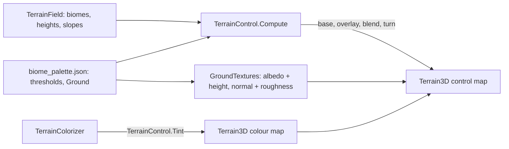

# Milestone 15, part 30 — Ground textures and light

## Overview

The first part of the §61 art pass. The owner asked for much better graphics; the specification
asks for a stylized fantasy look with distinct biomes, readable from high altitude. The decisions
are in [ADR-051](../docs/ADR/ADR-051-ground-textures-and-light.md).

- **The ground:** nine textures made in code (grass, forest floor, earth, rock, sand, snow, moss,
  mud, ash), each with a normal map.
- **The control map:** painted from biome, slope, height and the coast, with soft borders between
  biomes.
- **The light:** ACES tonemapping, ambient occlusion, a soft glow, a deeper sky and softer
  shadows, with a setting to switch the effects.

## Architecture

| Project | Changes |
| --- | --- |
| `Pantheon.Game` | • `Presentation/GroundSettings` and `GroundKind` (`Ground` in `biome_palette.json`) • `TerrainControl` (`BaseOf`, `At`, `Encode`, `Compute`, `Tint`) • `GameSettings.LightingEffects` |
| client | • `Terrain/GroundTextures`, replacing `GroundTexture` • `Terrain3DTerrainPresenter` (nine assets, the control map, the tint, softer blending) • `Main.tscn` (sky, sun, tonemapping, SSAO, glow, adjustments) • `SettingsApplier` and the settings page ("Lighting effects") |

## Test plan

- **`GroundTests`:**
  - the control word packs the textures, blend and turn as Terrain3D reads them;
  - each biome has its ground, with sand near the sea, rock on steep slopes and snow on cold
    heights;
  - a forest's edge blends into the grass over a few metres;
  - the tint keeps the textures' brightness and turns them only gently;
  - the ground needs colours for every texture.
- **`GameSettingsTests`:** the lighting effects round-trip and are on by default.

### Verification results

- **Build and tests:** `dotnet build` has no warnings, and 1497 tests pass (1492 before).
- **On the Mac (seed 1234 at 30, 90 and 300 m; seed 42's vast island at 300 m and 2.2 km):**
  - mottled meadows, dark forest floors, highland earth, cracked rock on slopes, snow on peaks,
    and sand along the coasts and low river banks, blending at biome borders;
  - frame rates of 152–196 FPS.
- **Found on the way:**
  - **Sand:** a first version laid pure sand below the beach height, which covered the vast
    island's low plains. Sand now fades in as the colour map's beach does.
  - **Grass:** the first grass pattern showed a cell network up close. It is now mottled patches
    with fine tufts.
- **Cost:**

  | Measure | Before | After |
  | --- | --- | --- |
  | Default island's visuals | about 0.6 s | 1.22 s |
  | Vast island's visuals | 1.38 s | 2.57 s (3.35 s before the control map ran in parallel) |
  | Grown game at ×16 | 198 FPS | 135 FPS |

  The textures are made once per run. The frame-rate drop is the textured ground: with ambient
  occlusion and glow off the game runs at 133 FPS. The fallback is unchanged: 341 ms and
  224 FPS.

## Tasks

### Completed

- [x] Ground textures, the control map and the tint.
- [x] The light and the lighting effects setting.

### Future

- Grass and ground clutter near the camera, painted roads, textures on the fallback renderer.
