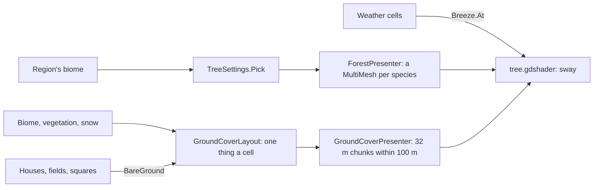

# Milestone 15, part 32 — Trees, ground cover and wind

## Overview

The third part of the §61 art pass. The decisions are in
[ADR-053](../docs/ADR/ADR-053-trees-ground-cover-and-wind.md).

- **Trees:** seven species made in code (pine, fir, oak, birch, palm, willow, snag), grown by each
  biome in its shares.
- **Ground cover:** grass, flowers, bushes, stones and reeds near the camera, streamed in small
  chunks.
- **Wind:** everything sways in the weather's wind and bends hard in storms.

## Architecture

| Project | Changes |
| --- | --- |
| `Pantheon.Game` | • `Presentation/TreeMesh` and `TreeSlot` • `TreeKind` as seven species • `TreeSettings` (`Trees` in `settlement_view.json`) • `ForestLayout.Place` takes the species • `GroundCover` (`GroundCoverKind`, `GroundCoverPlacement`, `GroundCoverSettings`, `GroundCoverLayout` with `BareGround`, `GroundCoverMesh`) • `Breeze` • `ChunkStreamer` looks only near the camera • the ground cover in F1's streaming line |
| client | • `Shaders/tree.gdshader` (trunk colour per node, leaves per instance, sway and flutter) • `Land/ForestPresenter` (a MultiMesh per species present, the wind) • `Land/GroundCoverPresenter` • `Meshes.ToArrayMesh` • `TreeMeshes` removed |

## Test plan

- **`VegetationTests`:**
  - every tree stands on its roots at a tree's height, with leaves but the snag;
  - each biome grows its species in their shares, and an unlisted biome grows grassland's;
  - the wind is the strongest cell's over a place, fading to its edge, blowing the weather's way;
  - ground cover keeps off water and bare ground, thins with vegetation while stones stay put, and
    is the same each time;
  - the streamer looks only near the camera and loads just what a full look would;
  - bad ground cover settings are rejected.

### Verification results

- **Build and tests:** `dotnet build` has no warnings, and 1512 tests pass (1506 before).
- **On the Mac:**
  - Duskwater at 30 m: tufts of grass, flowers, bushes and stones about the village, kept off its
    square and houses;
  - Willowmere at 90 m: palms on the coast, weeping willows, pines and oaks;
  - performance:

    | View | Frame rate | Triangles |
    | --- | --- | --- |
    | Grown game at ×16 | 133 FPS (135 before) | 4 million |
    | Vast island at 300 m | 135 FPS | 5.7 million |
    | Stress world | 92 FPS | 8 million |

- **Found on the way:**
  - the village's clearing (houses, fields and a margin) left the whole village bare; the cover now
    keeps only off houses, fields and the square;
  - stones moved as the grass withered; they now take their share of a cell's roll first;
  - the willows' leaf curtain looked like a drum; they now hang in switches.

## Tasks

### Completed

- [x] Seven tree species by biome, with the wind.
- [x] The ground cover, streamed near the camera.

### Future

- Wildlife (part 33), and grass that thickens nearer still.
