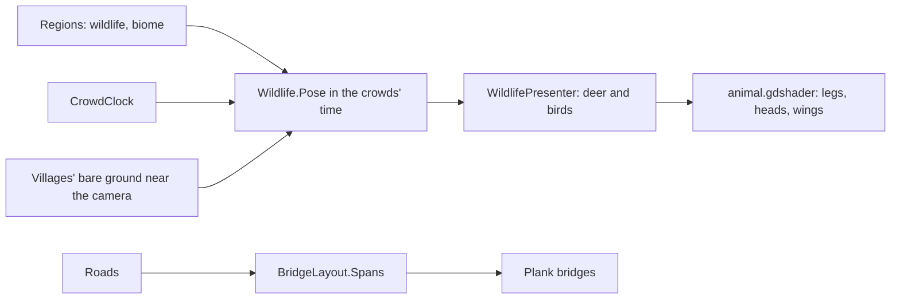

# Milestone 15, part 33 — Wildlife and bridges

## Overview

The fourth part of the §61 art pass. The decisions are in
[ADR-054](../docs/ADR/ADR-054-wildlife-and-bridges.md).

- **Wildlife:** herds of deer and flocks of birds near the camera, as many as each region's
  simulated wildlife.
- **Bodies:** deer and birds made in code and animated by a shader.
- **Bridges:** where roads cross water.

## Architecture

| Project | Changes |
| --- | --- |
| `Pantheon.Game` | • `Presentation/Wildlife` (`AnimalKind`, `AnimalMotion`, `AnimalPose`, `WildlifeSettings`, `Pose`, `NearestDeer`) • `AnimalMesh` and `AnimalPart` • `BridgeLayout` • `Wildlife` in `settlement_view.json` • `LaunchOptions.FocusWildlife` (`--wildlife`) • the wildlife in F1's streaming line |
| client | • `Shaders/animal.gdshader` • `Land/WildlifePresenter` • `RoadPresenter` lays bridges • `GameRoot` handles `--wildlife` • the ground cover and wildlife look only at nearby bare ground |

## Test plan

- **`WildlifeTests`:**
  - herds and flocks live where the land's wildlife does, and none where it is hunted out;
  - a herd grazes then walks on, the same each time, deer stand on the ground and birds fly high;
    and no herd grazes on the villages' bare ground;
  - animals stand on their feet with their parts tagged;
  - a road crossing water is carried over it on a bridge from bank to bank, and `--wildlife`
    parses.

### Verification results

- **Build and tests:** `dotnet build` has no warnings, and 1516 tests pass (1512 before).
- **On the Mac:**
  - seed 42's vast island, Willowmere at 16 m with `--wildlife=on`: a stag walking between
    pastures past the longhouses;
  - at 70 m, 5 deer and 28 birds near Thornbury and 9 and 10 near Willowmere, and a bridge
    carrying Willowmere's road over its river;
  - a grown game at ×16: 132 FPS; the stress world: 91 FPS.
- **Found on the way:** the stress world fell to 68 FPS because the wildlife and the ground cover
  tested every one of its 20,000 bare patches. They now look only at those near them.

## Tasks

### Completed

- [x] Herds and flocks, their bodies and motions, and `--wildlife`.
- [x] Bridges.

### Future

- Animals that flee the people and the Creature, fish, and villagers who keep to bridges.
