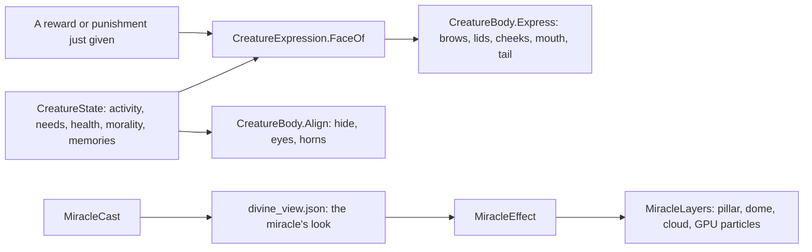

# Milestone 15, part 34 — Expressive Creatures and miracle looks

## Overview

The fifth and last part of the §61 art pass. The decisions are in
[ADR-055](../docs/ADR/ADR-055-expressive-creatures-and-miracle-looks.md).

- **Faces:** the Creature's face and tail show how it feels: from what it is doing, its needs,
  its health, its nature and its god's last word.
- **Nature:** its body shows its nature. A kind Creature is warm and softly glowing; a cruel one is
  dark and red-eyed, with longer horns.
- **Miracles:** eleven signature looks, so each miracle reads at a glance: rain from a cloud, a golden
  harvest pillar, a healing dome, flames and smoke, a quake's dust, a shield's dome, a fountain, a
  pillar of holy light, a dark swirl, a wheeling storm and a god's strike.

## Architecture

| Project | Changes |
| --- | --- |
| `Pantheon.Game` | • `Presentation/CreatureExpression` (`CreatureFace`, `CreatureMood`, `FaceOf`, `MoodOf`) • `MiracleEffectStyle` gains Strike, Rain, Harvest, Healing, Flames, Quake, Shield, Fountain, Holy, Shadow and Storm • `GodCameraModel.FaceFront` • F1's Creature lines show its face and nature |
| client | • `CreatureBody`: brows, lids, cheeks, pupils, a mouth and a tail (`Express`); hide, glow, eyes and horns by nature (`Align`) • `CreatureView` passes a just-given reward or punishment to the face • `Divine/MiracleLayers` (pillar, dome, cloud and GPU particles) • `Shaders/miracle_glow.gdshader` • `MiracleEffect` draws the new looks • the earthquake's look is Quake • looking at the Creature turns the view to its face |
| content | `divine_view.json` maps every miracle to its look |

## Test plan

- **`ExpressionTests`:**
  - a Creature scowls in a fight, widens its eyes in flight, grins at play and sleeps at rest, and
    wags only when happy;
  - a hungry, bored Creature is glum and a tired one drowsy;
  - a kind Creature smiles more than a cruel one, which scowls;
  - its god's word shows for a while: praise brings joy, a slap fear, and a word given to a deed
    still under way shows when the client passes it;
  - the face is derived from the state, the same each time;
  - every miracle has its look, and every look but Rise and Bolt (the weather's) is used.
- **`CreatureSessionTests`:** F1 shows the Creature's face and nature.
- **`GodCameraModelTests`:** looking at a face turns the view the short way round, to stand in
  front of it, a little to one side.

### Verification results

- **Build and tests:** `dotnet build` has no warnings, and 1523 tests pass (1516 before).
- **On the Mac**, seed 1234, Duskwater at 140 m:
  - Rain: an overcast cloud and streaks.
  - Food: a golden pillar with grain.
  - Heal: a green dome over the village with rising light.
  - Fire: flames and embers.
  - Earthquake: a dust haze.
  - Shield and Sanctuary: domes.
  - Water: a fountain and its ring.
  - Enlighten: a pillar of pale light.
  - Dread: a purple ring and dark wisps.
  - Lightning: the strike's ring.
  - The fallback renderer draws them too.
- **The Creature at 45 m:** content, then grinning with its cheeks up after a reward, then
  worried, with raised brows and wide pupils, after a punishment.
- **Performance:** a grown game at ×16, measured in the same checkout:
  - the previous build: 11.2 ms a frame;
  - this build: 11.5 ms.
- **Found on the way:**
  - The new looks first ran on CPU particles. With the AI gods casting about sixty miracles a
    minute at ×16, that cost a millisecond a frame (12.3 ms), so they now run on the GPU.
  - The face's small parts first cast shadows, adding about 130 draw calls.
  - The weather's storm lightning shared the miracle bolt's look. It keeps the plain bolt, and the
    gods' bolts take Strike.
  - A reward given to a deed still under way marks no memory, so it never reached the face. The
    view now passes what it has just seen given.

## Tasks

### Completed

- [x] The Creature's face, tail and nature, and the camera turning to its face.
- [x] Eleven signature miracle looks on the GPU, and the glow shader for domes and pillars.

### Future

- Faces shaped by species, mood sounds, and miracle looks shaped by the god's domains.
