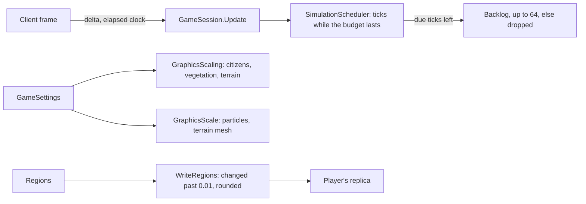

# Milestone 15, part 35 — The CPU budget, graphics scaling and regions within a tolerance

## Overview

The first part of the final pass. The decisions are in
[ADR-056](../docs/ADR/ADR-056-cpu-budget-graphics-scaling-and-region-tolerance.md).

- **The CPU budget (§105):** the simulation keeps to a budget a frame (the player's "Simulation
  budget", 6 ms by default). The ticks still due wait for the next frame.
- **Graphics scaling (§105):** vegetation, particles and terrain quality join shadows, render scale
  and citizens shown.
- **Regions within a tolerance (amends ADR-019):** a shared game's regions are sent again only when
  they have changed visibly.
- **The client at ×16:** floods, citizens, walkers' grids and forests react to the world at a pace,
  and only where it changed.

## Architecture

| Project | Changes |
| --- | --- |
| `Pantheon.Game` | • `SimulationScheduler.BudgetSeconds`, `MaxBacklogTicks`, `BudgetHits`, `Backlog`; `GameSession.Update(delta, elapsed)` • `GameSettings`: `Vegetation`, `Particles`, `TerrainQuality`, `SimulationBudget` • `Settings/GraphicsScaling` • `BudgetStatus` in F1's performance lines • `WorldSections.RegionTolerance`, `RegionChange.IsNear` and `Rounded` • `CitizenSettings.RosterRefreshSeconds`, and `SettlementCrowd` rebuilding at that pace • `Population/LocalNavLand`, `LocalNavGrid.Build(..., land)` • `FloodSurface.Mesh` skips dry rows and regions |
| client | • `Presentation/GraphicsScale` (particles, terrain) • every particle system scales its amount • Terrain3D's `mesh_size` by terrain quality • `Startup` applies `GraphicsScaling` • `SettingsApplier` sets the budget and the particles • the settings page's four new sliders • `PerformanceMonitor` passes the clock • `FreshWaterPresenter` checks once a second with a hash • `ForestPresenter` redraws only the chunks about a change |
| content | `RosterRefreshSeconds` in `settlement_view.json` |

## Test plan

- **`SimulationSchedulerTests`:**
  - the budget leaves due ticks for the next update but always runs one;
  - a backlog past its limit is dropped, and without a clock or a budget the old cap holds.
- **`GameSettingsTests`:**
  - the new settings round-trip, keep to their ranges and default to full and 6 ms;
  - `GraphicsScaling` scales the citizens, the ground cover, the forests and the fallback's
    detail, and picks Terrain3D's mesh size.
- **`SettlementCrowdTests`:** a village's roster is rebuilt at most once every refresh interval,
  then catches up.
- **`LocalNavTests`:** the land under a grid is kept between bakes while its frame holds, gives
  the same grid, and is sampled afresh for another terrain.
- **`MultiplayerReplicationTests`:**
  - every section still carries its part of the world, regions within the tolerance;
  - a region is sent again only past the tolerance or when a value reaches or leaves nothing, in
    thousandths.
- **`PerformanceToolTests`:** F1 shows the budget line.

### Verification results

- **Build and tests:** `dotnet build` has no warnings, and 1529 tests pass (1523 before).
- **On the Mac, stress world at ×16** (the client timed step by step, per frame):
  - the simulation fell from 30 ms to the 6 ms budget;
  - the world's visuals fell from 31 ms to 4 ms; the flood sheet's rebuild had cost 110 ms each;
  - the citizens fell from 42 ms to 11 ms;
  - the forests fell from 4.9 ms to 2.4 ms.
- **On the Mac, the grown game:**
  - the settings page shows the four new sliders, and F1 shows "simulation budget 6.0 ms a frame";
  - at the lowest settings it draws 739 calls against 856, the ground cover reaches 25 m and the
    forests are planted within 1313 m.
- **Headless traffic:** one player of the stress world receives 60 KB/s instead of 144 KB/s.
- **Found on the way:**
  - The stress world's own villages starve: food runs out by tick 750, and 100,000 people fall to
    23,000 by tick 2,500.
  - The Mac's screen was locked during these runs. A locked screen stops macOS taking the window's
    frames, and each frame then waits up to a second, which first looked like a GPU-bound stress
    world. The frame rates measured while it was locked are not used here.

## Tasks

### Completed

- [x] The CPU budget, its setting and its F1 line.
- [x] Vegetation, particles and terrain quality.
- [x] Regions within a tolerance.
- [x] Floods, citizens, walkers' grids and forests at a pace, only where they changed.

### Future

- A budget for the client's own work; measurements on Windows and Linux; re-measure frame rates
  on the Mac with the screen unlocked.
