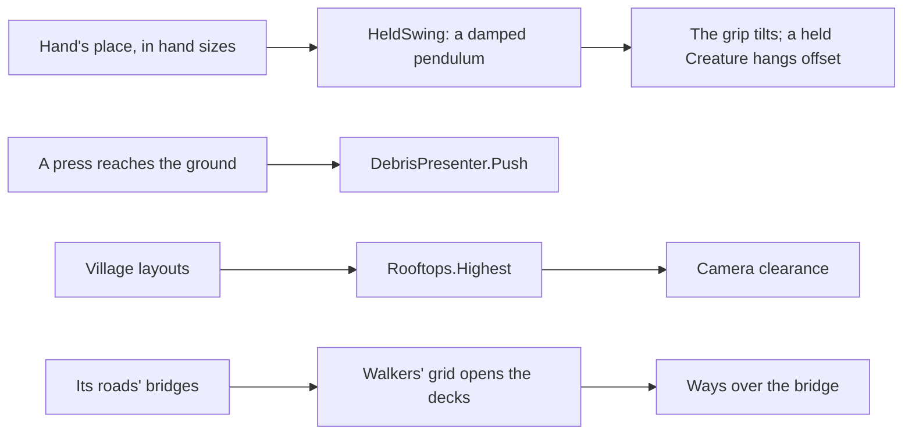

# Milestone 15, part 36 — A tactile hand, the camera above the roofs, and bridges

## Overview

The second part of the final pass. The decisions are in
[ADR-057](../docs/ADR/ADR-057-tactile-hand-camera-above-roofs-and-bridges.md).

- **The hand (§55):** what it holds swings with its moves, and its press knocks the debris about it
  away.
- **The camera:** it keeps above the roofs, not only the ground.
- **Bridges:** villagers whose rounds cross a river walk over their road's bridge.

## Architecture

| Project | Changes |
| --- | --- |
| `Pantheon.Game` | • `Hand/HeldSwing` • `Presentation/Rooftops` • `LocalNavGrid.Build(..., bridges)` opens the decks • `SettlementCrowd.Advance(..., roads)` bakes again as its roads are built |
| client | • `DivineHand`: the grip swings by `HeldSwing`, `Swing`, `Pressed` • `DivineController.HeldCreatureAt` hangs the Creature by the swing • `DebrisPresenter.Push`, `WorldPresenter.PushDebris` and `RoofAt` • `SettlementPresenter.RoofAt`; `SettlementView` passes the roads • `GodCameraController.Roofs` |

## Test plan

- **`TactileTests`:**
  - a held thing hangs still while the hand rests or glides evenly;
  - a quick move leaves it lagging, then it swings past and settles;
  - a jump of the cursor keeps the swing in bounds;
  - the camera keeps above the highest roof beside it, and no roof far away.
- **`LocalNavTests`:** a river is crossed on a bridge where one spans it, and without one there is
  no way.

### Verification results

- **Build and tests:** `dotnet build` has no warnings, and 1534 tests pass (1529 before).
- **On the Mac,** seed 1234 grown, Kestrel Rise at 25 m and 45 m: the camera looks over the
  village from above its roofs on the slope. It had looked out from inside a house there.
- **Not captured:** the swing and the push, as scripted captures cannot move the hand. The tests
  pin both.

## Tasks

### Completed

- [x] The swing, the push, the roofs and the bridges.

### Future

- A held thing that collides with the land, and a hand that pushes things without pressing.
