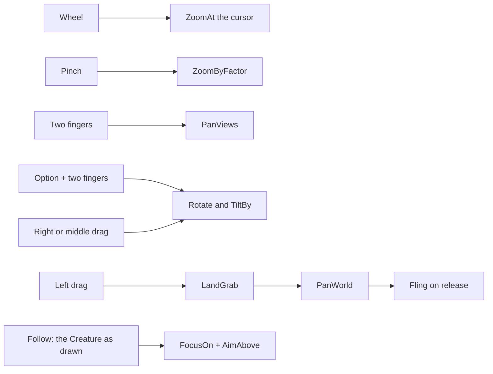

# Milestone 15, part 37 — Camera controls for the mouse and the trackpad

## Overview

The owner's first round of feedback after playing on a MacBook opens with "the mouse control is not
good; zooming in, moving around". The decisions are in
[ADR-058](../docs/ADR/ADR-058-camera-controls-for-mouse-and-trackpad.md).

- **The trackpad:** two fingers pan, a pinch zooms, and Option with two fingers turns and tilts.
- **The mouse:** the left button grabs and flings the land, the right or middle button orbits, the
  wheel zooms towards the cursor, and a double click flies there.
- **Following:** looking at the Creature follows it, framed by its body, until the player pans away.
- **Settings:** panning at the window's edge (now off by default), trackpad scrolling that zooms,
  and the camera's speed.

## Architecture

| Project | Changes |
| --- | --- |
| `Pantheon.Game` | • `GodCameraModel`: `TiltBy`, `PanViews`, `ZoomByFactor`, `Fling`, `AimAbove` • `GodCameraSettings`: the tilt's and the pitch's limits, the fling, `MinDistance` 12 • `GameSettings`: `EdgeScroll`, `TrackpadScrollZooms`, `CameraSpeed` |
| client | • `GodCameraController`: gestures, the left grab, the orbit, double click, `Follow` • `LandGrab`: a press that becomes a grab, and the fling's speed • the input map: left grabs, right and middle orbit, Page Up and Page Down tilt • `GameRoot`: C follows the Creature; `SettingsApplier` and the settings page |

## Test plan

- **`CameraControlTests`:**
  - tilting changes the pitch within its limits;
  - a trackpad pan moves a share of the view, farther when zoomed out;
  - a pinch zooms by its factor about the fingers, and a pinch of nothing does nothing;
  - a flung view glides on, slows and stops, its speed is capped, and a focus stops it;
  - the camera aims above a followed thing and back down after;
  - the controls are settings kept in range, and inconsistent limits are refused.

### Verification results

- **Build and tests:** `dotnet build` has no warnings, and 1540 tests pass (1534 before).
- **On the Mac,** seed 1234, with a temporary probe injecting events into the running game:
  - ten two-finger scrolls of 1.5 at 200 m panned 168 m, as `PanViews` gives;
  - pinching ten times by 1.08 brought the camera from 200 m to 92.6 m;
  - Option with two fingers turned and tilted the view;
  - a left press that moved 2 pixels stayed a click;
  - a left drag of 120 pixels at 93 m grabbed the land and moved the focus 14 m, and letting go
    flung it;
  - a right drag of 100 pixels right and 50 up turned the view 0.5 rad and tilted it 10°;
  - C followed the Creature at 60 m, still on it a second later.
- **The engine's doubling:** the probe found every gesture delivered twice, with the same delta, in
  the same frame. The repeat filter was added, and the figures above are with it.

## Tasks

### Completed

- [x] Gestures, the left grab and fling, the orbit, the tilt, following and the settings.

### Future

- Remapping the controls, and a trackpad's rotate gesture if Godot reports it.
