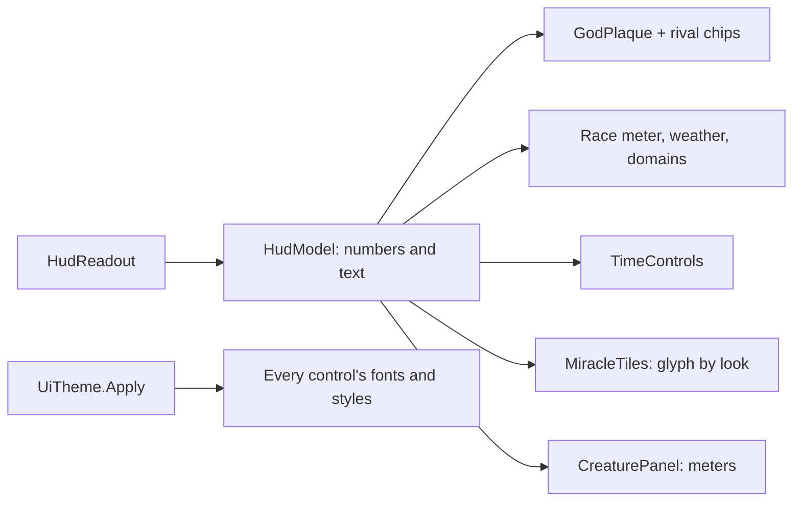

# Milestone 15, part 38 — The interface's look, its scaling, and a HUD of gauges

## Overview

The owner found the text and the miracle buttons too small and the interface unpolished ("like
Minecraft F1 help"). The decisions are in
[ADR-059](../docs/ADR/ADR-059-interface-look-scaling-and-hud.md).

- **Scaling:** the interface stretches with the window, the window opens at nine tenths of the
  screen, and an "Interface size" setting scales the interface further.
- **The look:** Cinzel and Alegreya Sans (OFL), one palette, and slate panels with a gilded edge,
  written once into the default theme.
- **The HUD:**
  - the god's plaque with meters, and chips for the rivals;
  - the race for victory with its meter;
  - pause and speed buttons;
  - drawn miracle tiles;
  - a Creature card of meters;
  - a status toast.

## Architecture

| Project | Changes |
| --- | --- |
| `Pantheon.Game` | • `HudModel`: power, income, followers, the next rank, belief and winning shares, calendar, pause, speed, `RivalChip`s • `CreatureCard`: name, species, level, needs, loyalty, morality • `GameSettings.InterfaceScale` |
| client | • `UI/UiTheme`: fonts, palette, the default theme's styles • `UI/Hud` and `UI/HudParts/`: `GodPlaque`, `Meter`, `TimeControls`, `AlertList`, `StatusToast`, `MiracleTile`, `MiracleGlyphs`, `CreaturePanel` • `SettingsApplier.FitWindow` and the interface's scale • `game/Fonts/` with the OFL licences; `project.godot`'s stretch |

## Test plan

- **`HudGaugeTests`:**
  - the plaque's numbers (power, followers, the next rank, belief and winning shares);
  - a chip for every other god, unmet until they meet, then with a standing;
  - the time controls' pause, speed and season;
  - the Creature card's needs and nature as numbers;
  - the interface size kept in range.

### Verification results

- **Build and tests:** `dotnet build` has no warnings, and 1545 tests pass (1540 before).
- **On the Mac,** seed 1234, both renderers:
  - the window opens at 2720 × 1530 and the interface draws at 1.7×;
  - the HUD, the Book, the diplomacy panel, the settlements panel and the menu all show the new
    fonts at readable sizes;
  - locked miracles show their padlock, and costs too high show red.
- **Frame time:** the grown world at 160 m went from 7.3 ms at 1600 × 900 to 16.8 ms at
  2720 × 1530, the cost of 2.9 times the pixels. The fallback renderer draws it in 10.4 ms.

## Tasks

### Completed

- [x] Stretch, window size and the interface size setting.
- [x] Fonts, palette and default theme.
- [x] The HUD of gauges.

### Future

- The main menu and the saves' metadata (part 39).
- Laying out the panels anew.
