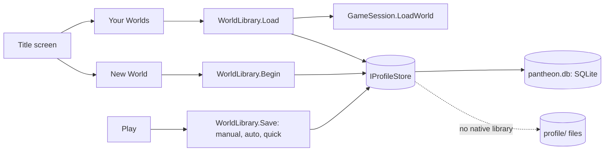

# Milestone 15, part 39 — A main menu and the player's profile in local SQLite

## Overview

The owner asked for a game menu and local SQLite instead of the command line. The decisions are in
[ADR-060](../docs/ADR/ADR-060-main-menu-and-local-sqlite-profile.md).

- **The profile:** settings, worlds, saves and progress in one SQLite file, with a file fallback.
- **The library:** worlds recorded with their god, size, rank, followers and time played; saves by
  kind; old saves and settings brought in once.
- **The title screen:** over the living island, with New World, Your Worlds, Play Together and a
  tabbed Settings page.
- **The pause menu:** saves to the library, and saves before leaving or quitting.

## Architecture

| Project | Changes |
| --- | --- |
| `Pantheon.Persistence` | • `Profile/IProfileStore`, `SqliteProfileStore` (Microsoft.Data.Sqlite), `FileProfileStore` • `ProfileStores.Open`, `Pack` and `Unpack` • `WorldRecord`, `SaveRecord`, `SaveKind` |
| `Pantheon.Game` | • `Flow/WorldLibrary` and `WorldCard` • `GameSession.LoadWorld`; `SessionStore.Prepare` • `LaunchOptions.TitlePage` |
| client | • `Startup.Profile` and settings in the profile • `GameFlow` through the library • `MenuScreen` (title, pause, end) with `NewWorldPage`, `WorldsPage`, `MultiplayerPage`, `SettingsPage` • `UiTheme`: tabs |

## Test plan

- **`ProfileStoreTests`**, for both stores:
  - values are kept across openings;
  - worlds are listed by when they were played;
  - a world keeps every manual save but only its newest autosave and quicksave;
  - deleting a world deletes its saves;
  - the profile is SQLite when its library loads;
  - saves pack small and unpack whole, and damage is a save error.
- **`WorldLibraryTests`:**
  - a new world is named after its first village and records its god and size;
  - a save loads back the same world and counts the time played;
  - saving a world not in the library records it first, and a quicksave replaces the last;
  - old save files are brought in once;
  - deleting the current world leaves it unrecorded.
- **`TitlePageOptionTests`:** the title page option, and its warning.

### Verification results

- **Build and tests:** `dotnet build` has no warnings, and 1561 tests pass (1545 before).
- **On the Mac:**
  - the title screen, the New World page and the Your Worlds page were captured;
  - a probe drove the menu in the running game: a new world from the title (recorded at once), a
    quicksave (its tick in the record) and a quickload;
  - the owner's old `hosted.json` save was brought in as a world.
- **Exports:** the macOS, Windows and Linux exports each carry SQLite's native library, and the
  exported Mac app ran with its profile in SQLite 3.41.2.

## Tasks

### Completed

- [x] The profile, its fallback and the library.
- [x] The title screen and its pages, the pause menu and saves in play.

### Future

- Renaming worlds, and a picture of each world on its card.
