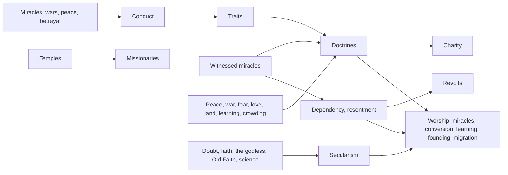

# Milestone 15, part 4 — Culture

## Overview

Part 4 gives villages beliefs of their own and gods a reputation (spec §7, §8, §11, §32–35, with
§3.2). The decisions are in
[ADR-024](../docs/ADR/ADR-024-doctrines-secularism-dependency-resentment-and-traits.md).

What the player gets:

- **Doctrines (§33):** every village holds pacifism, militarism, sacrifice, charity, nature
  worship, knowledge seeking, expansionism and isolationism more or less firmly.
  - They follow what the village lives through and the god most of it follows.
  - Each changes how it worships, takes in miracles, learns, founds villages, converts or
    welcomes strangers.
- **Turning from the gods (§35):** doubt, the godless, an Old Faith, resentment and science make
  villages agnostic, atheist, then anti-divine.
  - Secular villages yield less power, resist miracles and conversion, and learn faster.
  - Anti-divine ones turn people from every god and spread their reason.
- **Dependency and resentment (§7–8):** help in need breeds dependency, and fear and harm breed
  resentment.
  - Unsettled villages that fear and resent their god revolt and tear down its temple.
- **Missionaries and charity (§32, §33):** temples win the godless around them, and charitable
  villages feed hungry neighbours.
- **Traits (§11, §3.2, §34):** the world remembers what each god does, and traits emerge:
  compassionate, cruel, vengeful, merciful, generous, deceptive, honest, chaotic and ambitious.
  - A god known for mercy that strikes its own shocks them twice as hard.
- **Where to see it:**
  - the Settlements panel's culture and feelings;
  - traits on the HUD and in the diplomacy panel;
  - the Culture overlay, alerts, history and F1;
  - `--doctrine`.

## Architecture

| Project | Changes |
| --- | --- |
| `Pantheon.Domain` | Culture state and rules: • `Culture/` (`CultureState`, `Doctrine`, `SecularStage`, `GodConduct`, `GodTrait`, `CultureRules`) • `SettlementState.Culture`, `GodBelief.Dependency` and `Resentment`, `GodState.Conduct` and `Traits`, `DivineRules.Culture`  Events and history: • events `DoctrineEmbraced`, `SecularismRose`, `Rebellion` and `TraitEarned` • history kinds `Revolt`, `Renunciation` and `Doctrine` |
| `Pantheon.Simulation` | Culture: • `Culture/` (`CultureModel`, `ConductModel`, `WitnessCulture`, `CultureSystem`) • the engine runs it after the society step  Hooks: • the worship factor in `BeliefModel.ComputePower` • pull, feelings and expectation in `BeliefSystem` • witnesses and acts in `MiracleCaster` • acts in `DiplomacyAuthority` • learning and founding in `SocietySystem` and `Expansion` • welcome in `MigrationSystem` • culture and feelings inherited by new villages and migrants • the history's records |
| `Pantheon.Persistence` | Save version 16, `SocietySaveMigration.UpgradeFrom15` and `CultureIntegrity`. |
| `Pantheon.Game` | Text, readouts and commands: • `Culture/` (`CultureText`, `CultureReadout`, `CultureCommands`) • `Alerts/CultureAlerts` • `Presentation/CultureOverlay` and `OverlayKind.Culture`  Other: • traits on the HUD and in the diplomacy panel • culture in the Settlements panel and F1 • `--doctrine` (`Launch/CultureAtStart`) • the settlements section replicated every 2 s |
| Godot client | `SocietyController` applies `--doctrine`; the overlay comes through the existing cycle. |
| Content | `Culture` in `divine_rules.json`. |

## Test plan

- **Conduct and traits (`ConductTests`):**
  - Help well above harm is compassion, and with gifts, generosity.
  - Harm well above help, or cruelty to its own, is cruelty.
  - Faithfulness is mercy and honesty until deceit or wars spoil it.
  - Vengeance, upheaval and wars show their own traits.
  - Acts are noted and fade.
  - Diplomacy notes aggression and faithfulness.
- **The culture model (`CultureModelTests`):**
  - Secular stages.
  - Fear breeds resentment, love dissolves it, and sacrifice softens it.
  - Dependency fades, and the dependent doubt in hardship.
  - The worship, pull, welcome, witness and outrage factors.
  - What each doctrine follows.
  - What turns a village from the gods.
- **The culture step (`CultureSystemTests`):**
  - Doctrines drift, and an embraced doctrine is reported once.
  - Secularism passes through its stages.
  - Anti-divine villages turn people away and spread their reason.
  - Missionaries win the godless.
  - Charity moves food without losing any.
  - Revolts happen only in unsettled villages, and tear down the temple.
  - Traits are earned and reported once.
- **Witnesses (`WitnessCultureTests`):**
  - Harm to its own breeds resentment and sacrifice.
  - Help breeds dependency and charity, and blessings nature worship.
  - The world notes help, gifts, harm, cruelty, vengeance and upheaval.
  - Repeated lightning on its own people leaves them resentful and the god cruel.
  - Known mercy doubles the shock of betrayal.
- **Presentation (`CulturePresentationTests`):**
  - The panel's lines.
  - Traits on the HUD and in the diplomacy panel.
  - Alerts and history.
  - The overlay.
  - `--doctrine`.
- **Saves (`SaveMigrationV15Tests`):**
  - A save written by part 3's build gains cultures, feelings and conduct.
  - It keeps every other value and keeps playing the same way.
  - Broken cultures are refused.
- **Multiplayer:** the traffic test holds four players within budget with the settlements section
  every 2 s.

### Verification results

- **Build and tests:** `dotnet build` has no warnings. 965 tests pass (927 before).
- **Ten one-hour games** (seeds 100–109, a passive player):
  - **Doctrines:** villages come to hold charity and pacifism under loving gods.
  - **Traits:** Seren becomes compassionate and generous; Kaio cruel, vengeful, generous and
    chaotic; Vael cruel, vengeful and ambitious.
  - **Secularism:** it peaks near 0.46 (agnostic) in villages split between gods or with many
    godless.
  - **Revolts:** none, since the AI gods do not strike their own followers often enough. The
    unit tests cover them.
  - **Tuning:**
    - pacifism's weight on peace was lowered so it no longer dominated every village;
    - generosity now needs gifts as well as help;
    - the resentment needed for a revolt was set at 0.5.
- **Balance:** 40 one-hour games with a passive player (seeds 30–69).

  | Build | Games with a winner | Median time | Mean time | Winners |
  | --- | --- | --- | --- | --- |
  | Milestone 15 | 37 / 40 | 23.6 min | 29.3 min | Seren 22, Vael and Seren 14, Kaio 1 |
  | Part 2 | 36 / 40 | 27.8 min | 29.7 min | Seren 25, Vael and Seren 5, Kaio 6 |
  | Part 3 | 32 / 40 | 23.9 min | 26.4 min | Seren 14, Vael and Seren 13, Kaio 5 |
  | Part 4 (this build) | 37 / 40 | 28.1 min | 27.5 min | Seren 22, Vael and Seren 11, Kaio 4 |

  As many games find a winner as at Milestone 15, and those that are won take a little longer
  than in part 3 (a median of 28.1 against 23.9 minutes).
- **On the Mac** (seed 42, about 120 FPS):
  - **15 minutes in:** the Settlements panel on Brightwater. It holds charity firmly and
    pacifism, knowledge seeking and expansionism somewhat; it is devout, 15% turned away; and
    Kaio is loved at 49% and resented at 11%.
  - **30 minutes in:** the Culture overlay paints most of the island charity gold. The
    diplomacy panel reads "Seren the Guardian (seen as compassionate, generous)" and "Kaio the
    Trickster (seen as cruel, vengeful, generous, chaotic)".
  - **The fallback renderer:** `--doctrine=secular` turns Brightwater grey on the overlay, with
    "Brightwater turns against the gods".

## Tasks

### Completed

- [x] Culture state, rules and events; save version 16 with the migration, the integrity checks
  and the version 15 fixture.
- [x] The culture model, conduct and traits, witnesses, and the culture step.
- [x] Hooks in worship, belief, miracles, diplomacy, society, expansion and migration.
- [x] The Settlements panel, HUD, diplomacy panel, alerts, history, overlay, F1 and `--doctrine`.
- [x] Tests, probes and captures.

### Future

- Missionaries as walking people, and propaganda (§32).
- Schisms founding new religions with doctrines of their own.
- Politics (part 5) reading doctrines and traits.

## Relevant files

- `src/Pantheon.Domain/Culture/`
- `src/Pantheon.Simulation/Culture/`
- `src/Pantheon.Game/Culture/`, `Alerts/CultureAlerts.cs` and `Presentation/CultureOverlay.cs`
- `src/Pantheon.Persistence/CultureIntegrity.cs`
- `game/Data/divine_rules.json` (`Culture`)
- Tests: `src/Pantheon.Tests/Culture/`
