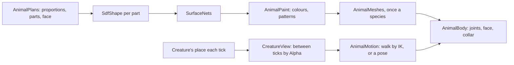

# Milestone 15, part 40 — Animal Creatures, distinct for every god, and their motion close up

## Overview

The owner asked for Creatures that are animals "like in the original Black and White game",
different for every god, and found the Creature's motion close up odd. The decisions are in
[ADR-061](../docs/ADR/ADR-061-animal-creatures.md).

- **Eight animals:** Cow, Ape, Tiger, Lion, Wolf, Bear, Horse and Tortoise, upright, one per god.
  Saves become version 34, renaming the old species.
- **Bodies:** signed-distance shapes meshed by surface nets, painted with patterns.
- **Motion:**
  - feet planted by inverse kinematics;
  - the Creature drawn between ticks;
  - poses for each action;
  - held by the scruff;
  - the camera's line of sight kept over hills.

## Architecture

| Project | Changes |
| --- | --- |
| `Pantheon.Game` | • `Presentation/Animals/`: `Sdf` (parts, `SdfShape`), `SurfaceNets`, `AnimalPlan`, `AnimalParts`, `AnimalPlans`, `AnimalPaint`, `AnimalMotion` and `BodyPose` • `CreatureLook`: `Body` and the extra colours • `WorldMaker`: every god keeps its own animal • `GodCameraModel`: line of sight |
| `Pantheon.Persistence` | • `AnimalSaveMigration` (33 to 34); `CurrentSaveVersion` 34 |
| client | • `AnimalMeshes`, `AnimalBody`, `AnimalFace`; `CreatureView` rewritten • `CreaturePresenter.Prepare` and the scheduler's alpha • `DivineHand.Grip` and `HoldLift` • the Beast on `AnimalBody`; `CreatureBody` removed |
| content | • `creatures.json`: eight species • `gods.json`: an animal per god • `divine_view.json`: their colours |

## Test plan

- **`AnimalBodyTests`:**
  - a sphere meshes to a closed surface on its radius, facing out;
  - blended parts melt together, and the nearest part's paint shows;
  - every body stands with its soles on the ground and its eyes forward;
  - every animal is a different body;
  - a look with an unknown body is refused;
  - the tiger is striped and the cow patched, and bellies stay plain.
- **`AnimalMotionTests`:**
  - a limb reaches its point, knee forward and elbow back;
  - a walking Creature's planted foot stays where it touched down, at a walk, a trot and a run,
    for every body;
  - a swinging foot lifts and lands ahead;
  - standing, working and fighting keep the feet on the ground, sitting lowers the hips, and play
    hops;
  - poses blend.
- **`SaveMigrationV33Tests`:** the version 33 save loads with the animals of its species' natures,
  keeps every other value and plays on the same.
- **The species' tests:** gods have different animals, and a rival takes the player's when the
  player chooses its own.
- **`CameraControlTests`:** a hill between lifts the camera over it.

### Verification results

- **Build and tests:** `dotnet build` has no warnings, and 1611 tests pass (1561 before).
- **On the Mac,** seed 1234:
  - every species was captured up close, each recognisably its animal;
  - the Cow dangled by its scruff from the hand;
  - the Tiger was caught mid-stride, one foot planted and one swinging.
- **Two faults found by the tests and fixed:** standing and boxing lowered the hips without bending
  the legs, so the feet sank, and the Tortoise's feet reached below their soles.
- **Meshing:** a species takes 0.5–1.7 s on a worker thread, and a body is 26,000–33,000 vertices.

## Tasks

### Completed

- [x] The eight animals and their content, the migration, the bodies, the motion and the camera.

### Future

- Skinned meshes, animals that move each in its own way, hands that grip.
