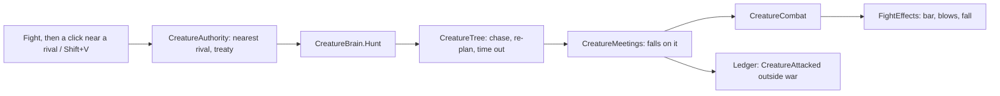

# Milestone 15, part 41 — Creature fights on command, and fights you can see

## Overview

The owner asked that the Creatures be able to fight each other. The decisions are in
[ADR-062](../docs/ADR/ADR-062-creature-fights-on-command.md).

- **The command:** a god points near a rival Creature and its own hunts it down, following it,
  and falls on it when they meet. A treaty can forbid it, and an attack outside a war is held
  against the attacker.
- **The AI gods** at war set their Creatures on their enemies' the same way.
- **Seeing it:**
  - health bars over the fighters;
  - sparks and dust as each blow lands;
  - the loser falling flat before it is banished.

## Architecture

| Project | Changes |
| --- | --- |
| `Pantheon.Domain` | • `CreatureCommandKind.Fight`; `CreatureBondRules.HuntReach` and `HuntSeconds` |
| `Pantheon.Simulation` | • `CreatureAuthority`: Fight, `NoRivalThere`, `Sworn` • `CreatureBrain.Hunt`, `Chase`, `IsHunting` • `CreatureTree`: the hunt • `CreatureMeetings`: hunters meet at once; the ledger • `GodAi`: `AiActionKind.SetCreatureOn` |
| `Pantheon.Game` | • `AnimalMotion.Fallen`, `Blows` and `BoxingRate` • `CreatureText` for the command • `LaunchOptions.Fight` |
| client | • `DivineController`: `FightMode`, `BeginFight`, `FightAt`, `FightNearest`, the ring • Shift+V; the card's Fight button • `FightEffects` and `health_bar.gdshader`; `MiracleLayers.Impact` • `CreatureView`: the fall |
| content | • `creatures.json`: `HuntReach` and `HuntSeconds` |

## Test plan

- **`CreatureHuntTests`:**
  - a god sets its Creature on the rival nearest where it points, and none near is refused;
  - a hunter falls on its rival even right after they met, and its god is remembered for it;
  - a hunter chases a rival that walks away;
  - a treaty forbids the fight, and a banished rival ends the hunt.
- **`AnimalMotionTests`:** a defeated Creature falls flat, and each punch counts one blow.
- **`CreatureRivalryAiTests`:** a god at war sets its Creature on the enemy's.

### Verification results

- **Build and tests:** `dotnet build` has no warnings, and 1616 tests pass (1611 before).
- **On the Mac,** seed 1234 with `--meet=on --fight=on`:
  - Bramble the Cow hunted Quill the Ape and they boxed;
  - sparks and dust flew where the blows landed, and health bars showed 84% and 79%;
  - the alert reported the attack, and Kaio turned hostile.
- **The AI gods,** eight seeds over forty minutes: defeats rose from 22 to 24, and 2 of 8 worlds
  were won before and after.

## Tasks

### Completed

- [x] The command, the hunt, the AI's use of it, and the fight's effects.

### Future

- Blows that knock a Creature back; fights of more than two.
