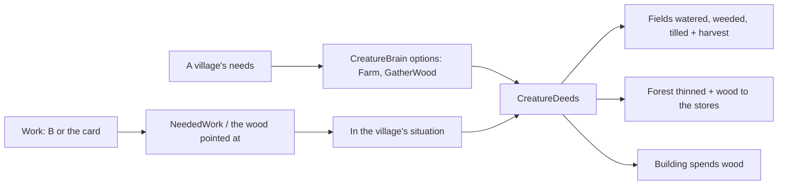

# Milestone 15, part 42 — Creatures farm the fields and fetch wood for the villages

## Overview

The owner asked that the Creatures help the villagers with farming and with getting trees. The
decisions are in [ADR-063](../docs/ADR/ADR-063-creatures-farm-and-fetch-wood.md).

- **Farming:** a Creature tends a village's fields (water, weeding, tilling) and brings in a harvest
  by their fertility.
- **Fetching wood:** it uproots trees in the forest around a village, thinning it, and the timber
  goes to the stores. Building now spends wood.
- **Choosing and teaching:** it chooses both by what villages need and what it has learned, and
  its god orders them with Work (B): at a village, what it needs most; in a wood, timber.

## Architecture

| Project | Changes |
| --- | --- |
| `Pantheon.Domain` | • `CreatureAction.Farm` and `GatherWood` • `CreatureCommandKind.Work`; `CreatureActed.Wood` |
| `Pantheon.Simulation` | • `CreatureDeeds`: `Farm`, `FetchWood`, building that spends wood • `CreatureBrain`: the options, `Work`, `NeededWork` • `CreatureAuthority`: Work, `NoWorkThere` • `CreatureTree`: the guards; `CreatureTemperament`: toiling • `ResourceModel.RichestForest` |
| `Pantheon.Game` | • `AnimalMotion.Farm` and `Uproot` • the words, alerts and moods for the deeds; `LaunchOptions.Work` |
| client | • `DivineController`: `WorkMode`, `BeginWork`, `WorkAt`, `WorkFor` • B for work, Shift+B for region boundaries; the card's Work button • `AnimalBody.ShowTree` |
| content | • `creatures.json`: the deeds' rules and starting preferences |

## Test plan

- **`CreatureWorkTests`:**
  - farming tills, waters and weeds the fields and brings in a harvest;
  - fetching wood thins the forest where it stands and fills the stores;
  - building spends the village's wood, and without wood nothing goes up;
  - a Creature offers to farm for a hungry village and to fetch wood for one short of it;
  - the Work order does what the village needs, or fetches from the wood pointed at, and is
    refused on bare land;
  - rewarding commanded work teaches the Creature to do it unasked.
- **`CreatureBehaviourTests`:** what it learned still decides what it does for a village in need
  (it caught farming's first pull being too strong).

### Verification results

- **Build and tests:** `dotnet build` has no warnings, and 1622 tests pass (1616 before).
- **On the Mac,** seed 1234 with `--work`:
  - Bramble farmed the fields of Duskwater, bending to the soil;
  - in the wood it heaved at a tree before it.
  - Pointing at a wood beside a village first set it farming, so a wood away from the houses now
    means its timber. The wood guard gave up at once in a village with enough wood, so it was
    dropped.
- **Balance,** eight seeds over forty minutes:

  | Measure | Before | After |
  | --- | --- | --- |
  | People | 25,402 | 27,211 |
  | Housing | 32,040 | 35,090 |
  | Wood | 10,778 | 11,600 |
  | Worlds won | 2 of 8 | 3 of 8 |

## Tasks

### Completed

- [x] The deeds, their choice and teaching, the order, the poses and the alerts.

### Future

- Carrying the timber home; working a field of the village's layout.
