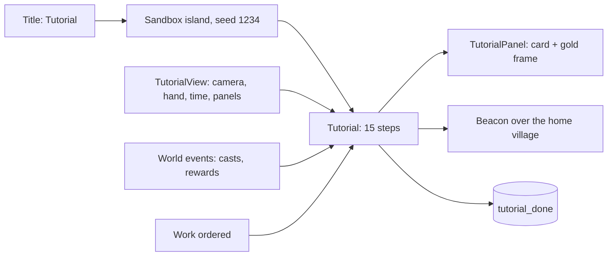

# Milestone 15, part 43 — An interactive tutorial

## Overview

The owner asked for a tutorial on how to play. The decisions are in
[ADR-064](../docs/ADR/ADR-064-interactive-tutorial.md).

- **Fifteen steps** teach the game by playing it:
  - the camera, the plaque, a miracle and influence;
  - the Creature: following, teaching, work and fights;
  - the hand, time, diplomacy and winning.
- **Each step** ends when the player does what it asks, or on Next. It points at the HUD with a
  gold frame, or at the home village with a beacon of light.
- **Starting it:** from the title screen, on a sandbox island. The profile remembers once it is
  finished.

## Architecture

| Project | Changes |
| --- | --- |
| `Pantheon.Game` | • `Flow/Tutorial`: `TutorialStep`, `TutorialTarget`, `TutorialView`, `TutorialSignal` • `LaunchOptions.Tutorial` |
| client | • `Bootstrap/TutorialController` • `UI/Flow/TutorialPanel` and its frame • `Hud.TargetRect`, `CreaturePanel.TargetRect`, `GodPlaque.Rects` • `DivineController.WorkOrdered` • `MenuScreen`: the Tutorial choice and the first-run hint • `GameFlow.StartTutorial` |

## Test plan

- **`TutorialTests`:**
  - the tutorial runs through every step by doing what each asks;
  - what the player did before a step does not count, and steps may be skipped;
  - every step has a title and words, naming the player's god, Creature and village.

### Verification results

- **Build and tests:** `dotnet build` has no warnings, and 1625 tests pass (1622 before).
- **On the Mac,** with `--tutorial=6` and `--tutorial=9`:
  - the card showed its step of fifteen;
  - the gold frame surrounded the Food tile, then the Reward and Punish buttons;
  - a beacon of light stood over Duskwater.

## Tasks

### Completed

- [x] The steps, their detection, the card, the frame, the beacon, the title's entry and the
  profile.

### Future

- Steps for domains, holy sites and the council; a tutorial for playing together.
