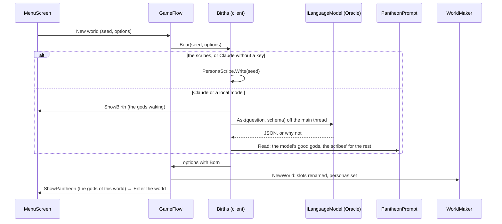

# Milestone 15, part 44 — The gods' minds, and a pantheon born for each world

## Overview

The owner asked to give the rival gods real minds through Anthropic, OpenAI or Gemini models,
with a unique personality and history for each god in every new game, and a way to talk to them.
The owner decided:

- local models and offline play are supported too;
- talking to the gods changes treaties and wars;
- the player brings their own key, set in Settings;
- Anthropic comes first;
- AI-suggested replies sit beside free text.

The decisions are in
[ADR-065](../docs/ADR/ADR-065-the-gods-minds-and-a-born-pantheon.md). This part lays the foundation
and bears a pantheon for each world.

- **Born gods.** Every new world's rival gods are born with it. Each has:
  - a name, an epithet and a personality;
  - a Creature's name, a history, a voice, a desire and a dread;
  - a temper that leans the god AI's weights.
- **Who writes them:**
  - the scribes, from the seed, offline (the default);
  - Claude, with the player's own Anthropic key;
  - a local model, through Ollama.
- **Failures.** Every failure falls back to the scribes, and the game never needs a network.

## Architecture

| Project | Changes |
| --- | --- |
| `Pantheon.Domain` | • `Gods/GodPersona`, `GodTemper` • `GodState.Persona` • `GodAiRules.TemperReach` |
| `Pantheon.Simulation` | • `Gods/GodTempers` • `GodAi.ProfileOf(GodState)`, used by every reader of a god's profile, including `TreatyAdvisor`'s judgement of another god |
| `Pantheon.Persistence` | • Save version 35 • `PersonaSaveMigration` • `SaveIntegrity` checks personas |
| `Pantheon.Game` | • `Minds/`: `ILanguageModel` and its question and answer, `MindProvider`, `MindContent` (`minds.json`), `PersonaScribe`, `PantheonPrompt`, `PantheonBirth`, `BornPantheon`, `PersonaText`, `MindCheck` • `NewWorldOptions.Born` and `WorldMaker.PantheonFor` • `GameSettings.Minds`, `ClaudeModel`, `LocalUrl` and `LocalModel` • `LaunchOptions.Minds`, `PantheonPage` and `MindCheck` • The persona in the Book's world page, the diplomacy readout and the F1 god AI lines |
| `Pantheon.Oracle` (new) | • `AnthropicLanguageModel` (the `Anthropic` SDK, 12.58.0) • `LocalLanguageModel` (Ollama) • `MindFactory` |
| client | • `Bootstrap/Births` • `Startup.AnthropicKey` and `TryLoadMinds` • `UI/Flow/PantheonPages` (the gods waking, the gods of a world) • `UI/Flow/MindsSettings` (the Minds tab) • the lore in `DiplomacyPanel` • `GameFlow`'s new worlds, hosting, F2, the tutorial, `--pantheon` and `--mind-check` |
| content | • `game/Data/minds.json` • `god_ai.json`'s `TemperReach` |

## Test plan

- **`PersonaScribeTests`:** the scribes write the same gods for a seed and other gods for others.
  The player's god is kept. Every rival has its own name start, Creature and personality, and a
  history with its placeholders filled. A temper leans a little, and one way more. A large world
  has seven personalities.
- **`PantheonPromptTests`:**
  - the schema asks for every line and only them, and the question names every slot and animal;
  - a good answer gives the model's gods, with the temper brought to -1..1;
  - badly written gods, ones named like the player or another, wrong slots, and answers that are
    not gods are the scribes'.
- **`PantheonBirthTests`:**
  - **The model:** one that answers writes the gods; a refused, failed, cut-short or cancelled
    question leaves them to the scribes.
  - **The world:** a world made from born gods has their names, Creatures, personalities and
    personas, and keeps the player's chosen animal. Without them, or with gods for another size,
    it has the content's gods.
  - **Saves:** born gods save, load and play the same. A save with a temper out of range is refused.
  - **Profiles:** a temper leans the god's profile; an even temper leaves it as it is; weights stay
    from 0 to 1.
- **`OracleTests`** (a stub HTTP server, no network):
  - **Claude's request:** the key, the fallback beta and `fallbacks: "default"`, the effort,
    `json_schema` output, the cached instructions, and no temperature or thinking parameters.
  - **Claude's answers:** a refusal, a cut-short answer and a refused key, each read correctly.
  - **The local model:** its request at its address (with a path kept), a long answer, a missing
    model, no server, and the server's models.
  - **The factory and Test:** each opens the model the settings choose, and Test reads a greeting.
- **`PersonaTextTests`:** titles, natures and numbers; the shipped `minds.json`, and broken ones
  refused; the minds' settings round-trip and come back into range; `--minds` and `--pantheon`.
- **`SaveMigrationV34Tests`:** a part 43 save (commit 6da1001) loads with no personas and plays on
  as before. Every older migration test applies `Version35Expectations`.
- **`ArchitectureRulesTests`:** `Pantheon.Oracle` references only Game, and has no clock or
  unseeded randomness.
- **`RivalPresentationTests`:** the F1 persona line.

### Verification results

- **Build and tests:** `dotnet build` has no warnings, and 1686 tests pass (1625 before).
- **On the Mac (Terrain3D):**
  - **The scribes:** `--pantheon=on` showed three rivals, each with an epithet, personality,
    Creature, history and nature.
  - **A local model:** with a stand-in for Ollama's API on port 11434, `--minds=local
    --pantheon=on` showed "The gods are waking" for the stand-in's 4 s. Then the model's gods
    made the world (Morrakh the Ash-Crowned, Selwyn of the Quiet Tide, Quillon the Grinning), and
    `--mind-check=on` printed the model's greeting.
  - **Claude:** `--minds=claude --mind-check=on`, with a deliberately invalid placeholder key, sent
    one request through the SDK, and Anthropic's refusal came back as "Anthropic did not accept the
    key". This shows the SDK and its `System.Text.Json` 10 load in Godot's runtime.
  - **The Book** told each god's history and nature.
  - **The Minds tab** showed the provider, the masked key, the model and Test.
- **On the fallback renderer:** the diplomacy panel told each god's lore, wrapped in its card.
- **The macOS release export** carries `Anthropic.dll`, `Microsoft.Extensions.AI.Abstractions.dll`,
  `System.Text.Json.dll` and `Pantheon.Oracle.dll`. It bore the stand-in model's gods and reached
  Anthropic as above.
- **Not verified:** a real Claude answer. No key was available on this Mac.

## Tasks

### Completed

- [x] The contract, the Claude and local adapters, the factory, and the Minds tab with the key kept
  apart and Test.
- [x] The scribes, the prompt and its strict reading, the birth with its waiting page and fallback,
  and the pantheon page.
- [x] Personas in the world and its saves (version 35), tempers in the god AI, and the persona in
  the Book, diplomacy and F1.

### Next parts (ADR-065)

- Talking to the gods: a conversation in the diplomacy panel, in each god's voice, with suggested
  replies to pick from and free text. The model's proposals reach the world only through
  `DiplomacyAuthority`, as the god's own commands, held to what its utility would accept within a
  small margin of persuasion.
- The gods' counsel: the model sets a god's long-term goals now and then, as the planner's options,
  told in the history.
- The Creatures' voices.
- OpenAI and Gemini behind the same contract.
