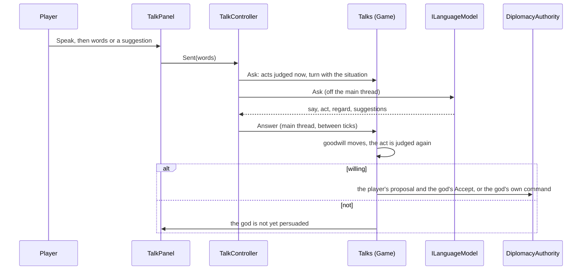

# Milestone 15, part 45 — Talking to the gods

## Overview

The second part of the gods' minds (ADR-065). The owner wanted to talk to the gods, with talk
changing treaties and wars, and suggested replies beside free text. The decisions are in
[ADR-066](../docs/ADR/ADR-066-talking-to-the-gods.md).

- **Opening.** Speak on a god's diplomacy card opens a conversation, and the world pauses.
- **With a model** (Claude or a local one):
  - the player types their own words or picks one of three suggested replies;
  - the god answers in its voice;
  - its answer may take one act: agree to an alliance, peace or a treaty, accept or decline the
    player's proposal, offer an alliance or peace itself, declare war, or break an alliance.
- **With the scribes:** each suggestion asks one deal, and the god answers by its personality.
- **Every act is judged by the god's own AI,** leaning by at most 0.15 with the goodwill the
  player's words have won, and done through the diplomacy authority.

## Architecture

| Project | Changes |
| --- | --- |
| `Pantheon.Game` | • `Minds/TalkActs` (`TalkAct`, `TalkActKind`, `TalkWillingness`, `Treaty` in words) • `GodTalk` (lines, turns, goodwill), `TalkPrompt` (instructions, turn, schema, `TalkReply`), `TalkScribe`, `Talks` • `TalkRules` in `MindContent` • `LaunchOptions.Talk` and `TalkSay` |
| client | • `UI/TalkPanel` • `Bootstrap/TalkController` (created by `GameFlow`) • `Births.OpenModel` • Speak on `DiplomacyPanel`'s cards • `GodCameraController` ignores keys while a text field has focus |
| content | • `minds.json`'s `Talk` |

## Test plan

- **`TalkTests`:**
  - **Leaning:** goodwill moves a friendly act by the reach at most, holds a hostile act back, and
    ill will draws it on. It moves by the regard and halves every half-life.
  - **The acts:** they are what the authority allows, with the god's own utilities (alliance
    + 0.2, war − 0.25), and treaties are told in words from each side.
  - **A model's answer:**
    - a god that trusts the player agrees to an alliance through the authority;
    - a god that distrusts the player is not talked into one, whatever the model says or claims;
    - an unknown act, or none, only talks.
  - **The question:** it tells the god who it is and how things stand, and only the acts it would
    consider. The model gets the newest turns, starting with the player's, and a failed question
    forgets its words.
  - **Without a model:** a suggestion asks an act, and the god does it only if willing, else
    refuses in character.
  - **Acts:** a hostile act is the god's own command, and peace waits out the status cooldown. A
    treaty agreed is the player's proposal, accepted.
  - **Replies:** they are read within bounds, and one that says nothing is not read.
- **`PersonaTextTests`:** `--talk` and `--talk-say`.

### Verification results

- **Build and tests:** `dotnet build` has no warnings, and 1714 tests pass (1686 before).
- **On the Mac (Terrain3D),** with the local model's stand-in on port 11434:
  `--gods-met=on --minds=local --talk=3 "--talk-say=Ashsaeth, let us be allies against the
  Tyrant."`.
  - The god replied in character and took `alliance`.
  - The authority made them allies: the toast said "Ashsaeth accepted your alliance", the chip read
    "allied", and the race counted you together.
  - The model's three suggestions replaced the scribes'.
  - The world stayed paused while you talked.
- **On the fallback renderer,** `--talk=3` without a model:
  - the scribes greeted the player;
  - the suggestions read "I will pay you tribute: 20 power a minute, for 5 minutes." and "Let us
    make a defensive pact against Wynlius, for 5 minutes.";
  - the free-text field said a model is needed.
- **Not verified:** a real Claude conversation. No key was available on this Mac. The adapter and
  its request are part 44's.

## Tasks

### Completed

- [x] Acts and their judgement, goodwill, the prompt and its reading, the scribes' talk, and the
  conversation.
- [x] The panel, the controller, Speak, pausing, and the camera ignoring typing.

### Next parts (ADR-065)

- The gods' counsel: the model sets a god's long-term goals now and then.
- The Creatures' voices.
- Talk for joined players, through the host.
- OpenAI and Gemini behind the same contract.
