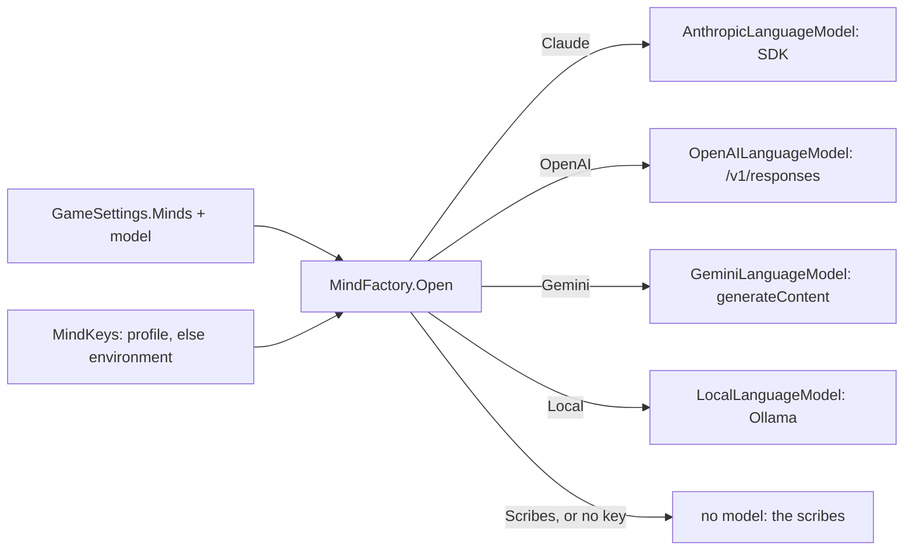

# Milestone 15, part 46 — OpenAI and Gemini as the gods' minds

## Overview

The owner asked for OpenAI and Gemini beside Claude, a local model and the scribes. The decisions
are in [ADR-067](../docs/ADR/ADR-067-openai-and-gemini-minds.md), which amends ADR-065.

- **GPT, by OpenAI:** GPT-6.1 Sol by default, GPT-6 Astra or GPT-6 Luna. It is asked through the
  Responses API, with strict JSON-schema output, the question's reasoning effort, and nothing
  stored on OpenAI's side.
- **Gemini, by Google:** Gemini 3.8 Flash by default, Gemini 4 Argon or Gemini 3.5 Flash-Lite. It
  is asked through `generateContent`, with a JSON response format and the question's thinking
  level; its thoughts are left out of the answer.
- **Keys.** Each provider's key is the player's own, kept apart in the profile or read from the
  usual environment variable, and sent only to its provider.
- **Shared behaviour.** The pantheon's birth, talk, the fallbacks to the scribes and the judgement
  of every act work the same through every provider.

## Architecture

| Project | Changes |
| --- | --- |
| `Pantheon.Game` | • `MindProvider.OpenAI` and `Gemini` • `MindKeys` • `MindContent.OpenAIModels`, `GeminiModels` and `ModelChoice` (was `ClaudeModelChoice`) • `GameSettings.OpenAIModel` and `GeminiModel` |
| `Pantheon.Oracle` | • `OpenAILanguageModel`, `GeminiLanguageModel` and `JsonHttp` • `MindFactory` takes `MindKeys`, with `KeyVariables`, `ProviderName` and `KeyName` |
| client | • `Startup.Keys` and `KeepKey` (`openai_key`, `gemini_key`) • `MindsSettings` builds every online provider's rows alike |
| content | • `minds.json`'s `OpenAIModels` and `GeminiModels` |

## Test plan

- **`OracleTests`:**
  - **The factory:** each provider opens with its own key and the model chosen. Without its key an
    online provider opens nothing and names the key, and another provider's key does not count.
    Keys are each provider's own, and Gemini's are read from two variables.
  - **GPT:**
    - the request goes to `/v1/responses` with the bearer key, the instructions, the turns' roles,
      the effort, the length, the strict `json_schema` and `store: false`;
    - the answer is read past a reasoning item;
    - cut short, filtered, refused, empty and unreadable answers give no answer;
    - a refused key, a spent quota, an unknown model and a bad request are told in words.
  - **Gemini:**
    - the request goes to `models/…:generateContent` with `x-goog-api-key`, the system
      instruction, the turns as `user` and `model`, the JSON response format, the thinking level
      and the length;
    - the answer is read without its thoughts;
    - `MAX_TOKENS`, `SAFETY`, `PROHIBITED_CONTENT`, a blocked prompt and only thoughts give no
      answer;
    - a refused key (400 `API_KEY_INVALID`), a rate limit, an unknown model and a bad request are
      told in words.
  - **No server:** both say to check the connection.
- **`PersonaTextTests`:** the shipped model lists and their defaults, broken lists refused, the new
  settings round-trip and come back to their defaults, and `--minds=openai|gemini`.

### Verification results

- **Build and tests:** `dotnet build` has no warnings, and 1739 tests pass (1714 before).
- **In the game (Terrain3D),** with deliberately invalid placeholder keys from the environment (one
  request each, refused by the provider at no cost):
  - `--minds=openai --mind-check=on` printed "GPT-6.1 Sol did not answer: OpenAI did not accept
    the key";
  - `--minds=gemini --mind-check=on` printed "Gemini 3.8 Flash did not answer: Google did not
    accept the key".
- **The Minds tab**, with GPT and then Gemini chosen (the profile's settings restored after),
  showed each provider's masked key, models and Test.
- **The fallback renderer** started a world and ran.
- **Not verified:** a real answer from GPT or Gemini, as no OpenAI or Gemini key was available on
  this Mac.

## Tasks

### Completed

- [x] Both adapters, the keys, the settings, the factory, the Minds tab, content and tests.

### Future

- The gods' counsel and the Creatures' voices (ADR-065's next parts), through any provider.
- Updating the model lists as the providers release and retire models.
