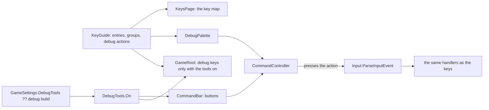

# Milestone 15, part 47 — Every command in view: the god's bar, the keys, and the debug tools

## Overview

The owner, playing, asked how to meet a god. The answer was a debug key (J or K), and they asked:
"Do we have shortcuts key maps? And all those settings should be in the settings menu UI", "there
should be a button for J and K", and "rethink the buttons we show the user". The decisions are in
[ADR-068](../docs/ADR/ADR-068-every-command-in-view.md), which amends ADR-059.

**What was found** (an inventory of all 67 input actions and every control in play):

- **Hidden panels:** apart from pause, the speeds, the Creature's orders and the miracles, nothing on
  screen opens anything. The Book (Tab), the villages (N), diplomacy (P), the council (U), the
  domains (G), the history (H), the overlays (O), the overview (`), veiled casting (T) and the menu
  (Esc) were reachable only by keys that nothing showed.
- **Cheats always on:** twenty debug keys (F2, F4, J, K, the disasters and more) work in every game,
  and F2 replaces the world at a touch.
- **No key map:** the only list of keys was the README.
- **Esc in an order:** in a Send, Fight or Work order, Esc opened the menu instead of cancelling the
  order, which the hint said it would.
- **Start-up options without a place in the menus:** the gods' first acquaintance (`--gods-met`) and
  the terrain renderer (`--terrain`) were launch options only.
- **No way to seek a god:** only the J and K cheats.

**What changes:**

1. **The god's bar.** A row of drawn icons under the season, top right, each with its key on a
   badge: the Book, the villages, the gods, the council, the domains, the history, the map
   overlays, the overview, the keys and the menu. A button presses its key, so the bar and the
   keys can never do different things.
2. **The map's chooser.** The map button lists the overlays by name, with the shown one marked. O
   still steps through them.
3. **Veil.** A toggle at the end of the miracle bar, lit while your miracles are veiled.
4. **The rivals.** Each rival under your plaque opens the gods' panel.
5. **Seeking a god.** A god you have not met offers "Seek them out" on its card. It sends your
   Creature to theirs, through the same order Send gives. When the two come within 40 m they meet,
   and so do you.
6. **The key map.** Every key and gesture, grouped and in words, generated from the game's own
   bindings. It opens from the bar's Keys button and from the settings' new Keys tab.
7. **Debug tools behind a setting.** The setting is in Interface.
   - **Off:** the debug keys do nothing, and the debug overlays leave the map chooser.
   - **On:** the bar shows a Debug button. Its palette has a button for every debug tool (J and K
     among them), each with its key. The council panel offers "Summon now (J)", and an unmet god's
     card offers "Bring its Creature (K)".
   - **The default:** on when the game runs from the project, as the owner plays it; off in an
     exported game.
8. **Choices in the menus.**
   - The New World page gains "The gods": strangers who meet as their lands grow, or known to one
     another from the start.
   - Graphics gains "Simple terrain", which takes effect at the next start.
9. **Esc** cancels an order before it opens the menu.
10. **"Where you point" over the interface.** A key pressed with the pointer over a panel, and
    every bar or palette button, acts at the view's centre, not at the ground hidden behind the
    panel.

## Architecture

| Project | Changes |
| --- | --- |
| `Pantheon.Game` | • `Controls/KeyGuide` (`KeyEntry`, `KeyGroup`, `KeyModifier`): every key and gesture in words, grouped; which actions are debug tools • `Controls/CommandBar` (`BarButton`, `BarCommand`): the bar's buttons • `OverlayMap.Offered`, `Title` and `Next(kind, debug)` • `CreatureCommands.Seek` • `NewWorldOptions.GodsMet` (`WorldMaker` introduces the gods) • `GameSettings.DebugTools` (null: the build decides) and `SimpleTerrain` • `HudModel.Veiled` • `LaunchOptions.Bar` (`--bar=<button>` presses a bar button at the start) and `--title-page=keys` |
| client | • `UI/HudParts/CommandBar` and `CommandGlyphs` • `UI/KeysPage` (the key map, in the settings' Keys tab and in play) • `UI/DebugPalette` • `Bootstrap/CommandController` (the bar, the chooser, the key map and the palette; buttons press their actions) • `Bootstrap/DebugTools` (whether they are on) • the diplomacy panel moves from `GameRoot` to `PoliticsController` • `GameRoot` skips debug keys when the tools are off • `GodCameraController` points at the view's centre over the interface • the Seek, Bring and Summon buttons, the Veil tile and the clickable rivals |
| content | no change |

## Test plan

- **`KeyGuideTests`:**
  - every action in `game/project.godot` is in the key map, and every action it names exists;
  - no entry has neither an action nor a gesture;
  - the debug actions are the debug group's, and every `debug_*` action is among them;
  - the debug group is shown only with the tools on.
- **`CommandBarTests`:** each button's action is a key-map action outside the debug group; the
  Debug button only with the tools on.
- **`OverlayMap`:** the debug overlays are offered and stepped through only with the tools on, and
  every overlay has a title.
- **`CreatureCommands.Seek`:**
  - it sends your Creature toward the other god's;
  - it refuses without a Creature on either side, or when theirs is banished.
- **`WorldMaker`:** with `GodsMet` every god knows every other at tick 0, and without it none do
  when meeting first is required.
- **Settings:** `DebugTools` and `SimpleTerrain` round-trip, and an old settings file leaves them
  at their defaults.

## Tasks

### Completed

- [x] The key map, the bar, the chooser, the palette, the debug setting, Seek, the New World choice,
  simple terrain, Esc, the pointer over the interface, `--bar`, tests, captures and docs.

### Verification results

- **Build and tests:** `dotnet build` has no warnings, and 1759 tests pass (1749 before): 9 in
  `ControlsTests` and 1 in `GameSettingsTests`.
- **In the game (Terrain3D), captured on the Mac:**
  - the bar under the clock, with its keys on badges, and Veil ending the miracle bar;
  - the key map from the Keys button (`--bar=keys`), its button lit, and the settings' Keys tab
    (`--title-page=keys`);
  - the map's chooser (`--bar=map`): fourteen overlays with the debug tools on, twelve with them off;
  - the debug palette (`--bar=debug`), a button and key for each of the twenty tools;
  - an unmet god's card with Seek them out and Bring its Creature (K), and the council with
    Summon now (J);
  - the Book opened by its bar button (`--bar=book`): the button presses Tab's action, the same way
    as the key;
  - the New World page with "The gods".
- **The debug tools off** (the setting written into the profile for the run, and the profile
  restored after): no Debug button on the bar, no debug overlays, and the key map without its debug
  group.
- **The fallback renderer** ran with the bar and the key map.
- **A capture lesson.** zsh does not split an unquoted variable into words. A capture loop passing
  `$a` gave Godot `--menu=off --bar=map` as a single option, so nothing opened; use `${=a}`.

### Future

- Rebinding keys from the key map.
