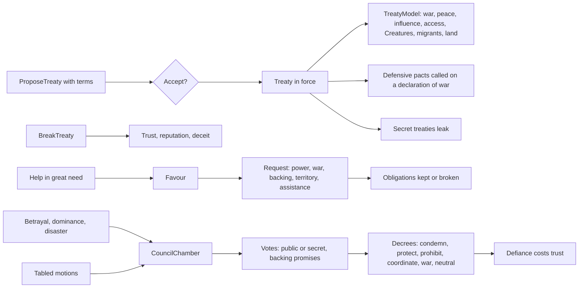

# Milestone 15, part 5 — Treaties and the Divine Council

## Overview

Part 5 gives gods the politics of §37–42 and §54: treaties beyond alliance and peace, secret
agreements, the consequences of breaking them, favours owed for help, and a Divine Council that
votes on the world's affairs. The decisions are in
[ADR-025](../docs/ADR/ADR-025-treaties-secrets-favours-and-the-divine-council.md). War goals,
intelligence, proxy wars and mortal holy wars (§43–46) follow in part 6.

What the player gets:

- **Treaties (§38):** eleven kinds besides alliance:
  - non-aggression, defensive pact, joint war, shared influence, religious access;
  - Creature truce, disaster assistance, mutual defence, territorial agreement, tribute,
    migration agreement.
  - Each runs for a term or until broken, and changes what the gods may do.
- **Secret agreements (§39):** a treaty may be signed in secret. Others learn of it when it is
  invoked or when it leaks, and the god it was aimed at remembers the plot.
- **Betrayal (§40):** breaking any treaty costs:
  - the partner's trust, and the trust of every god that knew of it;
  - the god's reputation for its word, so AI gods weigh a deceptive god's offers less.
- **Favours (§41):** saving another god's followers in great need puts it in your debt. Call it in
  for Divine Power, war on your enemy, its vote, its absence from your villages, or help for your
  people. Refusing what it owes is remembered.
- **The Divine Council (§42):**
  - A betrayal, a god rising to dominate or a disaster summons it; a tabled motion waits for the
    regular session.
  - It votes, in public or in secret, to condemn a god, protect a holy site, prohibit smiting,
    cataclysms or terror, coordinate disaster response, make war on a god together, or make a
    village neutral ground.
  - Decrees bind by reputation: defying one is possible and costly.
- **Absorbing an ally (§54):** a god may break its alliance and take a share of its ally's
  followers where it leads.
- **Where to see it:**
  - the diplomacy panel's treaties, favours and offers;
  - the council panel (U);
  - alerts, history and F1;
  - J and the launch options.

## Architecture

| Project | Changes |
| --- | --- |
| `Pantheon.Domain` | Politics state and rules: • `Politics/` (`Treaty`, `TreatyKind`, `TreatyTerms`, `RequestAsk`, `Favour`, `Obligation`, `CouncilMotion`, `CouncilState`, `PoliticsRules`) • `DiplomacyState.Treaties`, `Favours`, `Obligations`, `Council` and `Empty()` • `DiplomacyRules.Politics` • the new proposal kinds, commands and acts  Events and history: • events `TreatySigned`, `TreatyEnded`, `TreatyRevealed`, `TreatyInvoked`, `FavourOwed`, `RequestAnswered`, `ObligationEnded`, `CouncilSummoned`, `CouncilClosed`, `CouncilDefied` and `AllyAbsorbed` • history kinds `Treaty`, `Revelation`, `Decree` and `Absorption` |
| `Pantheon.Simulation` | Politics: • `Politics/` (`TreatyModel`, `CouncilModel`, `PoliticsChecks`, `TreatyBook`, `FavourBook`, `PoliticsActions`, `CouncilChamber`, `CouncilAuthority`, `Defiance`, `PoliticsSystem`) • the diplomacy authority handles treaties, requests and absorption, and calls defensive pacts on a declaration of war • the ledger turns rescues into favours  The AI: • `Gods/TreatyAdvisor` and `Gods/CouncilAdvisor`  Hooks: • influence, cost, territory and defiance in `MiracleCaster` • neutral ground and access in `BeliefSystem` • missionaries in `CultureSystem` • migrants in `MigrationSystem` • Creature truces in `CreatureMeetings` • disaster assistance in `MiracleValuer` |
| `Pantheon.Persistence` | Save version 17, `PoliticsSaveMigration` and `PoliticsIntegrity`. |
| `Pantheon.Networking` | `DiplomacyIntent` with terms, a treaty and an ask; `CouncilIntent`; protocol version 5. |
| `Pantheon.Game` | Text, readouts and commands: • `Politics/` (`PoliticsText`, `PoliticsReadout`, `CouncilReadout`, `PoliticsCommands`) • `Alerts/PoliticsAlerts` • `Diagnostics/PoliticsReadout`  Multiplayer: • `Multiplayer/SecretFilter`, with per-player snapshots, diplomacy and events in the host  Other: • `GameSession.Inspect` • `--treaty`, `--council-panel` and `--summon-council` (moved, with part 3 and 4's options, into `LaunchOptions.Expansion.cs`) |
| Godot client | `UI/CouncilPanel`, `Bootstrap/PoliticsController`, the diplomacy panel's treaties, term and secrecy choice and buttons (scrolling); the U and J actions. |
| Content | `Politics` in `diplomacy.json`. |

## Test plan

- **Treaties (`TreatyTests`):**
  - A non-aggression pact forbids war until broken, and breaking it is a betrayal: memory,
    others' trust, deceit and the event.
  - Invalid terms are refused.
  - At war only peace pacts may be proposed, and signing one makes peace.
  - A joint war sends both to war and forbids a separate peace.
  - A secret defensive pact calls its defender even against an ally, and comes to light.
  - Mutual defence works both ways.
  - Treaties run their term, and tributes are paid until the payer cannot pay.
  - Secret treaties leak, and their target remembers the plot.
  - Each kind's effect on what gods may do.
  - A territorial agreement refuses casts.
  - Absorbing an ally.
- **Favours (`FavourTests`):**
  - A rescue makes a god owe a favour.
  - Granting repays a favour, and refusing it is remembered.
  - War and territory requests are carried out.
  - Power that is not there cannot be granted.
  - Promises of assistance are kept or broken.
- **The council (`CouncilTests`):**
  - A betrayal summons a public condemnation that passes and condemns.
  - A secret ballot leaves no memory, and too few votes fail.
  - A tabled motion waits for the regular session.
  - Dominance brings a pantheon war on the leader by its voters.
  - A disaster brings a coordinated response that halves the cost of help.
  - Defiance costs every god's trust.
  - Neutral ground stops conversion, and harm there defies it.
  - The authority's checks.
  - AI votes: its own motion, a motion against it, a promise.
- **The AI (`TreatyAdvisorTests`):**
  - A deceptive proposer is trusted less.
  - No god agrees to an unaffordable tribute, and it honours favours.
  - A weary god at war proposes non-aggression.
- **Presentation (`PoliticsPresentationTests`):**
  - Sentences.
  - The diplomacy panel's treaties, favours, proposal and offers.
  - The council panel's session, ballot and motions.
  - Alerts, keeping others' secrets.
  - History.
  - Launch options and debug commands.
- **Multiplayer (`PoliticsMultiplayerTests`):**
  - A player's treaty and vote reach the host.
  - Secret treaties reach only their parties: snapshots, sections and events.
- **Saves (`SaveMigrationV16Tests`):**
  - A save written by part 4's build gains empty politics.
  - It keeps every other value and keeps playing the same way.
  - Broken politics are refused.

### Verification results

- **Build and tests:** `dotnet build` has no warnings. 1011 tests pass (965 before).
- **Ten one-hour games** (seeds 100–109, a passive player):
  - **Treaties signed:** 19 joint wars, 16 defensive pacts, 14 disaster assistance pacts, 9
    territorial agreements, 8 tributes, 7 mutual defence pacts, 5 non-aggression pacts, 1
    religious access. Most run their term; 14 were broken.
  - **The council:**
    - Condemnations passed 25 times (2 rejected), mostly of Kaio the Trickster.
    - Coordinated responses passed 26 times, protection of sites 4.
    - Pantheon wars passed 10 times and were rejected 15 times (allies of the leader vote
      against).
    - Prohibitions were rejected twice, and decrees were defied 8 times.
  - **Secrets and favours:** AI gods sign few secret treaties and favours are rare among them.
    Both are covered by the tests and open to the player.
  - **Tuning:**
    - The first build signed only war pacts and condemned someone at every session. Cooperative
      thresholds were lowered.
    - Peace pacts are now weighed as peace.
    - An AI only proposes to another AI what it might accept; 125 tribute demands had been
      declined.
    - Tribute must be affordable; 44 of 49 had defaulted, each summoning a council.
    - Only alliance betrayals summon the council, and decrees in force may not be tabled again.
- **Balance:** 40 one-hour games with a passive player (seeds 30–69).

  | Build | Games with a winner | Median time | Mean time | Winners |
  | --- | --- | --- | --- | --- |
  | Part 3 | 32 / 40 | 23.9 min | 26.4 min | Seren 14, Vael and Seren 13, Kaio 5 |
  | Part 4 | 37 / 40 | 28.1 min | 27.5 min | Seren 22, Vael and Seren 11, Kaio 4 |
  | Part 5 (this build) | 37 / 40 | 28.6 min | 31.2 min | Seren 21, Vael and Seren 12, Kaio 4 |

  As many games are won and the median holds. The mean rises by about four minutes: pantheon
  wars and joint wars draw out a few games.
- **On the Mac** (about 120 FPS):
  - **The council panel** (seed 42, 20 minutes in): a secret-ballot pantheon war in session,
    "Help where disaster struck costs half" in force, three tabled motions, and every motion the
    player may table.
  - **The bug it found:** the dominance motion first named Vael, the weak partner of a
    dominating bloc; it now names the god with the most followers.
  - **The diplomacy panel:** the player's mutual defence pact with Seren with Break, each god's
    other treaties on one line, and the term and secrecy choice. The first version overflowed
    the screen and offered Break on others' treaties; the cards now scroll, and only the player's
    treaties can be broken.
  - **The fallback renderer** (seed 1234): the council condemning Kaio in session, with a
    pantheon war on Kaio in force.

## Tasks

### Completed

- [x] Politics state, rules and events; save version 17 with the migration, the integrity checks
  and the version 16 fixture.
- [x] Treaties, secrets, betrayal, favours, requests, promises, the council and absorption.
- [x] The AI's treaties, requests, motions and votes, tuned over ten games.
- [x] Protocol 5, the intents, and secrets filtered for each player.
- [x] The diplomacy and council panels, alerts, history, F1, J and the launch options.
- [x] Tests, probes and captures.

### Future

- War goals and peace terms, intelligence and deception, proxy wars and mortal holy wars
  (part 6).
- Treaty conditions beyond a term and a target, and votes traded for treaties.

## Relevant files

- `src/Pantheon.Domain/Politics/`
- `src/Pantheon.Simulation/Politics/`, `Gods/TreatyAdvisor.cs` and `Gods/CouncilAdvisor.cs`
- `src/Pantheon.Game/Politics/`, `Alerts/PoliticsAlerts.cs`, `Diagnostics/PoliticsReadout.cs` and
  `Multiplayer/SecretFilter.cs`
- `src/Pantheon.Persistence/PoliticsSaveMigration.cs` and `PoliticsIntegrity.cs`
- `game/Scripts/UI/CouncilPanel.cs`, `UI/DiplomacyPanel.cs` and `Bootstrap/PoliticsController.cs`
- `game/Data/diplomacy.json` (`Politics`)
- Tests: `src/Pantheon.Tests/Politics/`
