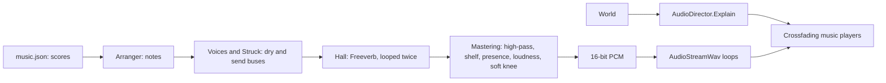

# Milestone 15, part 50 — An orchestra made in code, and a piece for every mood

## Overview

The owner: "We need more dramatic music. The music should be more orchestra." The decisions are in
[ADR-071](../docs/ADR/ADR-071-an-orchestra-made-in-code.md), which amends ADR-021.

- **What was there:** three 24-second loops of sine pads and bells.
- **What replaces it:**
  - a synthesized orchestra: string sections, horns, brass, choir, flute, oboe, harp, celesta,
    timpani, taiko and cymbals, in a hall;
  - seven original pieces in `game/Data/music.json`: a main theme for the title screen, and Calm,
    Dark, Tension, War, Disaster and Triumph;
  - the mood follows spec §60: morality, warfare, the Creature's fights, disaster, political tension
    and Divine Power.

## Architecture

| Project | Changes |
| --- | --- |
| `Pantheon.Game` | • `Audio/Orchestra/`: &nbsp;&nbsp;– `MusicContent`: `Instrument`, `Playing`, `HallRules`, `MoodScore` and `ScorePart` &nbsp;&nbsp;– `Notation`: chords, notes, tones, hits and bars &nbsp;&nbsp;– `Arranger`: `NoteEvent` and voicing &nbsp;&nbsp;– `Voices` and `Struck`: the instruments &nbsp;&nbsp;– `Dsp`: `Svf`, `Blep`, `Hall` and `Mastering` &nbsp;&nbsp;– `Orchestra.Render` • `MusicMood` gains Theme, Dark, War and Disaster • `AudioDirector.Explain` • `WavFile` • `--music` and `--music-export` • `MusicComposer` is removed • built optimised in every configuration |
| client | • `AudioPresenter` plays the pieces on worker threads, the Theme first; plays the Theme on the title screen; switches at once to a more urgent mood; writes WAV files when asked • `Startup.TryLoadMusic` • `GameFlow.TitleOpen` |
| content | `music.json` |

## Test plan

- **`OrchestraTests`:**
  - chord symbols read;
  - notes, patterns and bars read, and nonsense is refused;
  - the shipped music has a piece for every mood, each melody filling whole bars;
  - a broken score is refused;
  - chords are voiced near their octave, each voice moving little;
  - a piece is arranged from its parts;
  - a piece plays the same each time, within -0.99 to 0.99, at a loudness, and loops seamlessly.
- **`AudioTests`:** the mood follows cruelty, a rival near victory, war, an earthquake and dominion,
  and says why.

## Tasks

### Completed

- [x] The orchestra, the score, the moods, the presenter, the tooling, tests, measurements and docs.

### Verification results

- **Build and tests:** `dotnet build` has no warnings, and 1805 tests pass (1793 before).
- **The pieces, as played by a headless probe:**

  | Mood | Piece | Length | Notes |
  | --- | --- | --- | --- |
  | Theme | The Pantheon | 75.8 s | 393 |
  | Calm | The Quiet Fields | 80.0 s | 374 |
  | Dark | Shadows Over the Altar | 64.0 s | 239 |
  | Tension | Gathering Storm | 55.4 s | 391 |
  | War | The Gods Make War | 54.9 s | 998 |
  | Disaster | Wrath of the Earth | 58.2 s | 175 |
  | Triumph | Ascendant | 57.6 s | 549 |

  - Peaks are below 0.98.
  - Each loop's seam is no larger than the sound's own steps.
  - The loudness rises and falls as written: the Theme builds to its climax at bars 13–20 and falls
    back; Tension and Disaster swell.
- **Tone balance,** measured by band:
  - **First:** the mix was muffled, with 0.5–2.4% of the energy above 2 kHz, and boomy: Tension had
    81% below 120 Hz, from the timpani.
  - **The changes:** brighter filters on the strings and brass, less damping in the hall, a presence
    and air lift, a low shelf, and quieter drums.
  - **Now:** most pieces hold 1–7% below 120 Hz and 2–6% above 2 kHz, and the middle carries the
    music. Tension keeps its dark ostinato.
- **In the game:**
  - all seven pieces are made in 4.8 seconds; the first try took 19, before the game library was
    optimised in debug builds;
  - the title screen plays the Theme;
  - declaring war switches to "The Gods Make War" at once;
  - `--music-export=/tmp/pantheon-music` wrote all seven as WAV files.
- **Not verified:** how it sounds to a listener. The checks are numerical, as no one could listen
  here.

### Future

- The region's colour in the music, such as instruments by biome (spec §60: "region").
- Stems that rise and fall within a mood, by how hard a war goes.
