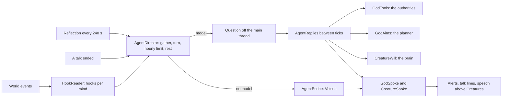

# Milestone 15, part 51 — Gods and Creatures as agents, woken by what happens

## Overview

The owner: "What about making each god an agent, that different hooks in the world trigger him,
same for the creature." Asked how far an agent may go, the owner chose:

- **A god:** free within the rules.
- **A Creature:** it decides at the moments that matter, and speaks.
- **Both** in one part.

The decisions are in [ADR-072](../docs/ADR/ADR-072-gods-and-creatures-as-agents.md).

**What it adds:**

- **Hooks.** The world's events wake the gods' and Creatures' minds: a Creature in a god's lands, a
  war, a treaty, a blow to its people, a fight, a reward, hunger. A god also looks about it every four
  minutes of the world's time.
- **A god's turn.** It is asked with a picture of the world from its side and its journal. It answers
  with up to three acts, through the same authorities as a player; words to gods it knows; aims that
  steer its instincts; and its journal rewritten.
- **A Creature's turn.** It speaks a line and chooses among its brain's options.
- **The scribes.** Without a model, they give the gods and Creatures their voices.
- **Seen in play.** Gods' words are alerts and lines of their conversations, and Creatures' words show
  above them.

## Architecture

| Project | Changes |
| --- | --- |
| `Pantheon.Domain` | • `GodState.Journal` (save version 36) • `GodSpoke` and `CreatureSpoke` events |
| `Pantheon.Simulation` | • `Creatures/CreatureWill` (an authority: a Creature's own choice, never against its god's errand) • `Gods/GodAims` (a god's own aims, judged and held from the planner) • `CreatureBrain.TryStart` internal |
| `Pantheon.Persistence` | `PersonaSaveMigration.UpgradeFrom35` |
| `Pantheon.Networking` | protocol version 22 |
| `Pantheon.Game` | • `Minds/Agents/`: &nbsp;&nbsp;– `AgentRules` and `VoiceLines`, in `minds.json` &nbsp;&nbsp;– `Hook` and `HookReader` &nbsp;&nbsp;– `GodView`, `GodAgentPrompt` and `GodTools` &nbsp;&nbsp;– `CreatureAgentPrompt` &nbsp;&nbsp;– `AgentScribe` &nbsp;&nbsp;– `AgentDirector`, `MindState` and `AgentReplies` • `Minds/MindWords` (a god's stance in its own words, also fixing talk's "You distrusts you") • talk hears a god's unasked words and gives its journal • `Alerts/MindAlerts` • `Diagnostics/AgentReadout` • `GameSettings` `Agents`, `AgentsQuick`, `AgentTurnsPerHour` and `Voices` • `--agents` and `--wake` |
| `Pantheon.Oracle` | `MindFactory.OpenAgents` (the quick model) |
| client | • `Bootstrap/AgentController`: the agents each frame; the Creatures' speech; gods' words into talk; quiet on the title screen • `CreatureView.Say` • `TalkController.Ended` and `Heard` • the Minds tab's agents rows • F1 lines |

## Test plan

- **`HookReaderTests`:** what wakes whom, in words from each side, and with the scribes' moment:
  - a visit, wars, betrayals and alliances;
  - fights ending each way;
  - meetings;
  - harmful miracles, open and veiled;
  - judgements and growth;
  - words.
- **`GodToolsTests`:**
  - a cast is done and paid for;
  - refusals say why;
  - war is made;
  - a treaty is proposed;
  - the Creature is sent;
  - aims are set when they make sense and held from the planner;
  - no more acts than the rules allow.
- **`GodAgentPromptTests`:**
  - the instructions name the god and every tool, treaty and aim;
  - a turn tells what woke the god, how things stand, its journal and its results;
  - a reflection says nothing in particular woke it;
  - answers are read and trimmed;
  - the schema is strict.
- **`CreatureWillTests`:**
  - options are distinct, with no errands;
  - a choice is carried out the same way for the same world;
  - no choice against an errand, out of a fight or among what it cannot do;
  - a Creature's turn and answer;
  - a god's aims held from the planner.
- **`AgentDirectorTests`:**
  - a god is asked once its hooks gather, and its answer is taken: war, words and journal;
  - no turn before its time;
  - the scribes speak to the player at most so often, and Creatures speak unless silenced;
  - the hour's last question goes to one mind;
  - after three failures the agents rest;
  - a Creature speaks and chooses;
  - words between AI gods wait;
  - a god reflects;
  - the player's god has no mind;
  - an answer about a replaced world is dropped.
- **`AgentContentTests`:**
  - every moment has lines with known names;
  - broken agents' rules and voices are refused;
  - the scribes fill the names the same way each time;
  - settings, launch options and the quick model;
  - a god's words are an alert and a line of its talk, its journal reaches its talk;
  - the debug lines.
- **`MindWordsTests`:** a god's feeling and memories in its own words.
- **`SaveMigrationV35Tests`:**
  - part 50's save loads without journals, keeps every other value and plays the same;
  - a journal survives a save.

## Tasks

### Completed

- [x] Hooks, turns, tools, aims, the will, words, journals, the scribes' voices, settings, tooling,
  tests and docs.

### Verification results

- **Build and tests:** `dotnet build` has no warnings, and 1868 tests pass (1805 before).
- **Offline, the scribes** (`--visit=6 --agents=off`):
  - Belrays told the player "Mossgate is mine. Your Bramble may look, but it will not take."
  - Bramble said "Pip watches Bramble. Bramble not afraid."
  - Pip said "Bramble in our village? Pip come!"
  - The lines showed above the Creatures, and Belrays's words in the alerts.
- **With Claude.** The owner's profile chose Claude with their key, so the first run asked Claude
  Haiku 5.5 a few questions. On Bramble's visit, Belrays:
  - set Pip on Bramble (`creature_fight`: done);
  - aimed to weaken Ilyra (taken);
  - wrote "Ilyra's Creature trespassed in my village and I have a grudge";
  - told the player "Your beast Bramble walked into Mossgate uninvited. Keep it out of my land, or
    my ape will teach it manners in blood."

  Bramble said "Bramble fights! Pip will learn Bramble is strong."; Pip said "Pip is strong!
  Bramble, go away!"
- **With a stand-in model** (Ollama's API, answering from the turn's text):
  - `--wake=0` woke the three gods, whose aims were taken;
  - Belrays cast Food on Mossgate and sent the player word;
  - Pip chose, after beating Bramble, to play in Mossgate.
  - Each turn's prompt was read through:
    - The first said "you has formed no view of you yet", and talk's said "You distrusts you", since
      the diplomacy panel's words are said to the player. `MindWords` now gives a god's stance in its
      own words: "you are unsure of Ilyra; Ilyra let its Creature trespass in Mossgate".
    - The trespass memory's own words were wrong for the panel, and are fixed ("you let your
      Creature trespass").
- **Bugs the tests found:**
  - the hour's last question went to two minds in one frame;
  - a god woken before the agents' first frame was forgotten.
- **Both renderers:** the Creatures' lines show above them, and the god's words in the alerts, on
  Terrain3D and the fallback (36 and 54 FPS in the capture).
- **Settings:** the Minds tab shows the agents' rows.
- **Not verified:**
  - a long game with a real model;
  - balance with agents;
  - a joined player hearing the words, which travel as events.

### Future

- Joined players talking to the gods (a protocol message for their words).
- Creatures' memories of words, and gods' words to each other shown with intelligence of them.
