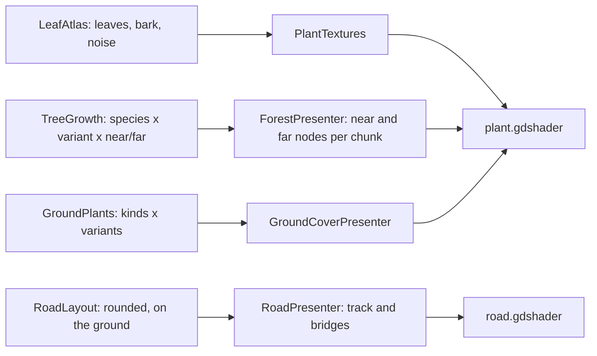

# Milestone 15, part 52 — Natural trees, roads and land, grown in code

## Overview

The owner: "Let's try to make the trees, the roads and the nature more realistic." The decisions are
in [ADR-073](../docs/ADR/ADR-073-natural-trees-roads-and-land.md), which amends ADR-053 and ADR-033.

- **Trees** are grown in code:
  - a trunk flaring at its roots, branches and twigs;
  - crowns of leaf cards cut from a leaf atlas drawn in code, lit as one rounded mass and letting
    light through;
  - three variants of each species, and lighter forms in the distance;
  - forests twice as dense.
- **Roads:**
  - rounded curves following the ground across and along;
  - drawn as worn tracks with ragged edges, ruts and grass down the middle;
  - bridges built to their span with rails, posts and piles.
- **Ground:**
  - tufts of curved blades;
  - flowers with petals;
  - leafy bushes;
  - a new fern;
  - broken stones with moss;
  - reeds;
  - a ground texture of fine blades.

## Architecture

| Project | Changes |
| --- | --- |
| `Pantheon.Game` | • `Presentation/Nature/`: &nbsp;&nbsp;– `PlantMesh`, `PlantBuilder` and `PlantRandom` &nbsp;&nbsp;– `LeafAtlas`: leaves, bark and ground noise, with coverage-keeping mipmaps &nbsp;&nbsp;– `NatureNoise`, `TreeGrowth` and `GroundPlants` • `TreePlacement.Variant` and `GroundCoverPlacement.Variant` • `GroundCoverKind.Fern` • `TreeSettings.DetailDistance` and `GroundCoverSettings.GrassRadius` • `ForestLayout.SquareMetresPerTree` 60 • `RoadLayout`: `RoadSection`, smoothed, every 1.5 m, `WidthAt` • `BridgeLayout.Mesh(length)`, decks level with the banks • `TreeMesh` and `GroundCoverMesh` removed |
| client | • `Land/PlantTextures` • `Meshes.ToArrayMesh(PlantMesh)` • `plant.gdshader` (replaces `tree.gdshader`) and `road.gdshader` • `ForestPresenter`: near and far nodes per chunk at its middle, far trees casting no shadows • `GroundCoverPresenter`: variants, grass radius • `RoadPresenter`: the track, and bridges built to length • the sun's shadow normal bias 2.2 |
| content | • `settlement_view.json`: `Trees.DetailDistance`; `GroundCover`'s `CellMetres`, `GrassRadius`, ferns and chances • `biome_palette.json`: the grass texture's colours |

## Test plan

- **`VegetationTests`:**
  - every species' variants stand on their roots at a tree's height, with leaves (but the snag),
    lighter far;
  - a tree grows the same each time and its variants differ;
  - leaf cards keep to their atlas cell and are lit as their crown;
  - the atlas has leaves in every cell and its small mipmaps keep their coverage;
  - every ground plant grows in each variant;
  - a road rounds its corners and wanders in width;
  - a bridge is built to its span with posts of the same size;
  - the ground cover's settings are checked.
- **`ResourcePresentationTests`:** a road is drawn along what is built, its sections' middles
  between their edges.
- **`WildlifeTests`:** a bridge crosses from bank to bank, level with their tops.

## Tasks

### Completed

- [x] Plants, atlas, shaders, forests, ground cover, roads, bridges, ground texture, tests and docs.

### Verification results

- **Build and tests:** `dotnet build` has no warnings, and 1874 tests pass (1868 before).
- **Five views,** captured before and after on the owner's Mac (M3 Pro, a 2720 × 1530 window,
  Terrain3D): close by a forest's edge, a village and its roads, a meadow, the play height and high
  over the island.
  - **Trees** that were balls are leafy crowns on visible trunks.
  - **Pines** carry needle sprays, palms arching fronds, and birches white trunks.
  - **Roads** are worn tracks curving through the village.
  - **Bridges** have rails and posts, their decks level with the banks.
  - **Ferns** and flowers grow about the village.
- **Frame times** rose 2.4–3.9 ms (about 12%):

  | View | Before | After |
  | --- | --- | --- |
  | village and road | 27.0 ms | 30.4 ms |
  | forest's edge | 26.5 ms | 30.4 ms |
  | meadow | 26.2 ms | 30.0 ms |
  | play height | 29.3 ms | 32.9 ms |
  | high | 30.4 ms | 32.8 ms |

  Far trees casting no shadows saved about 1–2 ms at the high view.
- **The fallback renderer** shows the same trees, tracks and bridges, at 41–56 FPS.
- **Fixes along the way:**
  - **Black roads:** Godot turns a back face's normal round, so the track, wound one way, was lit
    from below. The road shader now faces it up, and the plant shader undoes the turn for cards,
    blades and petals.
  - **Missing grass:** it was hidden by its visibility range until each chunk's node stood at its
    middle at the ground's height.
- **Not verified:** the stress world, with eight gods and fifty villages, under the new forests.

### Future

- Seasons in the crowns (autumn colours, bare winter oaks).
- Grass made on the GPU, for meadows thick to the horizon.
