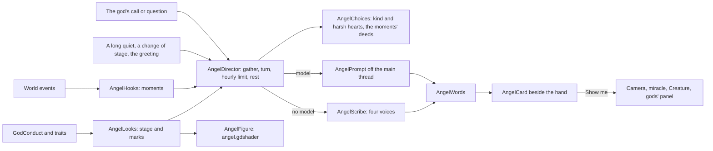

# Milestone 15, part 53 — The player's angel: a conscience and a guide

## Overview

The owner: "In the original Black & White there were two 'angels', one good and one evil, like
guides or consultants. I want only one angel that, based on my actions, becomes more good or evil and
suggests what to do next. We should make him like a guide too. It should be based on an LLM also."

The original's two advisors were researched, and sketches compared three forms and three places. The
owner chose the recommendation:

- a seraph;
- beside the hand;
- one suggestion in its own voice (both ways when torn);
- calling it, and asking it anything;
- the tutorial spoken by it.

The decisions are in [ADR-074](../docs/ADR/ADR-074-the-players-angel.md).

**What it adds:**

- **Its look.** It is read from what the world remembers of the god (its conduct and traits), never a
  score:
  - radiant, kind, unformed, torn, stern or fallen;
  - marks for the god's traits.
- **What moves it:**
  - the god's own deeds, kind and harsh;
  - what happens to it: its villages, rivals, wars, offers, its Creature, its traits and rank;
  - its first greeting, its god's call, a change of its own stage, and a long quiet.
- **What it urges.** Only deeds the god can do now:
  - miracles as a kind heart and as a harsh one would cast them;
  - help, the Creature at work or set on a visitor;
  - an answer to a god.
- **How it speaks.** By the chosen model, in the voice of its stage, or by the scribes' lines in four
  voices.
- **Where it appears.** A figure grown in code beside the god's hand, with a card: its words, Show me
  for each deed it urges, Thank you and Ask. The angel key (') and the bar's first button call it, and
  it speaks the tutorial.

## Architecture

| Project | Changes |
| --- | --- |
| `Pantheon.Simulation` | `GodAi.Evaluate(world, god, profile)`: a god's choices as another profile weighs them |
| `Pantheon.Game` | • `Angel/`: &nbsp;&nbsp;– `AngelContent` (`angel.json`) &nbsp;&nbsp;– `AngelLook` and `AngelLooks` &nbsp;&nbsp;– `AngelHook` and `AngelHooks` &nbsp;&nbsp;– `AngelChoices` &nbsp;&nbsp;– `AngelPrompt` &nbsp;&nbsp;– `AngelScribe` &nbsp;&nbsp;– `AngelDirector` • `Presentation/Angel/AngelMesh` • `Diagnostics/AngelReadout` • `SessionPreviews.PreviewGodAiAs` • `GodView.Describe(session, god, villagesShown)` • `GameSettings` `Angel`, `AngelThinks` and `AngelChatter` • `--angel` and `--angel-ask` • the key map's `angel_call` and the bar's Angel button |
| client | • `Bootstrap/AngelController`: the angel each frame, Show me, the key, the tutorial • `UI/AngelCard`: the figure and its card beside the hand • `Presentation/Angel/AngelFigure`: a `SubViewport` with the figure, lights and motes • `Shaders/angel.gdshader` • `Meshes.ToArrayMesh(AngelMesh)` • `TutorialPanel.Speaker` and `CardRect` • the bar's angel glyph • the Minds tab's angel rows • F1 lines |
| content | `game/Data/angel.json` |

## Test plan

- **`AngelLookTests`:**
  - a god that has done nothing has an unformed angel;
  - kindness makes it kind, then radiant;
  - harm makes it stern, and cruelty counts more, to fallen;
  - much of both tears it, little does not;
  - every trait's mark;
  - forced looks;
  - the shipped content, the name from the seed, and broken content refused.
- **`AngelHooksTests`:**
  - the god's own miracles as kind or harsh deeds;
  - a rival's harmful miracle on its village, named unless veiled;
  - wars, offers and meetings, and the god's own war and peace;
  - its villages hungry, struck and lost;
  - a visitor, fights, traits and rank;
  - other gods' events ignored.
- **`AngelCounselTests`:**
  - the deeds offered are castable now, kind and harsh, with ids;
  - the moments' deeds come first;
  - the question;
  - reading answers: only deeds offered, at most two;
  - the scribes' lines fill every name;
  - the scribes urge by tone.
- **`AngelDirectorTests`:**
  - the greeting comes soon, by the scribes, in its name;
  - it waits its turn before speaking of a deed;
  - a long quiet brings counsel, but not while paused;
  - a call is answered at once, paused or hushed;
  - with a model, its words and deeds are taken;
  - failures fall to the scribes, and after three it rests;
  - a change of stage is spoken of;
  - kept away, it says nothing;
  - a new world brings a new greeting.
- **`AngelFigureTests`:**
  - every part, and whole triangles;
  - mirrored wings;
  - the halo above the head, with the thorns above it;
  - the settings, launch options, key and bar button;
  - the debug lines.

## Tasks

### Completed

- [x] The look, moments, deeds, prompt, scribes and director, with content and tests.
- [x] The figure, shader, card, controller, key, bar button, settings, tutorial and F1 lines.
- [x] Captures on both renderers, through the scribes and through a stand-in model.

### Verification results

- **Build and tests:** `dotnet build` has no warnings, and 1921 tests pass (1874 before).
- **Every stage and its marks** (`--angel=<stage>`) were drawn and checked:
  - radiant, kind, unformed (silver), torn (split), stern and fallen;
  - the light marks: gold threads, glowing hands and clear eyes;
  - the dark marks: blade, veil, chains and crown.

  The first figure was overexposed: the glow light stood in front of its chest. Godot also turns the
  normals of the triangles it takes for back faces, so the body was lit from behind by the red rim
  and glow lights. The light moved behind the figure, the shader undoes the turn for every part, and
  the feathers grew broader and staggered.
- **Through the scribes** (`--minds=scribes`):
  - Vesperine greeted Ilyra: "I am Vesperine, Ilyra, and I will keep watch at your hand. Begin with
    Duskwater: its people are yours to care for." It urged "Food on Brightwater".
  - Torn, it said: "Feed it, or frighten it". It urged "Food on Brightwater" and "Lightning on
    Duskwater".
  - Show me flew the view to Brightwater with Food chosen.
- **Through a stand-in model** (Ollama's API on this Mac, answering from the turn's text):
  - `--angel-ask=What should I do first?` was asked once, with the greeting.
  - The prompt was read through:
    - its stage and voice;
    - the god's villages, reach and miracles;
    - the deeds `d1`–`d5`, Bramble's work among them.

  The answer's words and its deed `d1` were shown.
- **The tutorial** (`--tutorial=3`): the angel stands beside the card, signed "Vesperine, your
  angel · step 3 of 15".
- **The fallback renderer** (`--terrain=fallback`) shows it the same way.
- **Cost:** the figure's picture takes about 0.1 ms of the CPU a frame while shown, and is not drawn
  while the angel is away.
  - With vsync off, three runs each averaged 39.9–46.4 ms without it and 43.4–46.3 ms with it. The
    difference is within the noise.
  - The owner's game had been running for 17 hours at the same time, so frames were slower than part
    52's 30 ms.
