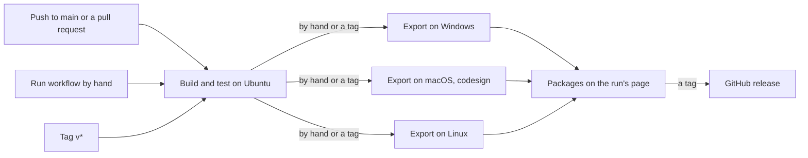
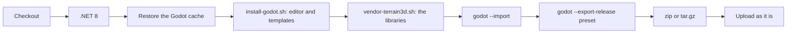

# Milestone 15, part 54 — Release builds in CI, and no binaries in git

## Overview

The owner: "We are building the installers locally right now. I want it to be in GitHub CI
instead, cross OS, and remove the artifacts from git source code."

**What it adds:**

- **A workflow**, `.github/workflows/build.yml`:
  - builds and tests on Linux on every push to `main` and every pull request;
  - exports Windows, macOS and Linux each on its own system, by hand or on a `v*` tag;
  - publishes the three packages as a GitHub release on a tag.
- **`tools/install-godot.sh`**, which installs the pinned Godot .NET editor and its platform's
  export templates, checked against Godot's SHA-512 sums.
- **No binaries in git.** `build/` was already ignored. Terrain3D's six native libraries (about
  20 MB) are no longer committed: `tools/vendor-terrain3d.sh` fetches them, from the pinned and
  checksummed archive, after cloning and in CI.

The decisions are in [ADR-075](../docs/ADR/ADR-075-builds-in-ci-and-fetched-libraries.md).

## Architecture

| Place | Changes |
| --- | --- |
| `.github/workflows/build.yml` | The Build and test, Export (a matrix of Windows, macOS and Linux) and Publish the release jobs |
| `tools/install-godot.sh` | New: Godot 4.7.2 .NET and the platform's templates, pinned SHA-512, reused when run again |
| `tools/vendor-terrain3d.sh` | Fetches only `bin/` by default; `--all` re-creates the whole addon, for an upgrade |
| `.gitignore`, `.gitattributes` | `game/addons/terrain_3d/bin/` ignored, and its libraries removed from the index |
| `ArchitectureRulesTests` | A missing library's message says to run `tools/vendor-terrain3d.sh` |

Each export job:

## Test plan

- `shellcheck` on both scripts and `actionlint` on the workflow (both in Docker).
- `tools/vendor-terrain3d.sh` in a fresh tree gives libraries identical to the ones that were
  committed.
- The whole suite builds and passes on Linux (the .NET 8 SDK container) as well as on macOS.
- The macOS export job rehearsed on the Mac in a fresh tree without the libraries, with a
  throwaway `HOME`: install, a second install that reuses, fetch, import, export.
- The workflow on GitHub: a push runs the tests; Run workflow exports all three; the packages
  download and the macOS one launches.

## Tasks

### Completed

- [x] The workflow, `tools/install-godot.sh`, and `tools/vendor-terrain3d.sh` fetching only the
  libraries.
- [x] The libraries out of the index and ignored; the test's message.
- [x] ADR-075; ADR-005 and ADR-031 amended; README, ARCHITECTURE, AGENTS and PROGRESS_SUMMARY.

### Verification results

- **Lint:** `shellcheck` and `actionlint` report nothing.
- **Libraries:** fetched in a fresh tree, the six libraries are byte for byte the committed ones.
  The committed import file of the icon differs from the archive's (Godot re-saved it), which is
  why the script no longer re-creates the committed files by default.
- **Linux:** in `mcr.microsoft.com/dotnet/sdk:8.0`, the solution builds with no warnings and 1921
  tests pass.
- **The macOS job, rehearsed:** the install took 38 s (the editor and 1.2 GB of templates) and a
  second run reused both. The import and the export then succeeded, 89 s in all. The export's one
  warning, an `Info.plist` generated for Terrain3D's framework, is the same as before. The app is
  universal (x86_64 and arm64), signed ad hoc without the hardened runtime, and its smoke run
  (`--seed=1234 --quit-after-frames=90 --screenshot`) drew the island on Terrain3D 1.0.2 and exited
  cleanly.
